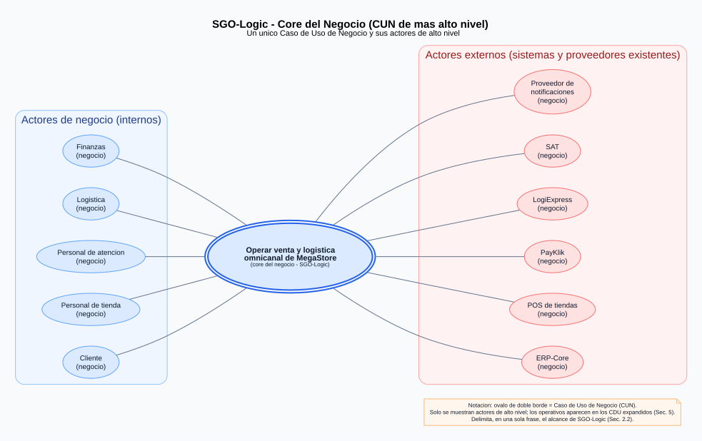
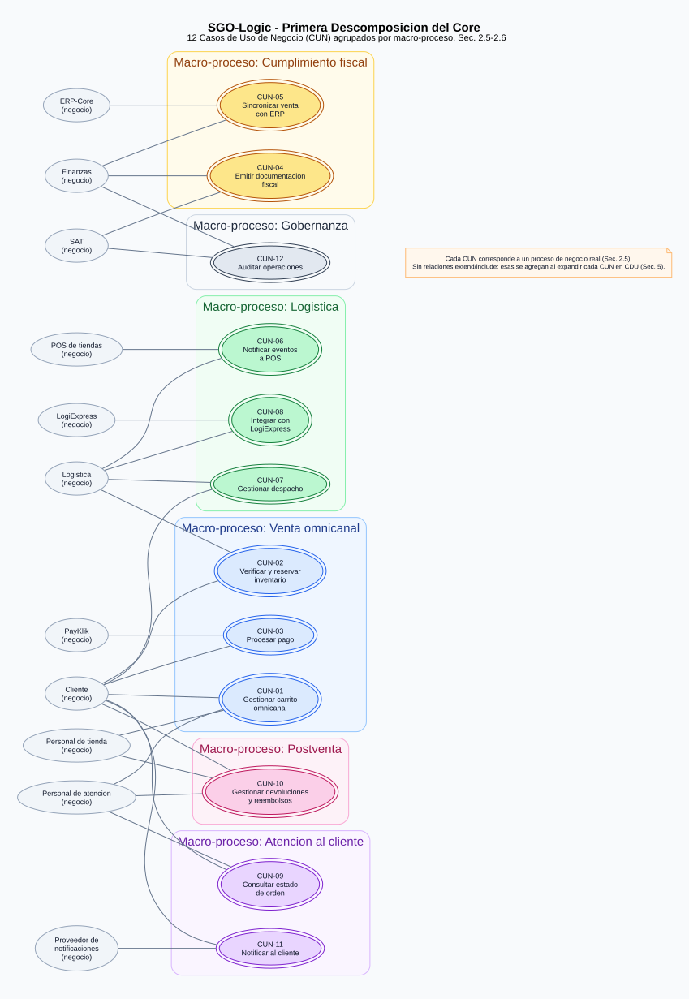
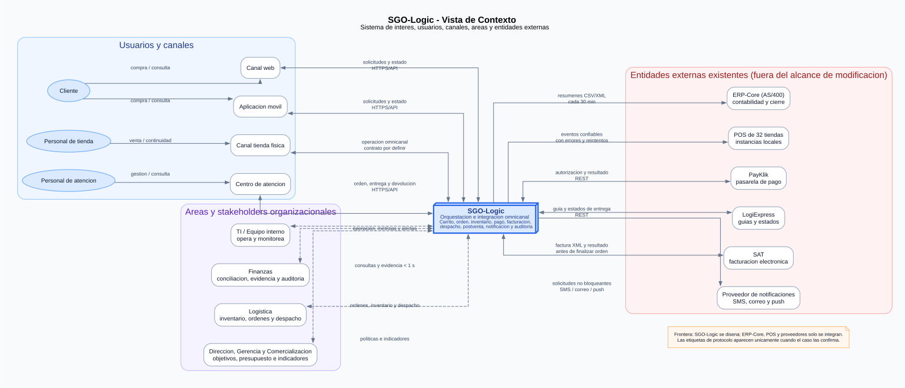

# Documento de Definición de Arquitectura (DDA)
## SGO-Logic — Sistema de Gestión de Órdenes y Logística Omnicanal · MegaStore

| Campo | Valor |
|---|---|
| Curso | Análisis y Diseño de Sistemas 2A |
| Grupo | `AYD2_A_2S2025_PROYECTO_G5` |
| Fase | 1 |
| Versión | 1.0 (entrega final de Fase 1) |
| Última actualización | 26/08/2026 |
| Responsable de esta versión | Equipo de Arquitectura — Grupo 5 |
| Estado documental | Finalizado y consolidado para entrega |

---

## Índice
1. [Resumen Ejecutivo](#1-resumen-ejecutivo)
2. [Identificación del Caso de Negocio](#2-identificación-del-caso-de-negocio)
3. [Stakeholders y Preocupaciones Arquitectónicas](#3-stakeholders-y-preocupaciones-arquitectónicas)
4. [Características del Sistema Priorizadas](#4-características-del-sistema-priorizadas)
5. [Drivers — Requisitos Funcionales](#5-drivers--requisitos-funcionales)
6. [Drivers de Calidad (EaC)](#6-drivers-de-calidad-eac)
7. [Drivers de Restricción](#7-drivers-de-restricción)
8. [Priorización de Drivers](#8-priorización-de-drivers)
9. [Matriz de Trazabilidad](#9-matriz-de-trazabilidad)
10. [Decisiones Arquitectónicas (ADRs)](#10-decisiones-arquitectónicas-adrs)
11. [Vistas Arquitectónicas](#11-vistas-arquitectónicas)
12. [Prototipo / Mockups](#12-prototipo--mockups)
13. [Anexos](#13-anexos)

---

## 1. Resumen Ejecutivo
MegaStore es una cadena regional de retail con 32 tiendas en Guatemala, El Salvador y Costa Rica y una facturación anual de USD 450 millones, cuyo comercio electrónico crece un 15 % cada año. Su operación actual está fragmentada: cada tienda administra inventario local, el canal en línea opera por separado, la disponibilidad se confirma por teléfono y Finanzas concilia ventas manualmente desde hojas de cálculo, generando devoluciones de hasta siete días hábiles y exposición a errores de despacho y a pérdidas ya cuantificadas, como los USD 150,000 de un solo evento de indisponibilidad de la pasarela de pago.

SGO-Logic se propone como una capa de orquestación e integración omnicanal que permite iniciar, continuar y completar una compra desde cualquier canal sin modificar ERP-Core ni los POS existentes, cuya sustitución la Junta Directiva descartó. La arquitectura aceptada en ADR-001 es un **monolito modular** organizado por capacidades de negocio, rodeado de una **capa de integración por puertos, adaptadores y mensajería** que aísla a SGO-Logic de PayKlik, LogiExpress, la SAT, los POS y el ERP. Este estilo protege los drivers críticos priorizados: continuidad de la orden ante fallas de PayKlik, escalabilidad de hasta 8x en Black Friday, trazabilidad completa para las auditorías de la SAT y mantenibilidad con las capacidades de Java, .NET y Docker del equipo interno, dentro del presupuesto aprobado y con una ruta planificada de evolución hacia la nube.

---

## 2. Identificación del Caso de Negocio
### 2.1 Situación actual y objetivo de negocio

MegaStore opera 32 tiendas físicas en Guatemala, El Salvador y Costa Rica y un canal de comercio electrónico que representa el 25 % de sus ventas. Sus aplicaciones y procedimientos evolucionaron de forma separada: las tiendas conservan ventas e inventario localmente, el comercio electrónico maneja información independiente, Logística confirma existencias por teléfono y Finanzas concilia archivos de hojas de cálculo. Esta fragmentación retrasa cambios y devoluciones hasta siete días hábiles, dificulta conocer el inventario disponible y expone a la organización a pérdidas, errores de despacho e inconsistencias fiscales.

El objetivo de SGO-Logic es habilitar una operación omnicanal en la que el cliente pueda iniciar, continuar y completar una compra desde tienda, web, aplicación móvil o centro de atención con una experiencia consistente. El sistema debe unificar la orquestación de órdenes, inventario, pagos, facturación, despacho, consulta, devolución, notificación y auditoría, integrándose con los sistemas existentes sin sustituirlos.

### 2.2 Sistema de interés y alcance

**Sistema de interés:** SGO-Logic es la capa de orquestación e integración omnicanal situada entre los canales de venta y los sistemas internos o externos existentes. Su frontera incluye la lógica necesaria para mantener la continuidad de la intención de compra y el ciclo de vida de la orden; no incluye la implementación interna de los sistemas con los que se integra.

**Dentro del alcance:**

- Orquestar el carrito y la orden entre web, aplicación móvil, tienda física y centro de atención.
- Verificar y reservar inventario antes de confirmar una venta, y liberar la reserva cuando la compra no concluye.
- Orquestar pagos por los métodos habilitados para cada canal y conservar cada intento asociado con la orden, el canal, la fecha y el resultado.
- Generar y enviar la documentación fiscal en XML a la SAT antes de finalizar la orden, conservando CUI y serie autorizada.
- Sincronizar resúmenes de ventas con ERP-Core mediante CSV o XML en intervalos de 30 minutos.
- Publicar eventos hacia las 32 instancias POS con manejo de errores y reintentos.
- Orquestar el despacho desde un centro de distribución, una tienda o recogida por el cliente, incluida la modificación del método de entrega después de la compra.
- Integrarse con LogiExpress para generar guías y recibir estados de entrega.
- Proveer consulta consolidada de órdenes, pagos, despachos, entregas, devoluciones e incidencias.
- Gestionar devoluciones y reembolsos conservando su relación con la venta original.
- Emitir notificaciones de confirmación, preparación, tránsito, entrega e incidencias sin bloquear la operación principal.
- Mantener trazabilidad suficiente para reconstruir quién realizó una operación, cuándo ocurrió y qué cambió.

**Fuera del alcance:**

- Modificar o reemplazar ERP-Core sobre AS/400.
- Modificar o reemplazar las 32 instancias POS.
- Modificar los servicios internos de PayKlik, LogiExpress, SAT o del proveedor de notificaciones.
- Implementar en esta fase el sistema productivo: la Fase 1 entrega definición arquitectónica, vistas, justificación y prototipo de alto nivel.

**Interfaces que atraviesan la frontera:**

| Entidad externa | Interacción conocida | Condición arquitectónica derivada del caso |
|---|---|---|
| ERP-Core | SGO-Logic entrega resúmenes de venta en CSV o XML | Procesamiento en intervalos de 30 minutos; ERP-Core no se modifica |
| POS de las 32 tiendas | Reciben eventos emitidos por SGO-Logic | Deben existir manejo de errores y reintentos; los POS no se modifican |
| PayKlik | Solicitudes de pago mediante REST | Latencia aproximada de 800 ms y hasta 5 s en alta demanda; el contrato vigente debe respetarse |
| LogiExpress | Generación de guías y recepción de estados mediante REST | Aproximadamente una de cada 50 solicitudes termina en timeout |
| SAT | Envío de factura electrónica en XML | La factura debe emitirse antes de finalizar la orden y conservar CUI y serie autorizada |
| Proveedor de notificaciones | Envío de SMS, correo y push | Su indisponibilidad no debe bloquear venta, pago, facturación o despacho |

### 2.3 Supuestos y preguntas arquitectónicas abiertas

Los siguientes puntos no están definidos por el enunciado y deben confirmarse antes de dimensionar o implementar. Las decisiones que podían cerrarse en esta fase se registraron en ADR-003 a ADR-008.

| Tema abierto | Por qué afecta la arquitectura | Tratamiento durante Fase 1 |
|---|---|---|
| Fuente autoritativa y mecanismo de actualización del inventario | Determina consistencia de reservas, prevención de doble compromiso y diseño de integración con tiendas y centros de distribución | Se exige una fuente lógica única y reserva atómica; el producto o sistema de registro se decide con Negocio y Logística |
| Formato, protocolo y garantías disponibles en cada POS | Define el contrato físico de los adaptadores | ADR-004 ubica idempotencia y reintento en el adaptador para no modificar POS; el formato queda parametrizable |
| Volumen normal, concurrencia y distribución del tráfico por canal | “8x” es una proporción, pero falta línea base | EaC-03 define una prueba relativa a la línea base `T`; TI debe medir `T` antes de dimensionar `N` instancias |
| Objetivos de disponibilidad, recuperación y pérdida de datos | Sin RTO, RPO y disponibilidad objetivo no se justifica una topología final de redundancia | La vista conserva `N` y no inventa réplicas; TI y Gerencia deben acordar SLO, RTO y RPO antes de producción |
| Jurisdicciones y controles concretos de protección de datos | MegaStore opera en tres países | Se aplican minimización, TLS, tokenización y control de acceso; Legal debe confirmar retención, residencia y normativa específica |

### 2.4 Diagrama de Casos de Uso de Negocio (CUN) — alto nivel



*Figura 1. Caso de Uso de Negocio de alto nivel de SGO-Logic.*

[Fuente versionable](./diagramas/cun-alto-nivel.dot) | [PNG para presentación](./diagramas/cun-alto-nivel.png)

El core de mayor nivel modela "Operar venta y logística omnicanal de MegaStore" como síntesis de la frontera descrita en 2.2. Se distinguen actores de negocio internos (Cliente, Personal de tienda, Personal de atención, Logística, Finanzas) de actores externos existentes (ERP-Core, POS, PayKlik, LogiExpress, SAT, proveedor de notificaciones), consistentes con las entidades externas de 3.1. La vista omite deliberadamente el detalle de asociaciones `«include»` y `«extend»`; esas relaciones aparecen en el CDU core y en las doce expansiones editables de la Sección 5.

**Notación:** el óvalo de doble borde representa un CUN y la etiqueta "(negocio)" marca actores de negocio, notación complementaria declarada explícitamente por no disponer de la diagonal de UML de negocio en la herramienta de diagramado (mismo criterio que `Docs/diagramas/README.md`).

### 2.5 Primera descomposición (macroprocesos)



*Figura 2. Primera descomposición del negocio en macroprocesos y CUN.*

[Fuente versionable](./diagramas/cun-primera-descomposicion.dot) | [PNG para presentación](./diagramas/cun-primera-descomposicion.png)

El core se descompone en los 12 CUN de 2.6, agrupados en seis macro-procesos de negocio. Cada CUN queda asociado a los actores de negocio que efectivamente lo originan o lo reciben, y cada macro-proceso corresponde a una línea de acción distinguible del negocio (venta, cumplimiento fiscal, logística, atención, postventa y gobernanza), no a una agrupación técnica de sistema:

| Macro-proceso | CUN incluidos | Actores de negocio asociados |
|---|---|---|
| Venta omnicanal | Gestionar carrito omnicanal, Verificar y reservar inventario, Procesar pago | Cliente, Personal de tienda, Personal de atención, Logística, PayKlik |
| Postventa | Gestionar devoluciones y reembolsos | Cliente, Personal de atención, Personal de tienda |
| Cumplimiento fiscal | Emitir documentación fiscal, Sincronizar venta con ERP | Finanzas, SAT, ERP-Core |
| Logística | Gestionar despacho, Integrar con LogiExpress, Notificar eventos a POS | Logística, LogiExpress, POS |
| Atención al cliente | Consultar estado de orden, Notificar al cliente | Cliente, Personal de atención, Proveedor de notificaciones |
| Gobernanza | Auditar operaciones | Finanzas, SAT |

Ningún CUN queda sin macro-proceso ni sin al menos un actor de negocio asociado; esa cobertura se reutiliza en la matriz de trazabilidad (Sección 9) y en el diagrama de Componentes (11.2), donde CUN-01 a CUN-03 orientan el módulo de Carrito/Órdenes, CUN-04/CUN-05 el módulo de Facturación, CUN-06 a CUN-08 el módulo de Despacho, CUN-09/CUN-11 el módulo de Notificaciones/Consulta, CUN-10 el módulo de Postventa y CUN-12 el módulo de Auditoría.

### 2.6 Lista de CUN identificados (insumo para 2.4)
1. **CUN-01:** Gestionar carrito omnicanal
2. **CUN-02:** Verificar y reservar inventario
3. **CUN-03:** Procesar pago
4. **CUN-04:** Emitir documentación fiscal
5. **CUN-05:** Sincronizar venta con ERP
6. **CUN-06:** Notificar eventos a POS
7. **CUN-07:** Gestionar despacho
8. **CUN-08:** Integrar con LogiExpress
9. **CUN-09:** Consultar estado de orden
10. **CUN-10:** Gestionar devoluciones y reembolsos
11. **CUN-11:** Notificar al cliente
12. **CUN-12:** Auditar operaciones

---

## 3. Stakeholders y Preocupaciones Arquitectónicas

Para este DDA, un stakeholder es una persona, grupo u organización con intereses sobre SGO-Logic o capacidad de afectar sus decisiones. ERP-Core, POS y los servicios de terceros se documentan como **entidades externas del contexto**, no como stakeholders humanos; sus condiciones técnicas se conservan en la frontera del sistema y en las matrices de trazabilidad. La agrupación no pretende imponer una cifra cerrada: debe refinarse si el equipo identifica propietarios, operadores o responsables contractuales adicionales.

| # | Stakeholder | Categoría | Preocupaciones arquitectónicas | Influencia o autoridad |
|---|---|---|---|---|
| 1 | Junta Directiva | Gobierno corporativo | Preservar ERP-Core y POS; controlar el alcance y proteger la inversión existente | Alta; su decisión sobre los sistemas legados es no negociable |
| 2 | Dirección | Patrocinio estratégico | Experiencia omnicanal consistente y capacidad de evolución regional | Alta; define el objetivo estratégico |
| 3 | Carlos Méndez, Gerente de TI | Operación y tecnología | Continuidad, monitoreo de dependencias externas, escalabilidad para Black Friday y mantenibilidad interna | Alta; responsable de operar la solución y rechaza cambios a ERP/POS |
| 4 | Ana Lucía Fuentes, Directora de Finanzas | Finanzas y cumplimiento | Trazabilidad, evidencia de transacciones, conciliación y cumplimiento fiscal | Alta; posee veto explícito sobre decisiones que reduzcan trazabilidad o cumplimiento |
| 5 | Roberto Quezada, Jefe de Logística | Operación logística | Visibilidad oportuna de inventario y órdenes; reducción del 70 % de errores de despacho | Media; responsable del resultado logístico |
| 6 | Directora de Comercialización | Negocio y experiencia de cliente | Carrito y experiencia consistentes entre canales, sin silos | Media; representa el objetivo omnicanal comercial |
| 7 | Jefe de Operaciones | Continuidad del negocio | Evitar pérdida de ventas durante caídas y picos de demanda | Media; aporta evidencia del impacto operativo |
| 8 | Gerencia | Gobierno financiero | Inversión máxima de USD 150,000 y operación de hasta USD 1,200 mensuales sin aprobación adicional | Alta; aprueba presupuesto y excepciones |
| 9 | Clientes | Usuario externo | Continuidad del carrito, rapidez, pagos disponibles, estado visible, devoluciones y notificaciones consistentes | Alto interés; influencia indirecta por experiencia e ingresos |
| 10 | Personal de atención al cliente | Usuario interno | Vista consolidada de compra, pago, despacho, entrega, devolución e incidencias | Alto interés; influencia operativa |
| 11 | Equipo interno de desarrollo y operación | Construcción y operación | Tecnología conocida, facilidad de adopción, despliegue, diagnóstico, mantenimiento y evolución | Media; condiciona la viabilidad de la solución |
| 12 | SAT | Regulador | Facturación electrónica, conservación de CUI y serie, auditabilidad y cumplimiento normativo | Alta; obligaciones no negociables |

### 3.1 Entidades externas relevantes

| Entidad | Rol en el contexto | Riesgo o restricción asociada |
|---|---|---|
| ERP-Core (AS/400) | Plataforma contable-financiera receptora de resúmenes de venta | No se modifica; integración por CSV/XML cada 30 minutos |
| POS de las 32 tiendas | Sistemas locales receptores de eventos de SGO-Logic | No se modifican; requieren manejo de errores y reintentos |
| PayKlik | Pasarela para pagos con tarjeta | Contrato por tres años, latencia variable e indisponibilidad observada |
| LogiExpress | Generación de guías y estados de entrega | Contrato por dos años y timeout aproximado en 2 % de solicitudes |
| Servicio de facturación electrónica de SAT | Receptor de XML fiscal | Respuesta variable y condición previa al cierre de la orden |
| Proveedor de SMS, correo y push | Distribución de notificaciones | Disponibilidad fuera del control de MegaStore; no debe bloquear el flujo principal |

---

## 4. Características del Sistema Priorizadas

| Característica | Por qué importa al negocio |
|---|---|
| Continuidad de la orden ante fallas de la pasarela de pago | Protege los ingresos y evita repetir pérdidas como los USD 150,000 ocasionados por 45 minutos de indisponibilidad en el último Black Friday |
| Capacidad para soportar hasta ocho veces el tráfico normal | Permite atender el pico comercial de noviembre sin degradar las consultas ni la recuperación de evidencia |
| Experiencia y carrito unificados entre tienda, web, aplicación y centro de atención | Cumple el objetivo estratégico de operar sin silos y conservar la intención de compra al cambiar de canal |
| Trazabilidad completa y evidencia recuperable en menos de un segundo | Permite reconstruir quién hizo qué y cuándo, reduce conciliaciones manuales y protege el cumplimiento ante auditorías de la SAT |
| Integración sin modificar ERP-Core ni POS | Preserva la inversión y respeta una decisión no negociable de la Junta Directiva |
| Despacho e inventario visibles y confiables | Ayuda a reducir en 70 % los envíos incorrectos, cuyo costo actual ronda USD 25 por caso |
| Operación mantenible por el equipo interno y dentro del presupuesto | Reduce riesgo de adopción y evita depender de competencias o costos operativos no aprobados |
| Evolución planificada desde infraestructura local hacia nube | Aprovecha la infraestructura existente y mantiene una ruta futura para elasticidad, recuperación y crecimiento regional |

---

## 5. Drivers — Requisitos Funcionales

Los doce CUN se detallan mediante su diagrama y descripción textual. El CDU inicial presenta el core completo y las doce figuras restantes expanden cada caso sin representar orden temporal entre ellos.


*Figura 3. CDU del Negocio — Core de SGO-Logic.*

### 5.1 CDU-01: Gestionar carrito omnicanal


*Figura 4. CUN-01 — Gestionar carrito omnicanal.*

```
ID: CDU-01
Nombre: Gestionar carrito omnicanal
Derivado de (CUN): CUN-01 — Gestionar carrito omnicanal
Actor(es): Cliente; Personal de tienda o Personal de atención cuando actúan
  en representación del cliente
Descripción breve: Permite iniciar, modificar y conservar un carrito de
  compra asociado al cliente, reconocible desde cualquier canal, para que
  la compra pueda continuar o completarse en un canal distinto al de inicio.
Precondiciones:
  - El cliente está identificado o puede identificarse en el canal
Flujo principal:
  1. El cliente inicia una intención de compra en un canal (web, app,
     tienda o centro de atención)
  2. El sistema identifica al cliente o solicita su identificación para
     asociar el carrito a su cuenta
  3. El cliente agrega, modifica o elimina productos del carrito
  4. Para cada producto agregado, el sistema invoca la verificación de
     disponibilidad (CDU-02: Verificar y reservar inventario) antes de
     confirmarlo en el carrito
  5. El sistema conserva el carrito asociado al cliente, independiente del
     canal de origen
  6. El cliente decide continuar la compra desde el mismo canal o desde
     otro distinto
  7. El cliente confirma el carrito para iniciar el pago (CDU-03: Procesar
     pago de una orden)
Flujos alternativos:
  A1. El cliente cambia de canal a mitad de la compra: el sistema recupera
      el carrito vigente en el nuevo canal sin pedir que reingrese los
      artículos
  A2. El cliente elimina productos o abandona el carrito: el inventario
      reservado para esos productos se libera según el mecanismo definido
      en CDU-02
Flujo de excepción:
  E1. Un producto deja de estar disponible mientras el cliente decide: el
      sistema informa la indisponibilidad y ofrece alternativas, o mantiene
      el carrito sin ese ítem, sin bloquear el resto de la compra
Postcondiciones:
  - Existe un carrito único y vigente asociado al cliente, reconocible
    desde cualquier canal, con los productos y su estado de disponibilidad
    actualizados
Relacionado con EaC: EaC-01 (consulta ≤ 5 s), EaC-03 (escalabilidad 8x),
  EaC-08 (no bloqueado por falla de notificaciones)
```

### 5.2 CDU-02: Verificar y reservar inventario


*Figura 5. CUN-02 — Verificar y reservar inventario.*

```
ID: CDU-02
Nombre: Verificar y reservar inventario
Derivado de (CUN): CUN-02 — Verificar y reservar inventario
Actor(es): Cliente; Personal de logística como consultante de disponibilidad
Descripción breve: Verifica existencia de un producto en una ubicación y
  reserva la cantidad solicitada para evitar que la misma unidad se
  comprometa con más de un cliente, liberando la reserva cuando la compra
  no concluye.
Precondiciones:
  - Existe un carrito o una orden con productos solicitados
Flujo principal:
  1. El módulo de Carrito/Órdenes solicita verificar disponibilidad de un
     producto en una ubicación (tienda o centro de distribución)
  2. El sistema consulta la fuente autoritativa de inventario (fuente
     exacta abierta; ver 2.3)
  3. Si hay existencia suficiente, el sistema reserva la cantidad
     solicitada y la marca como comprometida para esa orden
  4. El sistema responde con la confirmación de reserva y la ubicación
     desde la que se reservó
  5. Si la compra no concluye dentro de un tiempo acorde con la operación
     comercial, el sistema libera automáticamente la reserva
Flujos alternativos:
  A1. No hay existencia en la ubicación preferida: el sistema evalúa otra
      ubicación (tienda o centro de distribución) antes de declarar
      indisponibilidad
Flujo de excepción:
  E1. Dos solicitudes intentan reservar la última unidad disponible casi al
      mismo tiempo: el sistema debe garantizar que solo una reserva se
      confirme y la otra reciba indisponibilidad, evitando el doble
      compromiso de la misma unidad
Postcondiciones:
  - El inventario reservado queda comprometido y visible para el resto del
    sistema
  - Una reserva no concluida se libera en un tiempo acorde con la
    operación comercial
Relacionado con EaC: EaC-01 (consulta ≤ 5 s), EaC-03 (escalabilidad 8x)
```

### 5.3 CDU-03: Procesar pago


*Figura 6. CUN-03 — Procesar pago.*

```
ID: CDU-03
Nombre: Procesar pago de una orden
Derivado de (CUN): CUN-03 — Procesar pago
Actor(es): Cliente; PayKlik cuando el método seleccionado sea tarjeta
Descripción breve: Permite registrar y procesar el método de pago elegido,
  manteniendo la orden y la trazabilidad del intento cuando el proveedor no
  responda. Los actores de otros métodos de pago deben confirmarse.
Precondiciones:
  - El carrito fue confirmado y el inventario está reservado
Flujo principal:
  1. El cliente selecciona método de pago (tarjeta, transferencia, billetera digital)
  2. El sistema valida que el método esté disponible para el canal y crea un
     intento asociado con la orden, canal y fecha
  3. Para tarjeta, el sistema envía a PayKlik una solicitud con un identificador
     idempotente, sin almacenar el PAN completo ni el CVV
  4. PayKlik responde con el resultado aprobado o rechazado
  5. El sistema registra el resultado y, si fue aprobado, cambia la orden a
     "Pago aprobado" e inicia la emisión fiscal
  6. La orden no se marca como finalizada hasta cumplir la condición fiscal
Flujos alternativos:
  A1. El cliente cambia de método de pago antes de confirmar
  A2. El método seleccionado no utiliza PayKlik:
      el sistema invoca el adaptador habilitado por MegaStore para ese método
Flujo de excepción:
  E1. PayKlik no responde o supera el umbral de latencia:
      el sistema conserva la orden como "Pago pendiente de confirmación" y
      registra el resultado como indeterminado. Antes de reintentar debe consultar
      o conciliar el resultado anterior para evitar un cobro duplicado. El mecanismo
      definitivo de idempotencia, consulta y reintento se decidirá en ADR-003
Postcondiciones:
  - La orden queda en estado "Pago aprobado", "Pago rechazado" o
    "Pago pendiente de confirmación"
  - Existe un registro auditable del intento de cobro
Relacionado con EaC: EaC-04 (resiliencia de pago), EaC-07 (trazabilidad)
```

### 5.4 CDU-04: Emitir documentación fiscal


*Figura 7. CUN-04 — Emitir documentación fiscal.*

```
ID: CDU-04
Nombre: Emitir documentación fiscal
Derivado de (CUN): CUN-04 — Emitir documentación fiscal
Actor(es): Finanzas; SAT como sistema externo receptor
Descripción breve: Genera la factura electrónica de una venta, la envía en XML
  a la SAT antes de finalizar la orden y conserva el CUI, la serie y la respuesta.
Precondiciones:
  - La orden tiene pago aprobado y datos fiscales suficientes
Flujo principal:
  1. El sistema recibe la solicitud de facturación de una orden pagada
  2. Valida los datos fiscales y genera el documento XML
  3. Asigna y conserva el CUI y la serie autorizada
  4. Envía el XML a la SAT mediante el adaptador fiscal
  5. Registra la respuesta, fecha, correlación y evidencia del intercambio
  6. Autoriza la transición de la orden solo después de la confirmación fiscal
Flujos alternativos:
  A1. La operación corresponde a devolución: se genera el documento fiscal
      relacionado con la venta original
Flujo de excepción:
  E1. SAT no responde o rechaza el documento: la orden permanece en estado
      fiscal pendiente, se registra el intento y se aplica ADR-007; nunca se
      presenta la orden como finalizada sin confirmación fiscal
Postcondiciones:
  - La factura y la evidencia fiscal quedan vinculadas a la orden
Relacionado con EaC: EaC-02 (evidencia < 1 s), EaC-07 (auditabilidad)
```

### 5.5 CDU-05: Sincronizar venta con ERP


*Figura 8. CUN-05 — Sincronizar venta con ERP.*

```
ID: CDU-05
Nombre: Sincronizar venta con ERP
Derivado de (CUN): CUN-05 — Sincronizar venta con ERP
Actor(es): Finanzas; ERP-Core como sistema externo receptor
Descripción breve: Consolida las ventas confirmadas y entrega a ERP-Core un
  resumen CSV o XML dentro de su ventana de procesamiento de 30 minutos.
Precondiciones:
  - Existen ventas confirmadas aún no sincronizadas
Flujo principal:
  1. El planificador selecciona las ventas confirmadas de la ventana vigente
  2. El sistema consolida los datos contables y genera CSV o XML
  3. El adaptador ERP entrega el archivo sin modificar ERP-Core
  4. Registra identificador, contenido, fecha y resultado de procesamiento
  5. Marca las ventas como sincronizadas sin perder su trazabilidad individual
Flujos alternativos:
  A1. No hay ventas nuevas: se registra la ejecución sin generar archivo vacío,
      salvo que el contrato de ERP exija lo contrario
Flujo de excepción:
  E1. La transferencia o el procesamiento falla: se conserva el archivo, se
      reintenta según ADR-004 y se alerta si se agota la política
Postcondiciones:
  - Cada venta queda asociada con el archivo y resultado de sincronización
Relacionado con EaC: EaC-07 (auditabilidad); condicionado por R1 (ERP no modificable)
```

### 5.6 CDU-06: Notificar eventos a POS


*Figura 9. CUN-06 — Notificar eventos a POS.*

```
ID: CDU-06
Nombre: Notificar eventos a POS
Derivado de (CUN): CUN-06 — Notificar eventos a POS
Actor(es): POS como sistema externo receptor
Descripción breve: Publica los cambios relevantes de una orden hacia la
  instancia POS correspondiente con entrega reintentable e idempotencia en el
  adaptador, sin modificar el POS.
Precondiciones:
  - Existe un evento de negocio confirmado y registrado por Outbox
Flujo principal:
  1. El publicador de Outbox envía el evento al broker
  2. El trabajador identifica la tienda y el POS destinatario
  3. El adaptador registra la clave idempotente en su libro de entregas
  4. Entrega el evento usando el contrato disponible del POS
  5. Registra acuse o resultado y evita reenviar eventos ya confirmados
Flujos alternativos:
  A1. Un evento duplicado llega al trabajador: se descarta mediante el libro de
      idempotencia sin exigir cambios al POS
Flujo de excepción:
  E1. El POS no está disponible: el evento permanece en reintento; al agotar el
      límite pasa a mensajes fallidos y genera alerta según ADR-004
Postcondiciones:
  - El evento queda entregado o preservado con evidencia para recuperación
Relacionado con EaC: EaC-06 (entrega eventual), EaC-07 (auditabilidad)
```

### 5.7 CDU-07: Gestionar despacho


*Figura 10. CUN-07 — Gestionar despacho.*

```
ID: CDU-07
Nombre: Gestionar despacho
Derivado de (CUN): CUN-07 — Gestionar despacho
Actor(es): Personal de logística; Cliente (elige o cambia el método de
  entrega)
Descripción breve: Determina el origen y el método de despacho de una
  orden (centro de distribución, tienda o recogida por el cliente),
  coordina su preparación y mantiene su estado visible hasta la entrega.
Precondiciones:
  - La orden tiene el inventario reservado (CDU-02) y su pago aprobado o en
    proceso de aprobación según la política vigente
Flujo principal:
  1. El sistema determina las opciones de despacho disponibles para la
     orden: centro de distribución, tienda o recogida por el cliente
  2. El cliente o el sistema selecciona el método de entrega según
     disponibilidad e inventario reservado
  3. El sistema asigna la orden a la ubicación de despacho correspondiente
     y notifica a Logística qué preparar
  4. Personal de logística prepara el pedido y actualiza el estado de
     despacho
  5. El sistema genera la guía de envío mediante integración con
     LogiExpress (CDU-08) cuando el método de entrega lo requiere
  6. El sistema actualiza el estado de la orden conforme avanza el
     despacho (preparación, tránsito, entrega)
Flujos alternativos:
  A1. El cliente cambia el método de entrega después de confirmada la
      compra: el sistema reevalúa la ubicación de despacho y ajusta la
      reserva de inventario si es necesario
Flujo de excepción:
  E1. LogiExpress no confirma la generación de la guía o responde con
      timeout: el sistema aplica la política de ADR-004 sin bloquear la
      preparación física del pedido
Postcondiciones:
  - La orden queda asociada a un método y una ubicación de despacho, con
    estado visible y trazable hasta la entrega
Relacionado con EaC: EaC-05 (confiabilidad LogiExpress), EaC-06
  (confiabilidad hacia POS/tienda), EaC-07 (trazabilidad)
```

### 5.8 CDU-08: Integrar con LogiExpress


*Figura 11. CUN-08 — Integrar con LogiExpress.*

```
ID: CDU-08
Nombre: Integrar con LogiExpress
Derivado de (CUN): CUN-08 — Integrar con LogiExpress
Actor(es): Personal de logística; LogiExpress como proveedor externo
Descripción breve: Solicita guías y recibe estados de entrega mediante REST,
  tolerando los timeouts conocidos sin bloquear la preparación física.
Precondiciones:
  - La orden tiene método y ubicación de despacho asignados
Flujo principal:
  1. El sistema crea una solicitud de guía correlacionada con la orden
  2. El adaptador invoca la interfaz REST de LogiExpress con timeout definido
  3. LogiExpress devuelve la guía y el sistema la vincula con el despacho
  4. El proveedor comunica estados posteriores de entrega
  5. El sistema registra cada intercambio y actualiza la vista de la orden
Flujos alternativos:
  A1. El despacho es recogida por el cliente: no se solicita guía externa
Flujo de excepción:
  E1. Ocurre timeout: se conserva la solicitud, se reintenta con backoff y se
      registra en mensajes fallidos si se agota la política de ADR-004
Postcondiciones:
  - La guía y los estados conocidos quedan correlacionados con la orden
Relacionado con EaC: EaC-05 (timeout LogiExpress), EaC-07 (trazabilidad)
```

### 5.9 CDU-09: Consultar estado de orden


*Figura 12. CUN-09 — Consultar estado de orden.*

```
ID: CDU-09
Nombre: Consultar estado de orden
Derivado de (CUN): CUN-09 — Consultar estado de orden
Actor(es): Cliente; Personal de atención al cliente
Descripción breve: Entrega una vista consolidada del estado de una orden
  (compra, pago, despacho, entrega y, si aplica, devolución o incidencia)
  desde cualquier canal, sin que el solicitante deba consultar cada área
  por separado.
Precondiciones:
  - La orden existe en el sistema, independientemente del canal donde se
    originó
Flujo principal:
  1. El cliente o el personal de atención solicita el estado de una orden
     desde cualquier canal
  2. El sistema recupera el estado consolidado de la orden: compra, pago,
     despacho, entrega y, si aplica, devolución o incidencia
  3. El sistema muestra el resultado dentro del tiempo máximo aceptable
     para el negocio
Flujos alternativos:
  A1. La orden tiene una incidencia registrada: el sistema incluye la
      incidencia en la respuesta junto con el estado general
Flujo de excepción:
  E1. Alguno de los subsistemas de origen del dato (pago, despacho) no
      responde a tiempo: el sistema muestra la última información conocida
      indicando que puede no estar actualizada, en vez de fallar toda la
      consulta
Postcondiciones:
  - El solicitante obtiene una vista consolidada del estado de la orden sin
    necesidad de consultar cada canal o área por separado
Relacionado con EaC: EaC-01 (consulta ≤ 5 s), EaC-07 (trazabilidad)
```

### 5.10 CDU-10: Gestionar devoluciones y reembolsos


*Figura 13. CUN-10 — Gestionar devoluciones y reembolsos.*

```
ID: CDU-10
Nombre: Gestionar devoluciones y reembolsos
Derivado de (CUN): CUN-10 — Gestionar devoluciones y reembolsos
Actor(es): Cliente; Personal de atención al cliente; Personal de tienda
Descripción breve: Registra una devolución referenciando la venta
  original, calcula el reembolso o cambio correspondiente y conserva la
  relación entre ambos para auditoría y conciliación fiscal.
Precondiciones:
  - Existe una venta original confirmada y facturada (CDU-04: Emitir
    documentación fiscal)
Flujo principal:
  1. El cliente o el personal de atención inicia una devolución
     referenciando la orden o venta original
  2. El sistema recupera el historial completo de la compra (pago,
     despacho, entrega) para validar la elegibilidad de la devolución
  3. El personal de atención o de tienda registra el motivo y los
     artículos a devolver
  4. El sistema calcula el reembolso o cambio correspondiente y lo asocia
     a la venta original
  5. El sistema actualiza el inventario disponible con los artículos
     devueltos, cuando aplica
  6. El sistema genera la documentación fiscal de la devolución cuando la
     operación lo requiere (relacionado con CDU-04)
  7. El sistema notifica al cliente el resultado de la devolución
     (relacionado con CUN-11: Notificar al cliente)
Flujos alternativos:
  A1. La devolución corresponde solo a una parte de la orden: el sistema
      mantiene la relación entre la devolución parcial y la venta original
      completa
Flujo de excepción:
  E1. La venta original no se encuentra o no cumple condición de
      elegibilidad: el sistema informa el motivo y no continúa con el
      reembolso hasta que el caso se resuelva manualmente
Postcondiciones:
  - La devolución queda registrada y vinculada a la venta original, con el
    reembolso o cambio procesado y la evidencia disponible para auditoría
Relacionado con EaC: EaC-02 (evidencia < 1 s), EaC-07 (trazabilidad)
```

### 5.11 CDU-11: Notificar al cliente


*Figura 14. CUN-11 — Notificar al cliente.*

```
ID: CDU-11
Nombre: Notificar al cliente
Derivado de (CUN): CUN-11 — Notificar al cliente
Actor(es): Cliente; proveedor de SMS, correo y push
Descripción breve: Envía avisos de confirmación, preparación, tránsito, entrega
  o incidencia sin hacer que la disponibilidad del proveedor bloquee la orden.
Precondiciones:
  - Existe un evento notificable y un medio habilitado para el cliente
Flujo principal:
  1. El sistema crea una solicitud de notificación desde el evento de negocio
  2. La solicitud se registra y se publica en una cola independiente
  3. El trabajador selecciona SMS, correo o push según la información disponible
  4. El adaptador invoca al proveedor externo
  5. Registra el resultado de entrega y lo vincula con el evento de origen
Flujos alternativos:
  A1. Hay más de un canal habilitado: se aplican las preferencias conocidas
Flujo de excepción:
  E1. El proveedor no está disponible: se reintenta de forma asíncrona y la
      venta, pago, facturación y despacho continúan según ADR-008
Postcondiciones:
  - La notificación queda entregada o registrada como pendiente/fallida
Relacionado con EaC: EaC-08 (notificación no bloqueante), EaC-07 (trazabilidad)
```

### 5.12 CDU-12: Auditar operaciones


*Figura 15. CUN-12 — Auditar operaciones.*

```
ID: CDU-12
Nombre: Auditar operaciones
Derivado de (CUN): CUN-12 — Auditar operaciones
Actor(es): Finanzas; auditor de la SAT
Descripción breve: Reconstruye la historia de una operación indicando quién la
  ejecutó, cuándo ocurrió y qué cambió, con correlación entre orden, pago,
  factura, despacho y devolución.
Precondiciones:
  - El solicitante está autorizado y proporciona orden o transacción de búsqueda
Flujo principal:
  1. El solicitante busca por identificador de orden o transacción
  2. El sistema consulta el registro de auditoría indexado
  3. Correlaciona transiciones, intentos de pago, factura y despacho
  4. Si existe devolución, la vincula con la venta original
  5. Presenta actor, instante, cambio, resultado y correlación en menos de 1 s
  6. Registra el acceso a la evidencia
Flujos alternativos:
  A1. El auditor solicita exportación: el sistema genera una evidencia íntegra
      en el formato autorizado
Flujo de excepción:
  E1. No existe evidencia para el identificador: se registra la búsqueda fallida
      y se alerta a Finanzas para investigación, sin inventar información
Postcondiciones:
  - La consulta queda registrada y la evidencia permanece inalterada
Relacionado con EaC: EaC-02 (recuperación < 1 s), EaC-07 (auditabilidad)
```

---

## 6. Drivers de Calidad (EaC)

### 6.1 EaC-04 — Continuidad ante falla de PayKlik

```
ID: EaC-04
Atributo de calidad: Disponibilidad / Resiliencia
Fuente del estímulo: Pasarela de pago externa (PayKlik)
Estímulo: PayKlik cae o supera el umbral aceptable de latencia durante un pico de demanda
Artefacto: Módulo de Pago de SGO-Logic
Ambiente: Operación normal y picos de demanda (ej. Black Friday, hasta 8x tráfico normal)
Respuesta: El sistema detecta la falla mediante límites de tiempo y circuit breaker,
  conserva la orden y el intento con resultado indeterminado, y programa conciliación
  o reintento idempotente sin bloquear ni perder la orden del cliente
Medida de respuesta: 0 órdenes perdidas por falla del proveedor de pago; primer
  reintento o conciliación en ≤ 60 s y alerta operativa si continúa sin resolver
  durante 5 min
Reflejado en diagrama de despliegue como: adaptador de PayKlik con Circuit Breaker,
  persistencia del intento, cola de conciliación/reintentos y monitoreo de mensajes fallidos
```
### 6.2 Tabla resumen de EaC identificados

| ID | Atributo | Resumen del escenario | Medida |
|---|---|---|---|
| EaC-01 | Rendimiento | Cliente consulta estado de orden | ≤ 5 s |
| EaC-02 | Rendimiento | Finanzas recupera evidencia de transacción | < 1 s |
| EaC-03 | Escalabilidad | Demanda Black Friday | Soportar 8x tráfico normal |
| EaC-04 | Disponibilidad/Resiliencia | Falla de PayKlik | No perder la orden *(ver 6.1)* |
| EaC-05 | Confiabilidad | Timeout de LogiExpress (2%) | Despacho no bloqueado; reintento con backoff |
| EaC-06 | Confiabilidad | Envío de eventos a POS | Acuse ≤ 5 min; reintento persistente y alerta antes de 24 h |
| EaC-07 | Auditabilidad | Auditoría anual SAT | Reconstruir quién/cuándo/qué |
| EaC-08 | Disponibilidad parcial | Falla proveedor de notificaciones | Operación principal continúa |
| EaC-09 | Mantenibilidad | Operación por equipo interno | Stack Java/.NET/Docker básico |
| EaC-10 | Costo | Infraestructura en operación | ≤ $1,200/mes |
| EaC-11 | Portabilidad | Crecimiento futuro | On-prem → migración planificada a nube |
| EaC-12 | Seguridad | Datos de pago | Sin PAN completo ni CVV almacenado |

### 6.3 EaC formalizados

**EaC-01 — Consulta de estado de orden en menos de 5 segundos**
```
ID: EaC-01
Atributo de calidad: Rendimiento
Fuente del estímulo: Cliente o personal de atención al cliente
Estímulo: Solicita el estado consolidado de una orden desde cualquier canal
Artefacto: Módulo de Notificaciones/Consulta (vista de lectura de orden)
Ambiente: Operación normal y picos de demanda (hasta 8x en Black Friday)
Respuesta: El sistema recupera y presenta el estado consolidado (compra, pago,
  despacho, entrega, devolución/incidencia) dentro del tiempo máximo aceptable
Medida de respuesta: 100 % de las consultas del escenario de validación responden
  en ≤ 5 segundos; se reportan adicionalmente p50, p95 y p99
Reflejado en diagrama de despliegue como: entrada segura, ruta a SGO-Logic y
  lectura de la vista de orden; sin dependencias bloqueantes a subsistemas externos
```

**EaC-02 — Evidencia de transacción recuperable en menos de 1 segundo**
```
ID: EaC-02
Atributo de calidad: Rendimiento / Auditabilidad
Fuente del estímulo: Directora de Finanzas o auditor de la SAT
Estímulo: Solicita reconstruir quién ejecutó una operación, cuándo ocurrió y qué cambió
Artefacto: Registro de auditoría de SGO-Logic
Ambiente: Operación normal; disponible para auditoría anual y conciliación diaria
Respuesta: El sistema entrega el registro de la operación (actor, instante, cambio)
  desde el almacén de auditoría, indexado por identificador de orden o transacción
Medida de respuesta: Recuperación de la evidencia en menos de 1 segundo
Reflejado en diagrama de despliegue como: nodo de auditoría con lectura de baja
  latencia y persistencia separada del núcleo transaccional
```

**EaC-03 — Escalabilidad para 8x la demanda normal**
```
ID: EaC-03
Atributo de calidad: Escalabilidad
Fuente del estímulo: Pico comercial (Black Friday, noviembre; fecha inamovible)
Estímulo: Demanda hasta ocho veces superior a un día normal concentrada en ventas
Artefacto: Núcleo de SGO-Logic y su capa de entrada/integración
Ambiente: Ventana de alta demanda con picos sostenidos y ráfagas de solicitudes
Respuesta: El sistema mantiene el servicio y no degrada EaC-01 (≤5 s) ni EaC-02
  (<1 s); las instancias N se dimensionan por prueba de carga y observabilidad
Medida de respuesta: Soportar 8x el tráfico normal sin superar los umbrales de
  EaC-01 y EaC-02, y sin exceder el presupuesto de EaC-10
Reflejado en diagrama de despliegue como: instancias N del artefacto SGO-Logic,
  balanceador de entrada y broker con particionamiento dimensionado por carga
```

**EaC-05 — Tolerancia a timeout de LogiExpress (2%)**
```
ID: EaC-05
Atributo de calidad: Confiabilidad
Fuente del estímulo: LogiExpress (proveedor de logística externo)
Estímulo: Aproximadamente 1 de cada 50 solicitudes termina en timeout
Artefacto: Adaptador de LogiExpress en la capa de integración de SGO-Logic
Ambiente: Operación normal y picos; contrato vigente por dos años (R3)
Respuesta: El sistema reintenta con backoff, registra el mensaje fallido y mantiene
  la preparación física del pedido sin bloquearse por la falla del proveedor
Medida de respuesta: 0 pedidos bloqueados por falla de LogiExpress; hasta 3
  reintentos automáticos con backoff de 2 s, 8 s y 32 s antes de enviar la
  solicitud a mensajes fallidos y generar una alerta (ver ADR-004)
Reflejado en diagrama de despliegue como: adaptador LogiExpress con retry/backoff,
  cola de mensajes y bandeja de mensajes fallidos
```

**EaC-06 — Entrega eventual de eventos a los 32 POS**
```
ID: EaC-06
Atributo de calidad: Confiabilidad
Fuente del estímulo: Las 32 instancias POS (sistemas locales no modificables)
Estímulo: SGO-Logic publica un evento de orden/estado hacia cada POS
Artefacto: Trabajador de integración hacia POS en la capa de integración
Ambiente: Operación normal; los POS no se modifican y requieren reintentos (R1)
Respuesta: El sistema entrega el evento de forma eventual con idempotencia en el
  adaptador y reintento, sin pérdida del hecho de negocio aunque haya caídas
  transitorias
Medida de respuesta: acuse de entrega en ≤ 5 min durante disponibilidad normal;
  ante caída, reintento persistente y alerta antes de 24 h sin perder el evento
  (ver ADR-004)
Reflejado en diagrama de despliegue como: broker, trabajador de integración y
  cola de reintentos hacia los POS con libro idempotente en el adaptador
```

**EaC-07 — Auditabilidad completa para la SAT**
```
ID: EaC-07
Atributo de calidad: Auditabilidad / Trazabilidad
Fuente del estímulo: Directora de Finanzas y auditoría anual de la SAT
Estímulo: Requiere reconstruir quién ejecutó cada operación, cuándo y qué cambió
Artefacto: Registro de auditoría y eventos de negocio de SGO-Logic
Ambiente: Operación normal; obligación no negociable con veto de Finanzas (R4)
Respuesta: El sistema conserva traza de cada transición de orden, intento de pago,
  factura y despacho, vinculada al actor, instante y cambio
Medida de respuesta: Reconstrucción completa de quién/cuándo/qué para cualquier
  operación; evidencia recuperable en menos de 1 segundo (EaC-02)
Reflejado en diagrama de despliegue como: nodo de registro auditable, publicación
  confiable del hecho de negocio y correlación por identificador de orden
```

**EaC-08 — Continuidad ante falla del proveedor de notificaciones**
```
ID: EaC-08
Atributo de calidad: Disponibilidad parcial
Fuente del estímulo: Proveedor externo de SMS, correo y push
Estímulo: El proveedor de notificaciones cae o degrada su disponibilidad
Artefacto: Adaptador de notificaciones en la capa de integración
Ambiente: Operación normal; disponibilidad fuera del control de MegaStore
Respuesta: La venta, el pago, la facturación y el despacho continúan sin esperar
  al proveedor; la notificación se encola y reintenta de forma no bloqueante
Medida de respuesta: 0 operaciones principales bloqueadas por falla de notificación
Reflejado en diagrama de despliegue como: cola de notificaciones y consumidor
  asíncrono desacoplado del flujo principal de la orden
```

**EaC-09 — Mantenibilidad por el equipo interno**
```
ID: EaC-09
Atributo de calidad: Mantenibilidad
Fuente del estímulo: Equipo interno de desarrollo y operación
Estímulo: Debe operar, diagnosticar y evolucionar SGO-Logic tras el despliegue
Artefacto: Conjunto de módulos del núcleo y componentes de integración
Ambiente: Operación continua con capacidades declaradas (Java, .NET, Docker básico)
Respuesta: El sistema se mantiene con el stack conocido, sin dependencia de
  consultoría externa ni tecnologías fuera de la capacidad del equipo (R5)
Medida de respuesta: tras un taller máximo de 16 h, un integrante del equipo
  interno despliega la solución con el runbook en ≤ 2 h y diagnostica una falla
  de integración inyectada en ≤ 30 min
Reflejado en diagrama de despliegue como: un desplegable modular y operación/
  telemetría centralizada que el equipo interno puede administrar
```

**EaC-10 — Límite de costo de infraestructura**
```
ID: EaC-10
Atributo de calidad: Costo / Eficiencia
Fuente del estímulo: Gerencia (presupuesto aprobado)
Estímulo: La infraestructura en operación debe respetar el límite financiero
Artefacto: Despliegue on-premises inicial de SGO-Logic
Ambiente: Operación continua tras la puesta en marcha
Respuesta: El sistema opera sin superar USD 1,200 mensuales salvo justificación y
  aprobación adicional; se minimiza el consumo energético (R9)
Medida de respuesta: Costo operativo ≤ USD 1,200/mes o excepción documentada
Reflejado en diagrama de despliegue como: nota de validación contra el límite de
  costo, sin inventar redundancia o capacidad no justificada
```

**EaC-11 — Evolución desde on-premises hacia la nube**
```
ID: EaC-11
Atributo de calidad: Portabilidad / Evolutividad
Fuente del estímulo: Crecimiento de demanda y operación regional
Estímulo: La demanda supera la capacidad física instalada o requiere elasticidad
Artefacto: Frontera de despliegue de SGO-Logic
Ambiente: Despliegue inicial on-premises con ruta planificada (R6)
Respuesta: La arquitectura permite migrar módulos a la nube sin reescritura del
  núcleo, aprovechando elasticidad para Black Friday y recuperación
Medida de respuesta: el mismo artefacto contenedorizado se despliega en un entorno
  equivalente de nube, mediante configuración externalizada, en una jornada de
  validación y sin modificar el código del núcleo
Reflejado en diagrama de despliegue como: contorno on-premises inicial y ruta
  futura a nube (contorno verde discontinuo) separada de la primera etapa
```

**EaC-12 — Protección de datos de pago**
```
ID: EaC-12
Atributo de calidad: Seguridad
Fuente del estímulo: Políticas corporativas y normativa de protección de datos
Estímulo: Se procesa un pago con tarjeta o billetera digital
Artefacto: Adaptador de pago (PayKlik y otros métodos) en la capa de integración
Ambiente: Operación normal y picos; contrato PayKlik vigente (R3)
Respuesta: El sistema usa tokenización provista por el procesador, cifra el
  transporte con TLS, no registra datos sensibles en logs y no almacena PAN
  completo ni CVV; cada intento queda relacionado con la orden, canal, fecha y
  resultado (EaC-07)
Medida de respuesta: 0 apariciones de PAN completo o CVV en bases, mensajes y logs,
  verificadas mediante revisión de esquema y escaneo de evidencias de prueba
Reflejado en diagrama de despliegue como: adaptador de pago con restricción de no
  persistir PAN/CVV, tokenización y transporte cifrado
```

> Nota de consistencia: EaC-04 está formalizado en §6.1. Los doce
> escenarios (EaC-01 a EaC-12) están ahora completos en formato de 6 partes y
> coinciden con la tabla de correspondencia del diagrama de despliegue (§11.3).

---

## 7. Drivers de Restricción

| # | Restricción | Origen |
|---|---|---|
| R1 | No modificar ni reemplazar ERP-Core ni los POS | Decisión de Junta Directiva |
| R2 | Presupuesto: $150,000 inversión / $1,200 mensual sin aprobación adicional | Gerencia |
| R3 | Respetar contratos vigentes: PayKlik (3 años), LogiExpress (2 años) | Legal/Contractual |
| R4 | Cumplir normativa de protección de datos y facturación electrónica SAT | Regulatorio |
| R5 | Stack del equipo: Java, .NET, Docker básico | Capacidad del equipo interno |
| R6 | Despliegue inicial on-premises, con ruta de migración a nube | Decisión estratégica de Dirección/TI |
| R7 | Ruta viable de pagos/facturación desde el primer mes; Black Friday en noviembre no se mueve | Calendario comercial |
| R8 | Notación UML 2.5.1 | Cátedra |
| R9 | Minimizar el consumo energético de la infraestructura | Objetivo organizacional de sostenibilidad y costo |
| R10 | Repositorio privado de GitHub `AYD2_A_2S2025_PROYECTO_G5` | Cátedra |

---

## 8. Priorización de Drivers

### 8.1 Criterio utilizado

La prioridad combina cuatro dimensiones solicitadas por el enunciado:

- **Valor:** contribución a ingresos, experiencia omnicanal, cumplimiento o eficiencia operativa.
- **Riesgo:** pérdida o daño probable si el driver no se atiende; se consideran evidencia histórica, fallas conocidas y autoridad de veto.
- **Urgencia:** cercanía de una fecha o necesidad no desplazable, especialmente Black Friday y la ruta de pagos/facturación del primer mes.
- **Impacto arquitectónico:** grado en que el driver condiciona fronteras, estilo, integración, despliegue o mecanismos transversales.

La tabla es una priorización relativa, no una exclusión: los drivers que no aparecen en el grupo crítico continúan siendo obligatorios cuando el enunciado los establece.

### 8.2 Drivers críticos priorizados

| Prioridad | Driver | Valor | Riesgo | Urgencia | Impacto arquitectónico | Justificación basada en evidencia |
|---|---|---|---|---|---|---|
| 1 | EaC-04 — resiliencia de pagos | Alto | Alto | Alta | Alto | La caída de PayKlik durante 45 minutos produjo pérdidas estimadas en USD 150,000; la orden no puede perderse si el proveedor falla |
| 2 | EaC-03 — escalabilidad hasta 8x | Alto | Alto | Alta | Alto | Black Friday tiene fecha fija en noviembre y se espera hasta ocho veces la demanda normal sin degradar consultas ni evidencia |
| 3 | R1 — no modificar ERP-Core ni POS | Alto | Alto | Alta | Alto | Es una decisión no negociable de Junta que define la frontera del sistema y obliga a integrar sin alterar los legados |
| 4 | EaC-07 — auditabilidad y trazabilidad | Alto | Alto | Alta | Alto | Finanzas posee autoridad de veto y las transacciones sin respaldo pueden causar multas o inconsistencias fiscales |
| 5 | CUN-01 — gestionar carrito omnicanal | Alto | Medio | Alta | Alto | Es la capacidad que materializa el objetivo estratégico: iniciar en un canal y finalizar en otro sin perder la intención de compra |
| 6 | EaC-05 y EaC-06 — confiabilidad con LogiExpress y POS | Alto | Alto | Media | Alto | El timeout de LogiExpress ocurre aproximadamente en 1 de cada 50 solicitudes y los POS requieren manejo de errores y reintentos |
| 7 | R5 / EaC-09 — stack conocido y mantenibilidad interna | Medio | Alto | Media | Alto | Una alternativa fuera de Java, .NET y Docker básico añade capacitación, costo y riesgo de operación |
| 8 | EaC-11 / R6 — evolución on-premises a nube | Medio | Medio | Baja | Alto | El despliegue local inicial es obligatorio, pero la arquitectura debe permitir elasticidad, recuperación y expansión regional futuras |

### 8.3 Orden de atención del resto de drivers

Una vez protegidos los ocho grupos críticos, el siguiente orden de trabajo es: **cumplimiento y seguridad** (EaC-02, EaC-12, R4), **operación logística y consulta** (CUN-02, CUN-07 a CUN-10, EaC-01), **integraciones y continuidad parcial** (CUN-04 a CUN-06, CUN-08, CUN-11, EaC-08, R3), y **costo, sostenibilidad y gobernanza del entregable** (EaC-10, R2, R7 a R10). CUN-12 y EaC-07 atraviesan todos los grupos mediante auditoría.

---

## 9. Matriz de Trazabilidad

La matriz relaciona stakeholders y entidades externas con drivers, decisiones aceptadas, vistas y mecanismos de validación. Las referencias de vista corresponden a [Contexto (§11.1)](#111-diagrama-de-contexto), [Componentes (§11.2)](#112-diagrama-de-componentes), [Despliegue (§11.3)](#113-diagrama-de-despliegue), [Bloques (§11.4)](#114-diagrama-de-bloques) y [Prototipo (§12)](#12-prototipo--mockups). Una validación prevista es un criterio o diseño de prueba de Fase 1, no un resultado de implementación.

| Fuente de la preocupación | Preocupación o condición | Driver relacionado | Decisión/ADR | Vista prevista | Validación prevista |
|---|---|---|---|---|---|
| Junta Directiva y Dirección | Omnicanalidad sin modificar ERP/POS | CUN-01, R1 | ADR-001 aceptado | Contexto, Componentes, Bloques | Revisión de frontera sin cambios requeridos en ERP-Core o POS; recorrido del flujo entre canales |
| Carlos Méndez, TI | Continuidad, monitoreo, escalabilidad y mantenibilidad interna | EaC-03, EaC-09, EaC-11, R1, R5, R6 | ADR-001 y ADR-006 aceptados | Componentes, Despliegue, Bloques | Diseño de prueba de carga a 8x; ejercicio de runbook; alertas de dependencias, colas y capacidad |
| Ana Lucía Fuentes, Finanzas | Trazabilidad, evidencia rápida y cumplimiento fiscal | EaC-02, EaC-07, R4, CUN-04, CUN-12 | ADR-002 aceptado: publicación confiable y registro auditable | Componentes, Despliegue | Reconstrucción de quién, cuándo y qué cambió; recuperación de evidencia en menos de un segundo |
| Roberto Quezada, Logística | Visibilidad de inventario y órdenes; reducir 70 % los errores | CUN-02, CUN-07, CUN-08, EaC-05 | ADR-004 aceptado: reintentos; ADR-005 aceptado: coordinación y estados | Contexto, Componentes, Despliegue | Escenario de despacho y cambio de entrega; indicador de errores comparado con la línea base |
| Directora de Comercialización | Experiencia y carrito unificados, sin silos | CUN-01, EaC-01 | ADR-001 y ADR-005 aceptados | Contexto, Componentes, Bloques | Recorrido del CDU-01/prototipo entre canales; consulta en cinco segundos o menos |
| Jefe de Operaciones | Evitar pérdida de ventas en caídas y picos | EaC-03, EaC-04, R7 | ADR-001 aceptado; ADR-003 aceptado: resiliencia de pago | Componentes, Despliegue | Carga a 8x y falla sostenida de PayKlik; verificar que la orden persiste y puede continuar o recuperarse |
| Gerencia | Inversión y operación dentro del presupuesto | R2, EaC-10, R9 | ADR-001 aceptado con estimación ROM | Despliegue, Bloques | Inversión objetivo USD 105,000–140,000 e infraestructura USD 700–1,100/mes, sujetas a cotización y medición |
| Clientes | Continuidad del carrito, pago confiable, consulta y notificación | CUN-01, CUN-03, CUN-09 a CUN-11, EaC-01, EaC-04, EaC-08, EaC-12 | ADR-003, ADR-005 y ADR-008 aceptados | Contexto, Componentes, Prototipo | Flujo omnicanal; consulta ≤ 5 s; falla de notificación no bloqueante; escaneo sin PAN completo ni CVV |
| Personal de atención al cliente | Vista consolidada de orden, pago, entrega y postventa | CUN-09, CUN-10, EaC-01, EaC-07 | ADR-002 y ADR-005 aceptados | Contexto, Componentes, Prototipo | Consulta integral en cinco segundos o menos y trazabilidad de devolución hasta la venta original |
| Equipo interno de desarrollo y operación | Tecnología conocida, mantenibilidad y adopción viable | EaC-09, R5, R6 | ADR-001 aceptado | Componentes, Despliegue | Revisión de arquitectura por el equipo; ejercicio de despliegue y mantenimiento con las capacidades declaradas |
| ERP-Core (entidad externa) | Recibir CSV/XML cada 30 minutos sin cambios internos | CUN-05, R1 | ADR-002 y ADR-004 aceptados | Contexto, Componentes, Despliegue | Generación, reintento y procesamiento de archivo dentro de una ventana de 30 minutos |
| POS (entidades externas) | Recepción confiable de eventos sin modificar las instalaciones | CUN-06, EaC-06, R1 | ADR-002 y ADR-004 aceptados | Contexto, Componentes, Despliegue | Error y reintento; comprobar acuse ≤ 5 min e idempotencia en el adaptador sin modificar POS |
| PayKlik (entidad externa) | Integración REST bajo latencia o indisponibilidad | CUN-03, EaC-04, EaC-12, R3 | ADR-003 aceptado: aislamiento de fallas de pago | Contexto, Componentes, Despliegue | Latencia de cinco segundos y falla sostenida; comprobar orden recuperable y ausencia de PAN completo y CVV almacenados |
| LogiExpress (entidad externa) | Generación de guías y estados pese a timeouts | CUN-08, EaC-05, R3 | ADR-004 aceptado: reintento con backoff | Contexto, Componentes, Despliegue | Al menos 2 % de timeouts simulados; comprobar reintento sin bloquear la preparación del despacho |
| SAT | Factura XML, CUI/serie y evidencia auditable | CUN-04, CUN-12, EaC-02, EaC-07, R4 | ADR-002 y ADR-007 aceptados | Contexto, Componentes, Despliegue | XML y CUI/serie; estado fiscal pendiente ante timeout; evidencia < 1 s y reconstrucción de operación |
| Proveedor de SMS, correo y push | Su indisponibilidad no debe bloquear la operación principal | CUN-11, EaC-08 | ADR-008 aceptado | Contexto, Componentes, Despliegue | Inyección de falla mientras venta, pago, facturación y despacho continúan; reintento y mensaje fallido |

### 9.1 Matriz de cobertura de drivers críticos

Esta segunda lectura verifica que la priorización de la sección 8 no deje un driver crítico sin decisión, vista o validación prevista.

| Driver crítico | Stakeholders principales | Decisión/ADR | Vista prevista | Validación prevista |
|---|---|---|---|---|
| EaC-04 — resiliencia de pagos | Jefe de Operaciones, Clientes, TI, PayKlik | ADR-003 aceptado, apoyado por ADR-001 aceptado | Componentes, Despliegue | Falla sostenida y latencia alta de PayKlik; orden persistida y recuperable |
| EaC-03 — escalabilidad 8x | TI, Jefe de Operaciones | ADR-001 aceptado | Despliegue, Bloques | Carga equivalente a ocho veces el tráfico normal sin degradar EaC-01/EaC-02 |
| R1 — no modificar ERP/POS | Junta Directiva, TI, ERP-Core, POS | ADR-001 aceptado | Contexto, Componentes | Revisión de interfaces y alcance sin cambios en los sistemas legados |
| EaC-07 — auditabilidad | Finanzas, SAT, Atención al cliente | ADR-002 aceptado | Componentes, Despliegue | Reconstrucción de actor, instante y cambio de una operación; evidencia en menos de un segundo |
| CUN-01 — carrito omnicanal | Comercialización, Cliente | ADR-001 y ADR-005 aceptados | Contexto, Componentes, Prototipo | Iniciar una compra en un canal y continuarla o completarla en otro |
| EaC-05 / EaC-06 — entrega confiable | Logística, LogiExpress, POS | ADR-004 aceptado | Componentes, Despliegue | Timeouts y errores simulados con reintento, idempotencia y entrega eventual |
| R5 / EaC-09 — mantenibilidad interna | TI, Equipo interno | ADR-001 aceptado | Componentes, Despliegue | Revisión y ejercicio operativo por el equipo interno |
| EaC-11 / R6 — evolución a nube | Dirección, TI | ADR-001 aceptado | Despliegue, Bloques | Revisión de portabilidad y ruta de migración sin obligar migración inmediata |

### 9.2 Cobertura de drivers funcionales

| CUN | CDU expandido | Decisiones relacionadas | Vistas/evidencia | Validación de diseño |
|---|---|---|---|---|
| CUN-01 — Carrito omnicanal | CDU-01 / página 1 | ADR-001, ADR-005 | Componentes, Bloques, Prototipo | Iniciar en un canal y recuperar el mismo carrito en otro |
| CUN-02 — Reservar inventario | CDU-02 / página 2 | ADR-001, ADR-005 | Componentes, Despliegue | Dos solicitudes concurrentes no comprometen la misma unidad |
| CUN-03 — Procesar pago | CDU-03 / página 3 | ADR-003, ADR-005 | Componentes, Despliegue, Prototipo | Caída de PayKlik conserva orden e intento sin cobro duplicado |
| CUN-04 — Documentación fiscal | CDU-04 / página 4 | ADR-002, ADR-007 | Componentes, Despliegue | Timeout de SAT deja estado fiscal pendiente; no finaliza la orden |
| CUN-05 — Sincronizar ERP | CDU-05 / página 5 | ADR-002, ADR-004 | Contexto, Componentes, Despliegue | Archivo CSV/XML procesado o preservado para reintento en 30 min |
| CUN-06 — Eventos a POS | CDU-06 / página 6 | ADR-002, ADR-004 | Componentes, Despliegue | Error de entrega mantiene evento y deduplica desde el adaptador |
| CUN-07 — Despacho | CDU-07 / página 7 | ADR-004, ADR-005 | Componentes, Despliegue | Cambio de método reasigna origen y conserva trazabilidad |
| CUN-08 — LogiExpress | CDU-08 / página 8 | ADR-004 | Contexto, Componentes, Despliegue | Simular 2 % de timeout y comprobar reintento sin bloquear preparación |
| CUN-09 — Consultar orden | CDU-09 / página 9 | ADR-005, ADR-006 | Componentes, Prototipo | Estado consolidado en ≤ 5 s y última información ante dependencia caída |
| CUN-10 — Devoluciones | CDU-10 / página 10 | ADR-002, ADR-005, ADR-007 | Componentes, Prototipo | Devolución vinculada a venta y documento fiscal original |
| CUN-11 — Notificar cliente | CDU-11 / página 11 | ADR-002, ADR-008 | Componentes, Despliegue | Falla del proveedor no bloquea orden y conserva solicitud |
| CUN-12 — Auditar operaciones | CDU-12 / página 12 | ADR-002, ADR-006, ADR-007 | Componentes, Despliegue | Reconstruir quién/cuándo/qué y recuperar evidencia en < 1 s |

### 9.3 Cobertura y evidencia de cierre

- Los doce CUN tienen descripción textual y página UML editable en [`cdu-negocio-y-expandidos.drawio`](./diagramas/cdu-negocio-y-expandidos.drawio).
- EaC-01 a EaC-12 se relacionan explícitamente con elementos de Despliegue en §11.3.
- ADR-001 a ADR-008 están aceptados y cubren estilo, publicación confiable, pagos, entrega externa, coordinación, observabilidad, SAT y notificaciones.
- Las cuatro vistas poseen fuente versionable `.dot`, SVG y PNG; los mecanismos de validación se expresan como diseños de prueba de Fase 1 y no como resultados de una implementación inexistente.

---

## 10. Decisiones Arquitectónicas (ADRs)

### 10.1 ADR-001 — Estilo arquitectónico general de SGO-Logic

> **Responsable del registro inicial:** Persona 1 (Rol A) · **Responsable de revisión y aprobación:** Persona 3 (Rol C)

#### Estado

**Aceptado.** Revisado por Persona 3 (Rol C) con base en la priorización de la Sección 8. La alternativa de monolito modular con capa de integración por puertos, adaptadores y mensajería responde de forma proporcionada al conjunto de drivers críticos (EaC-03, EaC-04, EaC-05, EaC-06, EaC-07, EaC-09, EaC-11, R1, R5, R6) y mantiene la frontera de no modificar ERP-Core ni POS. Las consecuencias negativas aceptadas se mitigan mediante ADR-002 a ADR-008 y la disciplina de modularidad verificable.

#### Contexto

SGO-Logic debe integrar una operación omnicanal sin modificar ERP-Core ni las 32 instancias POS (R1). La solución inicia en infraestructura local y debe conservar una ruta de evolución a nube (R6, EaC-11). El equipo que la operará posee experiencia principalmente en Java, .NET y Docker básico (R5, EaC-09), mientras que la organización impone límites de inversión y operación (R2, EaC-10).

El diseño también debe soportar hasta ocho veces el tráfico normal en Black Friday (EaC-03), conservar la orden y permitir su recuperación cuando PayKlik falle (EaC-04), tolerar timeouts de LogiExpress (EaC-05), entregar eventos confiablemente a POS (EaC-06) y conservar trazabilidad completa (EaC-07). Estas condiciones favorecen límites internos claros y desacoplamiento de las integraciones, pero la capacidad actual del equipo y el despliegue inicial no justifican asumir desde el comienzo toda la complejidad operativa de una arquitectura de microservicios.

#### Decisión

Adoptar un **monolito modular** para el núcleo de SGO-Logic, organizado por capacidades de negocio: Carrito y Órdenes, Inventario y Reservas, Pagos, Facturación, Despacho, Postventa, Notificaciones y Auditoría. Los límites deberán validarse durante el modelado del dominio; esta lista no presupone que cada módulo sea automáticamente un *bounded context*. Cada módulo será propietario de su modelo y de las operaciones sobre sus datos, y la comunicación entre módulos se realizará mediante contratos explícitos, sin acceso directo a estructuras internas de otro módulo.

Rodear el núcleo con una **capa de integración mediante puertos y adaptadores**, complementada con mensajería para las interacciones que admitan procesamiento asíncrono. La arquitectura orientada a eventos se aplica a integraciones y cambios de estado que necesitan desacoplamiento; no convierte todas las operaciones en eventos ni elimina las respuestas síncronas necesarias.

Los modos de interacción se definirán según la semántica del negocio:

- **Síncrono y condicionado:** operaciones cuya respuesta determina una transición inmediata, como la autorización de pago o la aceptación fiscal, mientras el caso mantenga que la factura debe emitirse antes de finalizar la orden.
- **Asíncrono confiable:** propagación hacia POS, generación programada hacia ERP-Core, notificaciones y otros efectos que pueden completarse después sin perder el hecho de negocio.
- **Proceso de larga duración:** ciclo completo de la orden, con estados persistidos, reintentos idempotentes y compensaciones explícitas cuando un paso no pueda completarse.

El primer despliegue mantendrá un solo artefacto para el núcleo y una frontera transaccional local. Si se usa una base de datos compartida físicamente, cada módulo tendrá propiedad lógica de su esquema o tablas; el acceso cruzado se realizará mediante contratos del módulo. La publicación de eventos deberá coordinarse con la transacción de negocio para evitar cambios confirmados sin mensaje o mensajes sin cambio confirmado.

El ADR define el estilo y las fronteras, no una tecnología concreta. La selección de lenguaje, broker, base de datos y herramientas de despliegue deberá evaluarse por separado contra costo, capacidades del equipo y medidas de los EaC.

#### Alternativas consideradas

| Alternativa | Ventajas | Desventajas y riesgos | Evaluación |
|---|---|---|---|
| Monolito modular sin capa de eventos | Menor complejidad inicial; despliegue y diagnóstico simples | Mantiene dependencia temporal con proveedores; dificulta entrega eventual, reintentos y aislamiento de fallas | Descartada porque atiende R5, pero responde débilmente a EaC-04, EaC-05 y EaC-06 |
| Microservicios completos | Escalado y despliegue independientes por dominio; mayor aislamiento potencial | Aumenta operación distribuida, observabilidad, consistencia eventual, infraestructura y capacitación | Descartada para la primera etapa por R2, R5, R6 y EaC-09; puede reconsiderarse durante la evolución |
| Monolito modular con integración orientada a eventos y adaptadores | Equilibra mantenibilidad, resiliencia, trazabilidad y evolución; aísla legados y proveedores | Introduce mensajería, consistencia eventual en ciertos flujos y disciplina de modularidad | **Aceptada**, por responder mejor al conjunto de drivers críticos con complejidad proporcional |

#### Evaluación de inversión y costo operativo

La estimación es de orden de magnitud (ROM, precisión esperada ±30 %) para comparar alternativas, no una cotización. Supone que MegaStore reutiliza servidores, red y personal existentes; usa componentes de código abierto para broker, telemetría y contenedores; conserva los contratos vigentes de PayKlik y LogiExpress; y no incluye el costo transaccional de esos contratos porque el caso no proporciona tarifas. Antes de construir se debe sustituir por cotizaciones y capacidad medida.

| Alternativa | Inversión inicial estimada | Infraestructura mensual estimada | Lectura financiera |
|---|---:|---:|---|
| Monolito modular sin eventos | USD 75,000–100,000 | USD 350–650 | Cabe en presupuesto, pero traslada costo y riesgo a interrupciones, conciliación y recuperación manual; no protege adecuadamente EaC-04/EaC-06 |
| Microservicios completos | USD 155,000–220,000 | USD 1,600–3,000 | Supera inversión y operación autorizadas; exige plataforma, observabilidad distribuida y capacitación adicional |
| Monolito modular + adaptadores + eventos | **USD 105,000–140,000** | **USD 700–1,100** | Cabe en R2 con reserva de contingencia y ofrece resiliencia proporcional; requiere vigilar capacidad y consumo real |

Para la alternativa aceptada, la inversión contempla análisis/diseño y construcción (USD 70,000–90,000), integración y pruebas (USD 20,000–28,000), capacitación y runbooks (USD 5,000–8,000) y contingencia (USD 10,000–14,000). La infraestructura mensual contempla energía y capacidad incremental (USD 200–350), almacenamiento y respaldos (USD 120–220), broker y procesamiento (USD 100–180), y observabilidad/retención (USD 180–350). Los rangos no deben sumarse por sus máximos aislados: el tope de USD 1,100 representa la configuración objetivo ajustada dentro de R2.

#### Consecuencias

**Positivas:**

- ERP-Core, POS y proveedores externos quedan desacoplados mediante adaptadores, respetando R1 y R3.
- Las integraciones pueden incorporar Circuit Breaker, límites de tiempo, reintentos con backoff, idempotencia y publicación confiable sin contaminar la lógica central.
- Los límites modulares crean una ruta para extraer servicios independientes solo cuando la demanda o la operación lo justifiquen.
- Un registro de auditoría diseñado explícitamente, complementado por eventos e intentos de integración, puede apoyar trazabilidad, conciliación y diagnóstico.
- El núcleo permanece abordable con las capacidades tecnológicas declaradas por el equipo.

**Negativas y riesgos aceptados:**

- El equipo debe aprender y operar mensajería asíncrona, además de observar colas, reintentos y mensajes fallidos.
- La consistencia eventual obliga a definir estados intermedios, idempotencia y compensaciones en procesos como pago, facturación y despacho.
- Un único desplegable del núcleo puede requerir escalar más capacidad de la estrictamente necesaria durante picos; deberá verificarse contra EaC-03 y el límite de costo.
- La modularidad depende de reglas verificables de dependencia; sin ellas, el núcleo puede degradarse a un monolito fuertemente acoplado.
- El broker, la persistencia y los adaptadores se convierten en elementos operativos que requieren métricas, alertas, manejo de mensajes fallidos y procedimientos de recuperación.

#### Criterios de validación de la decisión

- Las vistas de Componentes y Despliegue muestran límites modulares, adaptadores, mensajería y mecanismos de resiliencia coherentes.
- La vista de Componentes identifica contratos provistos y requeridos, propietario de datos y dirección de cada dependencia; no muestra accesos cruzados a datos internos.
- Una revisión de arquitectura demuestra que ERP-Core y POS no requieren modificaciones.
- El diseño de prueba cubre carga de 8x, caída de PayKlik, timeouts de LogiExpress, reintentos hacia POS y reconstrucción auditable.
- La estimación de inversión y operación respeta R2 o documenta la aprobación necesaria.
- El equipo interno confirma que puede desplegar, observar y mantener la alternativa con capacitación razonable.

#### Drivers relacionados

CUN-01, CUN-03 a CUN-06, CUN-08, CUN-11 y CUN-12; EaC-03 a EaC-12; R1 a R7 y R9.

### 10.2 ADRs complementarios

#### ADR-002 — Publicación confiable y registro auditable

##### Estado

**Aceptado.** Revisado y aprobado por Persona 3 (Rol C) para garantizar trazabilidad (EaC-07) y evidencia recuperable en menos de 1 segundo (EaC-02) sin depender de la disponibilidad de los sistemas externos.

##### Contexto

SGO-Logic debe integrarse con ERP-Core, POS, PayKlik, LogiExpress, SAT y el proveedor de notificaciones sin modificarlos (R1, R3). Varias de estas integraciones son asíncronas y varias operaciones (pago, facturación, despacho) requieren que el hecho de negocio quede registrado aunque el destino externo falle o esté lento. Además, Finanzas tiene veto sobre cualquier decisión que reduzca la trazabilidad (EaC-07, R4). El núcleo modular de ADR-001 ejecuta una transacción de negocio y debe poder publicar su resultado de forma que no se pierda mensaje ni se confirmen cambios sin su evento correspondiente.

##### Decisión

Adoptar el patrón **Outbox** como mecanismo base de publicación confiable: el cambio de negocio y el mensaje saliente se registran en una misma transacción local (tabla de outbox). Un proceso independiente lee la tabla, publica en el broker y marca el mensaje como entregado. El **Event Store** se considera un patrón distinto y no se adopta como mecanismo primario de integración: se usará únicamente si en una fase posterior se requiere reconstruir el estado a partir de la secuencia de eventos para una capacidad específica (por ejemplo, auditoría forense ampliada), y en ese caso se documentará en un ADR aparte.

##### Alternativas consideradas

1. **Outbox (elegida):** acopla el registro del hecho y el mensaje en una transacción local; entrega eventual vía broker; soporta idempotencia y reintento. Pros: garantiza que no hay cambio confirmado sin mensaje ni mensaje sin cambio. Contras: requiere proceso de lectura/borrado de la tabla outbox y disciplina de idempotencia en consumidores.
2. **Event Store como fuente de estado:** conserva la secuencia de eventos como estado. Pros: trazabilidad nativa y reconstrucción de estado. Contras: complejidad operativa mayor, curva de aprendizaje y riesgo de duplicar responsabilidad con la base operacional del núcleo; no resuelve por sí solo la entrega hacia sistemas externos.
3. **Doble escritura (negocio + broker en la misma operación sin outbox):** Pros: simplicidad aparente. Contras: puede confirmar el cambio y no publicar el mensaje (o viceversa) ante falla, rompiendo EaC-07 y la conciliación con ERP/SAT. Descartada.

##### Consecuencias

**Positivas:**
- Cada transición de orden queda registrada y publicable sin pérdida, apoyando EaC-07 y EaC-02.
- Permite reintento e idempotencia hacia ERP-Core, POS y LogiExpress sin acoplar el núcleo a sus disponibilidades.
- Facilita la reconstrucción de quién/cuándo/qué para la SAT.

**Negativas / riesgos aceptados:**
- El proceso de outbox debe ser monitoreado; una tabla sin drenar podría retrasar integraciones.
- La idempotencia en los consumidores externos debe diseñarse explícitamente (ver ADR-004).

##### Drivers relacionados

EaC-02, EaC-07, R1, R3, R4.

---

#### ADR-003 — Aislamiento de fallas y continuidad de órdenes ante PayKlik

##### Estado

**Aceptado.** Revisado y aprobado por Persona 3 (Rol C) para atender el driver crítico de resiliencia de pagos (EaC-04) y la protección de datos de pago (EaC-12).

##### Contexto

Durante el último Black Friday, PayKlik permaneció indisponible 45 minutos y MegaStore perdió aproximadamente USD 150,000. Se espera hasta 8x la demanda normal. La organización no puede perder la orden si el proveedor falla, debe poder procesar pagos sin depender 100% del proveedor externo y cada intento fallido debe ser auditable (EaC-04). Además, no se almacenan PAN completos ni CVV (EaC-12, R4). El contrato de PayKlik sigue vigente (R3), por lo que no se sustituye, pero sí debe aislarse su falla.

##### Decisión

Aislar PayKlik con un **Circuit Breaker** y límites de tiempo en el adaptador de pago. Al fallar o superar el umbral de latencia, SGO-Logic conserva la orden en estado "Pago pendiente de confirmación" y registra el intento con resultado indeterminado. El primer reintento o conciliación se programa en un máximo de 60 segundos y se genera alerta si el caso permanece sin resolver durante cinco minutos. La reserva de inventario no se libera de inmediato, sino que permanece comprometida según la política de caducidad de carrito (CDU-02), de modo que la orden persista y pueda continuar o recuperarse.

El módulo de Pagos se mantiene independiente del proveedor mediante un puerto común. Las tarjetas continúan usando PayKlik por el contrato vigente; transferencias y billeteras se conectan mediante adaptadores cuando MegaStore confirme sus contratos. Si PayKlik cae, el cliente puede conservar la orden o elegir un método no dependiente de PayKlik que esté habilitado. Sin un segundo adquirente contratado no se afirma que una tarjeta pueda liquidarse durante la caída; esta limitación queda explícita y evita inventar un proveedor.

##### Alternativas consideradas

1. **Circuit Breaker + reintento idempotente con conciliación (elegida):** Pros: no pierde la orden, aísla cascadas, auditable. Contras: requiere lógica de conciliación y estado intermedio de la orden.
2. **Bloquear la orden hasta respuesta de PayKlik:** Pros: simple. Contras: ante indisponibilidad de 45 min, la venta se pierde; contradice EaC-04 y el objetivo de negocio.
3. **Segundo adquirente en paralelo:** Pros: reduce dependencia. Contras: el enunciado no describe un segundo proveedor contratado; introduciría nuevo contrato y riesgo fuera de R3. Queda como supuesto abierto (§2.3), no se decide aquí.

##### Consecuencias

**Positivas:**
- 0 órdenes perdidas por falla de PayKlik.
- Intentos de cobro auditables y vinculados a orden/canal/fecha/resultado.
- PAN/CVV nunca persistidos en SGO-Logic.

**Negativas / riesgos aceptados:**
- La orden puede quedar en estado intermedio y requerir conciliación manual o automatizada.
- La política de caducidad de reserva debe coordinarse con CDU-02 y ADR-005.

##### Drivers relacionados

EaC-04, EaC-12, R3, R4.

---

#### ADR-004 — Entrega confiable y reintentos hacia LogiExpress, POS y ERP-Core

##### Estado

**Aceptado.** Revisado y aprobado por Persona 3 (Rol C) para atender EaC-05, EaC-06 y la restricción R1 de no modificar los sistemas externos.

##### Contexto

LogiExpress presenta timeout en ~2% de solicitudes (EaC-05) y las 32 instancias POS requieren recepción confiable de eventos sin ser modificadas (EaC-06, R1). ERP-Core recibe resúmenes CSV/XML cada 30 minutos y tampoco se modifica (R1). Ninguno de estos destinos debe bloquear la operación principal de la orden.

##### Decisión

Estandarizar la entrega asíncrona confiable mediante **broker + cola de reintentos con backoff** y **idempotencia en el adaptador**, sin exigir cambios a los sistemas legados:

- **Hacia LogiExpress:** el adaptador ejecuta hasta tres reintentos con esperas de 2 s, 8 s y 32 s; después registra el mensaje fallido y alerta, sin bloquear la preparación física (CDU-07).
- **Hacia POS:** un trabajador consume del broker y entrega el evento; un libro de entregas en el adaptador conserva la clave idempotente, el intento y el acuse, por lo que no se modifica el POS. En operación normal se espera acuse en cinco minutos; una falta de entrega genera alerta antes de 24 horas.
- **Hacia ERP-Core:** generación de archivo CSV/XML en ventana de 30 min con reintento de entrega y registro de procesamiento.

El mecanismo se apoya en el Outbox de ADR-002 para no perder el hecho de negocio.

##### Alternativas consideradas

1. **Cola con retry/backoff + idempotencia (elegida):** Pros: desacopla, tolera caídas, entrega eventual. Contras: requiere operación de cola y bandeja de mensajes fallidos.
2. **Llamada síncrona directa con reintento en el hilo de la orden:** Pros: simple. Contras: bloquea la operación principal y contradice EaC-05/EaC-06; además, ante caída del POS o LogiExpress, la orden se estanca. Descartada.
3. **Fire-and-forget sin reintento:** Pros: mínima complejidad. Contras: pérdida de eventos, rompe EaC-06 y conciliación con ERP. Descartada.

##### Consecuencias

**Positivas:**
- Despacho y sincronización no se bloquean por fallas externas.
- Entrega eventual garantizada con evidencia de reintentos.

**Negativas / riesgos aceptados:**
- Necesidad de monitoreo de mensajes fallidos y procedimiento de recuperación manual si se agota la política.
- El adaptador debe conservar el libro idempotente y reconciliar acuses; esta responsabilidad añade almacenamiento y operación.

##### Drivers relacionados

EaC-05, EaC-06, R1, R3.

---

#### ADR-005 — Coordinación y estados del ciclo de vida de la orden

##### Estado

**Aceptado.** Revisado y aprobado por Persona 3 (Rol C) para coordinar el flujo de la orden (CUN-01, CUN-03, CUN-07) y soportar las compensaciones requeridas por EaC-04 y EaC-07.

##### Contexto

La orden omnicanal atraviesa múltiples pasos: reservar inventario → cobrar → facturar → despachar → entregar, con posibilidad de devolución o cancelación. Varios pasos involucran sistemas externos con falla parcial (PayKlik, LogiExpress, SAT). Se requiere un modelo de estados explícito y un mecanismo de compensación cuando un paso falla, sin perder trazabilidad ni la intención de compra del cliente.

##### Decisión

Adoptar **Saga orquestada** como coordinador del ciclo de vida de la orden, con un módulo de Coordinación/Órdenes que dirige los pasos y sus compensaciones. Estados definidos: `Pendiente → Pago aprobado → En preparación → Despachada → Entregada`, con estados de excepción `Pago pendiente de confirmación`, `Cancelada` y `Devuelta`. Compensaciones: liberar reserva de inventario si el pago no se confirma tras la política de reintento (ADR-003/ADR-004), revertir o anular factura si aplica, y registrar cada transición para EaC-07. La Saga orquestada se prefiere sobre la coreografiada porque centraliza la lógica de compensación y facilita la auditoría desde un único coordinador.

##### Alternativas consideradas

1. **Saga orquestada (elegida):** Pros: lógica de compensación centralizada, trazabilidad clara, más simple de auditar para Finanzas. Contras: el coordinador es un punto con mayor responsabilidad.
2. **Saga coreografiada:** Pros: menos acoplamiento al coordinador. Contras: la lógica de compensación queda dispersa en los participantes, dificulta la reconstrucción de quién/cuándo/qué (EaC-07) y complica la defensa ante el comité.
3. **Proceso monolítico síncrono:** Pros: simple. Contras: una falla de PayKlik o LogiExpress detiene toda la orden, contradiciendo EaC-04 y EaC-05. Descartada.

##### Consecuencias

**Positivas:**
- Permite recuperación y compensación ante fallas parciales.
- Estados visibles y trazables para cliente y personal de atención (EaC-01, EaC-07).
- Consistente con el núcleo modular de ADR-001.

**Negativas / riesgos aceptados:**
- El coordinador debe diseñarse con cuidado para no convertirse en cuello de botella.
- Las compensaciones deben ser idempotentes y auditables.

##### Drivers relacionados

CUN-01, CUN-03, CUN-07, EaC-01, EaC-04, EaC-05, EaC-07.

---

#### ADR-006 — Observabilidad centralizada de SGO-Logic e integraciones

##### Estado

**Aceptado.** Revisado por Persona 3 (Rol C) para atender continuidad, escalabilidad y mantenibilidad operativa.

##### Contexto

TI debe operar la solución y monitorear dependencias fuera de su control. SGO-Logic incorpora un núcleo, broker, Outbox, trabajadores, mensajes fallidos y seis adaptadores; sin correlación común, una orden podría quedar detenida sin que el equipo pueda localizar el punto de falla.

##### Decisión

Adoptar telemetría centralizada con **métricas, logs estructurados, trazas distribuidas y alertas**, correlacionadas por identificador de orden, transacción e intento de integración. Se observarán latencia y tasa de error de API/adaptadores, estado del Circuit Breaker, profundidad y antigüedad de colas, mensajes fallidos, retraso de Outbox, capacidad y costo. Los logs excluirán PAN completo, CVV, secretos y datos no necesarios. Los umbrales de EaC-01 a EaC-06 generarán alertas y existirán runbooks de diagnóstico y recuperación.

##### Alternativas consideradas

1. **Telemetría centralizada (elegida):** permite correlación y respuesta operativa; añade almacenamiento, retención y disciplina de instrumentación.
2. **Logs locales por proceso:** menor costo inicial, pero dificulta reconstrucción y diagnóstico, especialmente con varias instancias y trabajadores.
3. **Suite propietaria administrada:** reduce carga operativa, pero puede superar EaC-10 y crear dependencia externa; se reevalúa con cotizaciones.

##### Consecuencias

- TI puede detectar fallas de proveedor, retrasos y saturación antes de perder continuidad.
- Deben definirse retención, acceso, muestreo y presupuesto de telemetría.
- La observabilidad consume parte del rango mensual estimado en ADR-001.

##### Drivers relacionados

EaC-01 a EaC-06, EaC-09, EaC-10, R2, R5.

---

#### ADR-007 — Confirmación fiscal síncrona con recuperación controlada

##### Estado

**Aceptado.** Revisado por Persona 3 (Rol C) para preservar la condición fiscal previa al cierre y la trazabilidad exigida por Finanzas.

##### Contexto

La factura XML debe enviarse a la SAT antes de finalizar la orden, pero el servicio tiene respuesta variable. La arquitectura no puede declarar una orden finalizada sin confirmación fiscal ni perder el pago o la evidencia si SAT está temporalmente indisponible.

##### Decisión

El adaptador SAT realiza la solicitud de forma síncrona respecto de la transición fiscal, con timeout y clave de correlación. Si no obtiene confirmación, la Saga conserva la orden en estado interno `Fiscal pendiente`, registra el intento mediante Outbox/auditoría y programa recuperación controlada. La orden no avanza a `En preparación` ni se presenta como finalizada hasta confirmar CUI y serie. Un rechazo funcional requiere intervención de Finanzas; una falla transitoria admite reintento idempotente. Los detalles contractuales no descritos por el caso se parametrizan y se validan con SAT antes de implementar.

##### Alternativas consideradas

1. **Confirmación condicionante con estado fiscal pendiente (elegida):** cumple el orden fiscal y conserva la operación; introduce un estado interno y recuperación.
2. **Facturar de forma totalmente asíncrona después de finalizar:** mejora latencia, pero contradice la condición explícita del caso.
3. **Cancelar automáticamente ante cualquier timeout:** simplifica estados, pero puede perder ventas y duplicar documentos al confundir timeout con rechazo.

##### Consecuencias

- Se preserva el veto de Finanzas y la relación entre venta, documento y evidencia.
- La operación requiere bandeja de casos fiscales pendientes y alertas.
- La compensación fiscal solo se ejecutará conforme al contrato de SAT; no se inventa una anulación automática.

##### Drivers relacionados

CUN-04, CUN-10, CUN-12, EaC-02, EaC-07, R4, R7.

---

#### ADR-008 — Notificaciones asíncronas no bloqueantes

##### Estado

**Aceptado.** Revisado por Persona 3 (Rol C) para atender EaC-08 y evitar que un proveedor externo detenga el ciclo de la orden.

##### Contexto

El cliente debe recibir avisos de confirmación, preparación, tránsito, entrega e incidencias, pero la disponibilidad del proveedor de SMS, correo y push está fuera del control de MegaStore y no debe impedir venta, pago, facturación o despacho.

##### Decisión

Crear solicitudes de notificación desde eventos confirmados mediante Outbox, publicarlas en una cola independiente y procesarlas con un trabajador y adaptador externo. El resultado queda registrado por canal e intento. La falla del proveedor provoca reintento y, al agotar la política, mensaje fallido y alerta; nunca revierte ni bloquea la transición principal de la orden. Las preferencias de canal se aplican únicamente cuando existan datos confirmados.

##### Alternativas consideradas

1. **Cola independiente y trabajador (elegida):** desacopla disponibilidad y permite reintento auditable; añade operación de cola.
2. **Llamada síncrona dentro de la orden:** sencilla, pero propaga la falla del proveedor y contradice EaC-08.
3. **No registrar resultado:** reduce almacenamiento, pero impide soporte, auditoría y recuperación.

##### Consecuencias

- La operación principal continúa aunque fallen todos los canales de comunicación.
- El cliente puede recibir una notificación tardía; el estado autoritativo continúa siendo la consulta de orden.
- Deben monitorearse antigüedad, reintentos y mensajes fallidos.

##### Drivers relacionados

CUN-11, EaC-08, EaC-07, R3.

---

## 11. Vistas Arquitectónicas

Las cuatro vistas se conservan como fuentes Graphviz versionables y se publican en SVG para mantener legibilidad al ampliar. Además, existe una [versión consolidada y completamente editable en draw.io](./diagramas/vistas-arquitectonicas-sgo-logic.drawio), con una página por vista. Se declara **UML 2.5.1 simplificado** para Componentes y Despliegue: los estereotipos, fronteras, interfaces y tipos de relación se indican explícitamente. Contexto y Bloques emplean notación complementaria declarada, apropiada para comunicar la frontera del sistema y la visión ejecutiva. La guía de notación, los comandos de regeneración y las decisiones abiertas se conservan en [`Docs/diagramas/README.md`](./diagramas/README.md).

### 11.1 Diagrama de Contexto



*Figura 16. Contexto de SGO-Logic, sus canales, áreas y sistemas externos.*

[Fuente versionable](./diagramas/contexto.dot) | [PNG para presentación](./diagramas/contexto.png) | [Draw.io editable — página 01](./diagramas/vistas-arquitectonicas-sgo-logic.drawio)

La frontera central identifica SGO-Logic como capa de orquestación e integración. A la izquierda se separan usuarios, canales y áreas organizacionales; a la derecha aparecen las seis entidades externas existentes. ERP-Core, POS y proveedores se integran sin presentarlos como componentes internos ni como sistemas que deban modificarse.

**Criterios de aceptación:**

- Delimita claramente SGO-Logic como sistema de interés y mantiene fuera de la frontera a ERP-Core, POS, PayKlik, LogiExpress, SAT y el proveedor de notificaciones.
- Muestra los cuatro canales, sus usuarios principales y las áreas de TI, Finanzas, Logística, Dirección, Gerencia y Comercialización.
- Rotula propósito y dirección; solo afirma REST para PayKlik y LogiExpress, CSV/XML para ERP-Core, XML para SAT y eventos hacia POS donde existe evidencia en el caso.
- Marca como pendiente de definición el contrato del canal tienda, en vez de inventarlo.

### 11.2 Diagrama de Componentes


*Figura 17. Componentes del núcleo modular y de la capa de integración.*

[Fuente versionable](./diagramas/componentes.dot) | [PNG para presentación](./diagramas/componentes.png) | [Draw.io editable — página 02](./diagramas/vistas-arquitectonicas-sgo-logic.drawio)

La vista materializa ADR-001 a ADR-008: un núcleo modular desplegable, una API omnicanal, Saga orquestada y una capa de puertos, adaptadores y mensajería. Cada módulo declara el propietario lógico de sus datos. La publicación confiable usa Outbox conforme a ADR-002; la vista lo distingue de un Event Store y ubica la idempotencia en los adaptadores para no modificar los legados.

**Criterios de aceptación:**

- Representa Carrito, Órdenes y Coordinación, Inventario y Reservas, Pagos, Facturación, Despacho, Postventa, Notificaciones y Auditoría/Consulta.
- Distingue contratos síncronos con línea sólida y mensajes/eventos asíncronos con línea discontinua; las políticas transversales se muestran con línea punteada.
- Señala propiedad lógica de carrito, orden, reserva, intento de pago, factura, despacho, devolución, notificación y evidencia; prohíbe acceso directo a datos internos de otro módulo.
- Ubica explícitamente Outbox, broker, idempotencia en adaptadores y los seis adaptadores externos requeridos.

### 11.3 Diagrama de Despliegue


*Figura 18. Despliegue inicial on-premises y ruta planificada de evolución.*

[Fuente versionable](./diagramas/despliegue.dot) | [PNG para presentación](./diagramas/despliegue.png) | [Draw.io editable — página 03](./diagramas/vistas-arquitectonicas-sgo-logic.drawio)

El contorno azul representa el despliegue inicial **on-premises**. El número de instancias, los productos y la redundancia permanecen abiertos hasta contar con ADR y evidencia de pruebas. El contorno verde discontinuo muestra únicamente una ruta futura a nube; no afirma que esa infraestructura exista en la primera etapa.

| Driver de calidad | Elemento visible en la vista |
|---|---|
| EaC-01 — consulta ≤ 5 s | Entrada segura y ruta al artefacto SGO-Logic |
| EaC-02 — evidencia < 1 s | Registro y lectura de auditoría con objetivo explícito |
| EaC-03 — demanda 8x | Instancias `N` dimensionadas por prueba de carga y observabilidad de capacidad |
| EaC-04 — falla de PayKlik | Timeout, Circuit Breaker, intento persistido, broker y conciliación/reintento |
| EaC-05 — timeout de LogiExpress | Adaptador con retry/backoff, cola y mensajes fallidos |
| EaC-06 — entrega a POS | Broker, trabajador, libro idempotente en adaptador, acuse y reintento |
| EaC-07 — auditabilidad | Registro de quién, cuándo y qué cambió |
| EaC-08 — falla de notificaciones | Cola y consumidor no bloqueante |
| EaC-09 — mantenibilidad | Un desplegable modular y operación/telemetría centralizada para el equipo interno |
| EaC-10 — costo | Nota de validación contra el límite de USD 1,200 mensuales, sin inventar capacidad |
| EaC-11 — evolución | Ruta futura a nube separada mediante contorno discontinuo |
| EaC-12 — datos de pago | Adaptador de pago con TLS, tokenización y restricción de no persistir PAN completo ni CVV |

**Criterios de aceptación:**

- Distingue canales, entrada segura, entorno de ejecución, artefactos, base operacional, auditoría, broker, mensajes fallidos, intercambio ERP y observabilidad.
- Hace visibles los doce EaC sin convertir medidas abiertas en afirmaciones inventadas.
- Mantiene protocolos conocidos y marca como pendientes la selección de productos, redundancia, cifrado en reposo, retención y contrato del canal tienda.
- No fija réplicas, capacidad, RTO, RPO ni disponibilidad; `N` debe resultar de la validación de carga a ocho veces el tráfico normal.

### 11.4 Diagrama de Bloques


*Figura 19. Vista ejecutiva de capacidades, controles transversales y valor.*

[Fuente versionable](./diagramas/bloques.dot) | [PNG para presentación](./diagramas/bloques.png) | [Draw.io editable — página 04](./diagramas/vistas-arquitectonicas-sgo-logic.drawio)

Esta vista resume para el comité cómo la experiencia omnicanal atraviesa la entrada unificada, el núcleo modular y la integración confiable con legados y proveedores. Auditoría, seguridad y observabilidad aparecen como confianza transversal; el despliegue local y la ruta a nube se muestran como operación evolutiva. El resultado se expresa en términos de continuidad de ingresos, cumplimiento fiscal, reducción de errores logísticos y experiencia consistente.

**Criterios de aceptación:**

- Mantiene el estilo aceptado visible sin presentar productos tecnológicos ni topología física detallada.
- Relaciona capacidades con continuidad de ingresos, trazabilidad fiscal, reducción de errores de despacho, experiencia consistente y evolución sin romper legados.
- Conserva la misma frontera: los sistemas legados y proveedores se integran y no se reemplazan.
- Usa el mismo núcleo modular, la misma capa de integración y los mismos controles transversales de las otras tres vistas.

---

## 12. Prototipo / Mockups

Wireframes no funcionales del flujo principal: iniciar compra en la app móvil → continuar y pagar en la web → consultar estado desde cualquier canal → generar una devolución desde el centro de atención. Cada pantalla anota el CUN y el EaC que ilustra, para mantener trazabilidad con las secciones 2, 6 y 9.

[`Docs/prototipo/mockups.html`](./prototipo/mockups.html) — abrir directamente en el navegador. Detalle en [`Docs/prototipo/README.md`](./prototipo/README.md).

**Criterios de aceptación:**

- No contiene lógica, datos reales ni backend; es explícitamente un mockup de alto nivel.
- Cubre el flujo completo exigido por el enunciado en un solo recorrido (carrito → pago → consulta → devolución).
- Cada pantalla referencia al menos un CUN y, cuando aplica, el EaC que motiva su diseño (ej. mensaje de pago pendiente para EaC-04).
- El recorrido se contrasta con CDU-01, CDU-03, CDU-09 y CDU-10; los datos mostrados son ejemplos no productivos.

---

## 13. Anexos

### 13.1 Glosario
| Término | Definición |
|---|---|
| CUN | Caso de Uso de Negocio |
| CDU | Diagrama de Casos de Uso; en este DDA identifica la expansión funcional derivada de un CUN |
| EaC | Escenario de Atributo de Calidad |
| ADR | Architecture Decision Record |
| Stakeholder | Persona, grupo u organización con intereses sobre el sistema o capacidad de afectar sus decisiones |
| Entidad externa | Sistema o servicio fuera de la frontera de SGO-Logic con el que existe una integración |
| Driver arquitectónico | Requisito funcional, atributo de calidad o restricción que influye de manera significativa en la arquitectura |
| Puerto y adaptador | Enfoque que aísla el núcleo de una tecnología o sistema externo mediante contratos y adaptadores reemplazables |
| Outbox | Patrón de publicación confiable que registra el cambio de negocio y el mensaje saliente en una misma transacción local |
| Event Store | Almacén de eventos que conserva la secuencia de cambios como fuente de estado; no es sinónimo de Outbox |
| Circuit Breaker | Mecanismo que interrumpe temporalmente llamadas a una dependencia que está fallando para evitar fallas en cascada |
| Saga | Coordinación de una transacción de negocio distribuida mediante pasos y acciones de compensación |

### 13.2 Referencias
