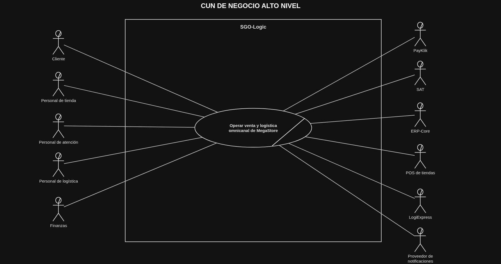
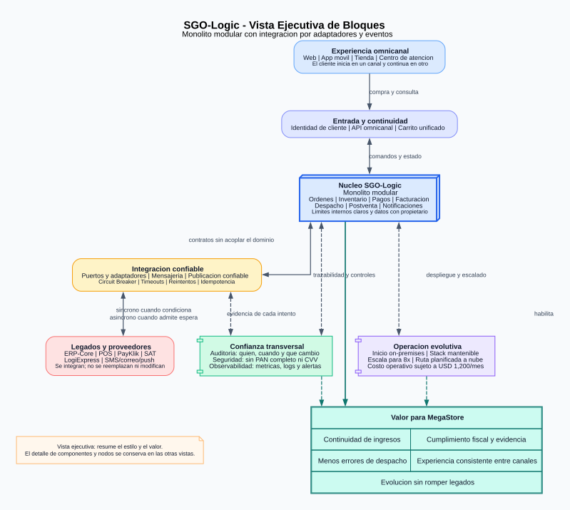
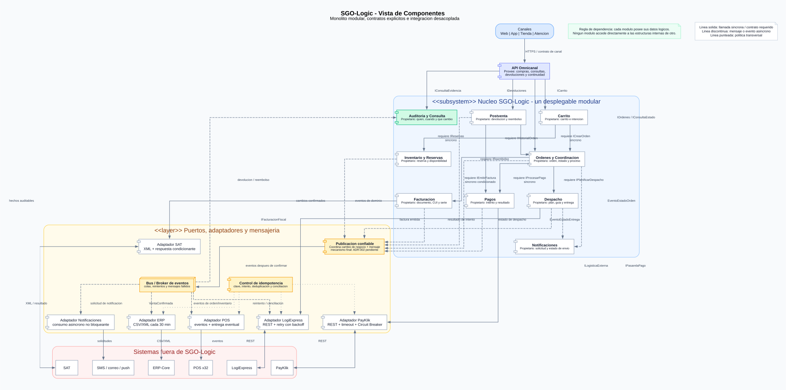
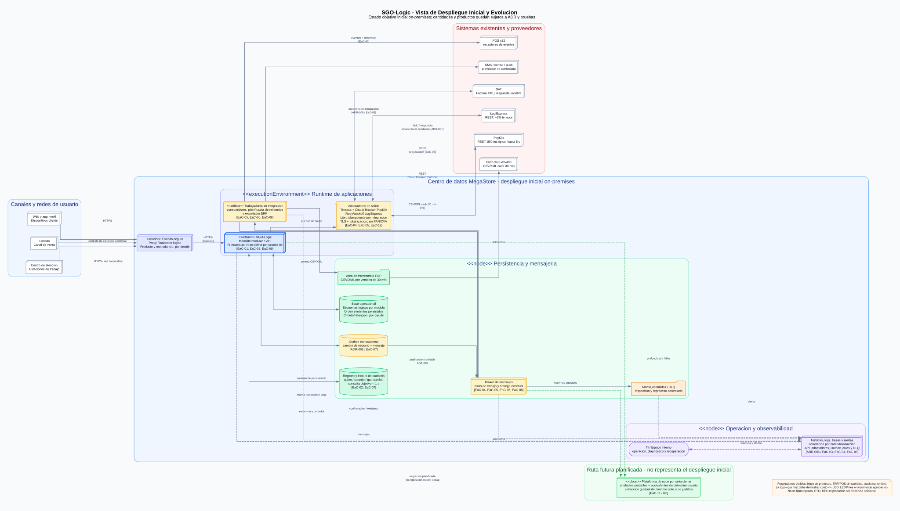

<div align="center">

<p>
  <strong>UNIVERSIDAD DE SAN CARLOS DE GUATEMALA</strong><br>
  Facultad de Ingeniería<br>
  Escuela de Ingeniería en Ciencias y Sistemas<br>
  Análisis y Diseño de Sistemas 2 Seccion A
</p>

<br>

<h1>DOCUMENTO DE DEFINICIÓN DE ARQUITECTURA</h1>
<h2>SGO-Logic</h2>
<h3>Sistema de Gestión de Órdenes y Logística Omnicanal</h3>

<p><strong>Caso de estudio: MegaStore</strong></p>

<br>

<p>
  <strong>Proyecto - Fase 2</strong><br>
  Grupo 5<br>
  AYD2_A_2S2025_PROYECTO_G5
</p>

<br>

<p>
  <strong>Equipo de Arquitectura</strong><br>
  Jairo Gómez<br>
  Jorge Pumay<br>
  Edson Sosa<br>
  Andy Sánchez<br>
  Kevin Girón
</p>

<br>

<p>
  <br>
  Guatemala, 10 de octubre de 2026
</p>

</div>

---

---

## Índice
1. [Resumen Ejecutivo](#1-resumen-ejecutivo)
2. [Contexto y Alcance del Sistema](#2-contexto-y-alcance-del-sistema)
3. [Descomposición Funcional](#3-descomposición-funcional)
4. [Drivers Arquitectónicos](#4-drivers-arquitectónicos)
5. [Estrategia y Decisiones Arquitectónicas](#5-estrategia-y-decisiones-arquitectónicas)
6. [Vistas Arquitectónicas](#6-vistas-arquitectónicas)
7. [Validación y Trazabilidad](#7-validación-y-trazabilidad)
8. [Prototipo / Mockups](#8-prototipo--mockups)
9. [Conclusiones Arquitectónicas](#9-conclusiones-arquitectónicas)
10. [Anexos](#10-anexos)

---

## 1. Resumen Ejecutivo

MegaStore es una cadena regional de retail con 32 tiendas en Guatemala, El Salvador y Costa Rica y una facturación anual de USD 450 millones, cuyo comercio electrónico crece un 15 % cada año. Su operación actual está fragmentada: cada tienda administra inventario local, el canal en línea opera por separado, la disponibilidad se confirma por teléfono y Finanzas concilia ventas manualmente desde hojas de cálculo, generando devoluciones de hasta siete días hábiles y exposición a errores de despacho y a pérdidas ya cuantificadas, como los USD 150,000 de un solo evento de indisponibilidad de la pasarela de pago.

SGO-Logic se propone como una capa de orquestación e integración omnicanal que permite iniciar, continuar y completar una compra desde cualquier canal sin modificar ERP-Core ni los POS existentes, cuya sustitución la Junta Directiva descartó. La arquitectura aceptada en ADR-001 es un **monolito modular** organizado por capacidades de negocio, rodeado de una **capa de integración por puertos, adaptadores y mensajería** que aísla a SGO-Logic de PayKlik, LogiExpress, la SAT, los POS y el ERP. Este estilo protege los drivers críticos priorizados: continuidad de la orden ante fallas de PayKlik, escalabilidad de hasta 8x en Black Friday, trazabilidad completa para las auditorías de la SAT y mantenibilidad con las capacidades de Java, .NET y Docker del equipo interno, dentro del presupuesto aprobado y con una ruta planificada de evolución hacia la nube.

---

## 2. Contexto y Alcance del Sistema

### 2.1 Situación actual y objetivo de negocio

MegaStore opera 32 tiendas físicas en Guatemala, El Salvador y Costa Rica y un canal de comercio electrónico que representa el 25 % de sus ventas. Sus aplicaciones y procedimientos evolucionaron de forma separada: las tiendas conservan ventas e inventario localmente, el comercio electrónico maneja información independiente, Logística confirma existencias por teléfono y Finanzas concilia archivos de hojas de cálculo. Esta fragmentación retrasa cambios y devoluciones hasta siete días hábiles, dificulta conocer el inventario disponible y expone a la organización a pérdidas, errores de despacho e inconsistencias fiscales.

El objetivo de SGO-Logic es habilitar una operación omnicanal en la que el cliente pueda iniciar, continuar y completar una compra desde tienda, web, aplicación móvil o centro de atención con una experiencia consistente. El sistema debe unificar la orquestación de órdenes, inventario, pagos, facturación, despacho, consulta, devolución, notificación y auditoría, integrándose con los sistemas existentes sin sustituirlos.

### 2.2 Sistema de interés y alcance

**Sistema de interés:** SGO-Logic es la capa de orquestación e integración omnicanal situada entre los canales de venta y los sistemas internos o externos existentes. Su frontera incluye la lógica necesaria para mantener la continuidad de la intención de compra y el ciclo de vida de la orden; no incluye la implementación interna de los sistemas con los que se integra.

**Dentro del alcance:**

- Orquestar el carrito y la orden entre web, aplicación móvil, tienda física y centro de atención.
- Verificar y reservar inventario antes de confirmar una venta, y liberar la reserva cuando la compra no concluye.
- Orquestar pagos por los métodos habilitados para cada canal y conservar cada intento asociado con la orden, el canal, la fecha y el resultado.
- Generar y enviar la documentación fiscal en XML a la SAT antes de finalizar la orden, conservando CUI y serie autorizada.
- Sincronizar resúmenes de ventas con ERP-Core mediante CSV o XML en intervalos de 30 minutos.
- Publicar eventos hacia las 32 instancias POS con manejo de errores y reintentos.
- Orquestar el despacho desde un centro de distribución, una tienda o recogida por el cliente, incluida la modificación del método de entrega después de la compra.
- Integrarse con LogiExpress para generar guías y recibir estados de entrega.
- Proveer consulta consolidada de órdenes, pagos, despachos, entregas, devoluciones e incidencias.
- Gestionar devoluciones y reembolsos conservando su relación con la venta original.
- Emitir notificaciones de confirmación, preparación, tránsito, entrega e incidencias sin bloquear la operación principal.
- Mantener trazabilidad suficiente para reconstruir quién realizó una operación, cuándo ocurrió y qué cambió.

**Fuera del alcance:**

- Modificar o reemplazar ERP-Core sobre AS/400.
- Modificar o reemplazar las 32 instancias POS.
- Modificar los servicios internos de PayKlik, LogiExpress, SAT o del proveedor de notificaciones.
- Implementar en esta fase el sistema productivo: la Fase 1 entrega definición arquitectónica, vistas, justificación y prototipo de alto nivel.

**Interfaces que atraviesan la frontera:**

| Entidad externa | Interacción conocida | Condición arquitectónica derivada del caso |
|---|---|---|
| ERP-Core | SGO-Logic entrega resúmenes de venta en CSV o XML | Procesamiento en intervalos de 30 minutos; ERP-Core no se modifica |
| POS de las 32 tiendas | Reciben eventos emitidos por SGO-Logic | Deben existir manejo de errores y reintentos; los POS no se modifican |
| PayKlik | Solicitudes de pago mediante REST | Latencia aproximada de 800 ms y hasta 5 s en alta demanda; el contrato vigente debe respetarse |
| LogiExpress | Generación de guías y recepción de estados mediante REST | Aproximadamente una de cada 50 solicitudes termina en timeout |
| SAT | Envío de factura electrónica en XML | La factura debe emitirse antes de finalizar la orden y conservar CUI y serie autorizada |
| Proveedor de notificaciones | Envío de SMS, correo y push | Su indisponibilidad no debe bloquear venta, pago, facturación o despacho |

### 2.3 Diagrama de Contexto



*Figura 1. Contexto de SGO-Logic, sus canales, áreas y sistemas externos.*

La frontera central identifica SGO-Logic como capa de orquestación e integración. A la izquierda se separan usuarios, canales y áreas organizacionales; a la derecha aparecen las seis entidades externas existentes. ERP-Core, POS y proveedores se integran sin presentarlos como componentes internos ni como sistemas que deban modificarse.

**Criterios de aceptación:**

- Delimita claramente SGO-Logic como sistema de interés y mantiene fuera de la frontera a ERP-Core, POS, PayKlik, LogiExpress, SAT y el proveedor de notificaciones.
- Muestra los cuatro canales, sus usuarios principales y las áreas de TI, Finanzas, Logística, Dirección, Gerencia y Comercialización.
- Rotula propósito y dirección; solo afirma REST para PayKlik y LogiExpress, CSV/XML para ERP-Core, XML para SAT y eventos hacia POS donde existe evidencia en el caso.
- Marca como pendiente de definición el contrato del canal tienda, en vez de inventarlo.

### 2.4 Stakeholders y Preocupaciones Arquitectónicas

Para este DDA, un stakeholder es una persona, grupo u organización con intereses sobre SGO-Logic o capacidad de afectar sus decisiones. ERP-Core, POS y los servicios de terceros se documentan como **entidades externas del contexto**, no como stakeholders humanos; sus condiciones técnicas se conservan en la frontera del sistema y en las matrices de trazabilidad. La agrupación no pretende imponer una cifra cerrada: debe refinarse si el equipo identifica propietarios, operadores o responsables contractuales adicionales.

| # | Stakeholder | Categoría | Preocupaciones arquitectónicas | Influencia o autoridad |
|---|---|---|---|---|
| 1 | Junta Directiva | Gobierno corporativo | Preservar ERP-Core y POS; controlar el alcance y proteger la inversión existente | Alta; su decisión sobre los sistemas legados es no negociable |
| 2 | Dirección | Patrocinio estratégico | Experiencia omnicanal consistente y capacidad de evolución regional | Alta; define el objetivo estratégico |
| 3 | Carlos Méndez, Gerente de TI | Operación y tecnología | Continuidad, monitoreo de dependencias externas, escalabilidad para Black Friday y mantenibilidad interna | Alta; responsable de operar la solución y rechaza cambios a ERP/POS |
| 4 | Ana Lucía Fuentes, Directora de Finanzas | Finanzas y cumplimiento | Trazabilidad, evidencia de transacciones, conciliación y cumplimiento fiscal | Alta; posee veto explícito sobre decisiones que reduzcan trazabilidad o cumplimiento |
| 5 | Roberto Quezada, Jefe de Logística | Operación logística | Visibilidad oportuna de inventario y órdenes; reducción del 70 % de errores de despacho | Media; responsable del resultado logístico |
| 6 | Directora de Comercialización | Negocio y experiencia de cliente | Carrito y experiencia consistentes entre canales, sin silos | Media; representa el objetivo omnicanal comercial |
| 7 | Jefe de Operaciones | Continuidad del negocio | Evitar pérdida de ventas durante caídas y picos de demanda | Media; aporta evidencia del impacto operativo |
| 8 | Gerencia | Gobierno financiero | Inversión máxima de USD 150,000 y operación de hasta USD 1,200 mensuales sin aprobación adicional | Alta; aprueba presupuesto y excepciones |
| 9 | Clientes | Usuario externo | Continuidad del carrito, rapidez, pagos disponibles, estado visible, devoluciones y notificaciones consistentes | Alto interés; influencia indirecta por experiencia e ingresos |
| 10 | Personal de atención al cliente | Usuario interno | Vista consolidada de compra, pago, despacho, entrega, devolución e incidencias | Alto interés; influencia operativa |
| 11 | Equipo interno de desarrollo y operación | Construcción y operación | Tecnología conocida, facilidad de adopción, despliegue, diagnóstico, mantenimiento y evolución | Media; condiciona la viabilidad de la solución |
| 12 | SAT | Regulador | Facturación electrónica, conservación de CUI y serie, auditabilidad y cumplimiento normativo | Alta; obligaciones no negociables |

### 2.5 Entidades externas relevantes

| Entidad | Rol en el contexto | Riesgo o restricción asociada |
|---|---|---|
| ERP-Core (AS/400) | Plataforma contable-financiera receptora de resúmenes de venta | No se modifica; integración por CSV/XML cada 30 minutos |
| POS de las 32 tiendas | Sistemas locales receptores de eventos de SGO-Logic | No se modifican; requieren manejo de errores y reintentos |
| PayKlik | Pasarela para pagos con tarjeta | Contrato por tres años, latencia variable e indisponibilidad observada |
| LogiExpress | Generación de guías y estados de entrega | Contrato por dos años y timeout aproximado en 2 % de solicitudes |
| Servicio de facturación electrónica de SAT | Receptor de XML fiscal | Respuesta variable y condición previa al cierre de la orden |
| Proveedor de SMS, correo y push | Distribución de notificaciones | Disponibilidad fuera del control de MegaStore; no debe bloquear el flujo principal |

### 2.6 Supuestos y preguntas arquitectónicas abiertas

Los siguientes puntos no están definidos por el enunciado y deben confirmarse antes de dimensionar o implementar. Las decisiones que podían cerrarse en esta fase se registraron en ADR-003 a ADR-008.

| Tema abierto | Por qué afecta la arquitectura | Tratamiento durante Fase 1 |
|---|---|---|
| Fuente autoritativa y mecanismo de actualización del inventario | Determina consistencia de reservas, prevención de doble compromiso y diseño de integración con tiendas y centros de distribución | Se exige una fuente lógica única y reserva atómica; el producto o sistema de registro se decide con Negocio y Logística |
| Formato, protocolo y garantías disponibles en cada POS | Define el contrato físico de los adaptadores | ADR-004 ubica idempotencia y reintento en el adaptador para no modificar POS; el formato queda parametrizable |
| Volumen normal, concurrencia y distribución del tráfico por canal | “8x” es una proporción, pero falta línea base | EaC-03 define una prueba relativa a la línea base `T`; TI debe medir `T` antes de dimensionar `N` instancias |
| Objetivos de disponibilidad, recuperación y pérdida de datos | Sin RTO, RPO y disponibilidad objetivo no se justifica una topología final de redundancia | La vista conserva `N` y no inventa réplicas; TI y Gerencia deben acordar SLO, RTO y RPO antes de producción |
| Jurisdicciones y controles concretos de protección de datos | MegaStore opera en tres países | Se aplican minimización, TLS, tokenización y control de acceso; Legal debe confirmar retención, residencia y normativa específica |

---

## 3. Descomposición Funcional

### 3.1 Diagrama de Casos de Uso de Negocio (CUN) - alto nivel


*Figura 2. Caso de Uso de Negocio de alto nivel de SGO-Logic.*

El nivel 0 modela "Operar venta y logística omnicanal de MegaStore" como síntesis de la frontera descrita en 2.2. Se distinguen actores humanos internos (Cliente, Personal de tienda, Personal de atención, Personal de logística y Finanzas) de los sistemas u organizaciones externas que intercambian información con SGO-Logic (ERP-Core, POS, PayKlik, LogiExpress, SAT y proveedor de notificaciones). El único caso de uso de este nivel se descompone inmediatamente en los doce CUN del nivel 1 (§3.2); por ello no oculta el alcance funcional ni representa una secuencia.

**Notación:** se emplean actores UML nativos, casos de uso elípticos, frontera explícita y asociaciones continuas sin dirección. Las asociaciones indican participación, no orden temporal. El archivo draw.io contiene formas editables y no imágenes incrustadas.

### 3.2 Primera descomposición


*Figura 3. Primera descomposición del negocio en CUN.*

El core se descompone en los 12 CUN de 2.6, agrupados en seis macro-procesos de negocio. Cada CUN queda asociado a los actores de negocio que efectivamente lo originan o lo reciben, y cada macro-proceso corresponde a una línea de acción distinguible del negocio (venta, cumplimiento fiscal, logística, atención, postventa y gobernanza), no a una agrupación técnica de sistema:

| Macro-proceso | CUN incluidos | Actores de negocio asociados |
|---|---|---|
| Venta omnicanal | Gestionar carrito omnicanal, Verificar y reservar inventario, Procesar pago | Cliente, Personal de tienda, Personal de atención, Logística, PayKlik |
| Postventa | Gestionar devoluciones y reembolsos | Cliente, Personal de atención, Personal de tienda |
| Cumplimiento fiscal | Emitir documentación fiscal, Sincronizar venta con ERP | Finanzas, SAT, ERP-Core |
| Logística | Gestionar despacho, Integrar con LogiExpress, Notificar eventos a POS | Logística, LogiExpress, POS |
| Atención al cliente | Consultar estado de orden, Notificar al cliente | Cliente, Personal de atención, Proveedor de notificaciones |
| Gobernanza | Auditar operaciones | Finanzas, SAT |

Ningún CUN queda sin macro-proceso ni sin al menos un actor asociado. Para evitar el entramado de líneas del modelo anterior, un mismo actor puede aparecer más de una vez en distintas bandas; cada repetición representa exactamente el mismo rol y no un actor nuevo. Los contenedores de macroproceso son agrupaciones visuales: no expresan secuencia, inclusión ni extensión. Esta cobertura se reutiliza en la matriz de trazabilidad (Sección 7) y en el diagrama de Componentes (6.1), donde CUN-01 a CUN-03 orientan el módulo de Carrito/Órdenes, CUN-04/CUN-05 el módulo de Facturación, CUN-06 a CUN-08 el módulo de Despacho, CUN-09/CUN-11 el módulo de Notificaciones/Consulta, CUN-10 el módulo de Postventa y CUN-12 el módulo de Auditoría.

### 3.3 Catálogo de CUN identificados

1. **CUN-01:** Gestionar carrito omnicanal
2. **CUN-02:** Verificar y reservar inventario
3. **CUN-03:** Procesar pago
4. **CUN-04:** Emitir documentación fiscal
5. **CUN-05:** Sincronizar venta con ERP
6. **CUN-06:** Notificar eventos a POS
7. **CUN-07:** Gestionar despacho
8. **CUN-08:** Integrar con LogiExpress
9. **CUN-09:** Consultar estado de orden
10. **CUN-10:** Gestionar devoluciones y reembolsos
11. **CUN-11:** Notificar al cliente
12. **CUN-12:** Auditar operaciones

### 3.4 CDU Core

Los doce CUN se detallan mediante su diagrama y descripción textual. El CDU inicial presenta el core completo y las doce figuras restantes expanden cada caso sin representar orden temporal entre ellos.


*Figura 4. CDU del Negocio - Core de SGO-Logic.*

### 3.5 CDU-01: Gestionar carrito omnicanal


*Figura 5. CUN-01 - Gestionar carrito omnicanal.*

```
ID: CDU-01
Nombre: Gestionar carrito omnicanal
Derivado de (CUN): CUN-01 - Gestionar carrito omnicanal
Actor(es): Cliente; Personal de tienda o Personal de atención cuando actúan
  en representación del cliente
Descripción breve: Permite iniciar, modificar y conservar un carrito de
  compra asociado al cliente, reconocible desde cualquier canal, para que
  la compra pueda continuar o completarse en un canal distinto al de inicio.
Precondiciones:
  - El cliente está identificado o puede identificarse en el canal
Flujo principal:
  1. El cliente inicia una intención de compra en un canal (web, app,
     tienda o centro de atención)
  2. El sistema identifica al cliente o solicita su identificación para
     asociar el carrito a su cuenta
  3. El cliente agrega, modifica o elimina productos del carrito
  4. Para cada producto agregado, el sistema consulta la disponibilidad,
     pero todavía no crea una reserva
  5. El sistema conserva el carrito asociado al cliente, independiente del
     canal de origen
  6. El cliente decide continuar la compra desde el mismo canal o desde
     otro distinto e inicia el checkout
  7. El sistema crea la orden e invoca CDU-02 para reservar inventario
  8. Con la reserva confirmada, inicia CDU-03: Procesar pago de una orden
Flujos alternativos:
  A1. El cliente cambia de canal a mitad de la compra: el sistema recupera
      el carrito vigente en el nuevo canal sin pedir que reingrese los
      artículos
  A2. El cliente elimina un artículo antes del checkout: solamente se
      actualiza el carrito porque todavía no existe una reserva asociada
  A3. El checkout no concluye: el temporizador libera la reserva creada al
      iniciar el checkout, según CDU-02
Flujo de excepción:
  E1. Un producto deja de estar disponible mientras el cliente decide: el
      sistema informa la indisponibilidad y ofrece alternativas, o mantiene
      el carrito sin ese ítem, sin bloquear el resto de la compra
Postcondiciones:
  - Existe un carrito único y vigente asociado al cliente, reconocible
    desde cualquier canal, con los productos y su estado de disponibilidad
    actualizados
Relacionado con EaC: EaC-01 (consulta ≤ 5 s), EaC-03 (escalabilidad 8x),
  EaC-08 (no bloqueado por falla de notificaciones)
```

### 3.6 CDU-02: Verificar y reservar inventario


*Figura 6. CUN-02 - Verificar y reservar inventario.*

```
ID: CDU-02
Nombre: Verificar y reservar inventario
Derivado de (CUN): CUN-02 - Verificar y reservar inventario
Actor(es): Cliente; Personal de logística como consultante de disponibilidad
Descripción breve: Verifica existencia de un producto en una ubicación y
  reserva la cantidad solicitada para evitar que la misma unidad se
  comprometa con más de un cliente, liberando la reserva cuando la compra
  no concluye.
Precondiciones:
  - Existe una orden creada al iniciar checkout; un carrito abierto por sí
    solo no crea ni mantiene reservas
Flujo principal:
  1. Al iniciar checkout, el módulo de Carrito/Órdenes solicita reservar un
     producto para la orden en CD-WEB
  2. El sistema consulta el inventario operativo de CD-WEB, abastecido por
     folios del almacén central
  3. Si hay existencia suficiente, el sistema reserva la cantidad
     solicitada y la marca como comprometida para esa orden
  4. El sistema responde con la confirmación de reserva y la ubicación
     desde la que se reservó
  5. Si la compra no concluye dentro de un tiempo acorde con la operación
     comercial, el sistema libera automáticamente la reserva
Flujos alternativos:
  A1. No hay existencia en la ubicación preferida: el sistema evalúa otra
      ubicación (tienda o centro de distribución) antes de declarar
      indisponibilidad
Flujo de excepción:
  E1. Dos solicitudes intentan reservar la última unidad disponible casi al
      mismo tiempo: el sistema debe garantizar que solo una reserva se
      confirme y la otra reciba indisponibilidad, evitando el doble
      compromiso de la misma unidad
Postcondiciones:
  - El inventario reservado queda comprometido y visible para el resto del
    sistema
  - Una reserva no concluida se libera en un tiempo acorde con la
    operación comercial
Relacionado con EaC: EaC-01 (consulta ≤ 5 s), EaC-03 (escalabilidad 8x)
```

### 3.7 CDU-03: Procesar pago


*Figura 7. CDU-03 expandido — autorización idempotente, conciliación y
continuación de la Saga.*

```
ID: CDU-03
Nombre: Procesar pago
Derivado de (CUN): CUN-03 - Procesar pago
Actor(es): Cliente; PayKlik
Descripción breve: Autoriza el pago mediante PayKlik con una llave
  idempotente, conserva el intento y concilia una respuesta tardía sin generar
  un segundo cobro. La Saga continúa, compensa o espera según el resultado.
Precondiciones:
  - El carrito fue confirmado y el inventario está reservado
Flujo principal:
  1. El cliente confirma el pago de la orden
  2. El sistema crea el intento y solicita autorización a PayKlik por REST con
     X-Api-Key y una llave idempotente, sin enviar ni almacenar PAN o CVV
  3. PayKlik registra la autorización y responde APPROVED o REJECTED
  4. El sistema conserva el intento, el resultado y su correlación con la orden
  5. Si el pago fue aprobado, la Saga retoma facturación SAT, confirmación y
     despacho
Flujos alternativos:
  A1. PayKlik devuelve REJECTED: la Saga compensa la operación y libera la
      reserva de inventario
Flujo de excepción:
  E1. PayKlik supera el límite de 5 s: el intento queda
      PAYMENT_INDETERMINATE porque el proveedor pudo haber cobrado
  E2. La conciliación consulta a PayKlik con la misma llave idempotente. Si
      recupera APPROVED, la Saga retoma; si recupera REJECTED, compensa; si
      sigue indeterminado, la orden permanece WAITING_PAYMENT
Postcondiciones:
  - Existe un solo efecto de cobro por llave idempotente
  - La orden queda aprobada, rechazada/compensada o pendiente de conciliación
  - El intento y su resultado permanecen auditables
Relacionado con EaC: EaC-04 (resiliencia de pago), EaC-07 (trazabilidad)
Implementación: payments, OrderSagaService, payklik-service
Evidencia: OrderSagaReconciledPaymentTest, HttpPayKlikAdapterTest,
  PayKlikIntegrationTest
```

### 3.8 CDU-04: Emitir documentación fiscal


*Figura 8. CUN-04 - Emitir documentación fiscal.*

```
ID: CDU-04
Nombre: Emitir documentación fiscal
Derivado de (CUN): CUN-04 - Emitir documentación fiscal
Actor(es): Finanzas; SAT como sistema externo receptor
Descripción breve: Genera la factura electrónica de una venta, la envía en XML
  a la SAT antes de finalizar la orden y conserva el CUI, la serie y la respuesta.
Precondiciones:
  - La orden tiene pago aprobado y datos fiscales suficientes
Flujo principal:
  1. El sistema recibe la solicitud de facturación de una orden pagada
  2. Valida los datos fiscales y genera el documento XML
  3. Asigna y conserva el CUI y la serie autorizada
  4. Envía el XML a la SAT mediante el adaptador fiscal
  5. Registra la respuesta, fecha, correlación y evidencia del intercambio
  6. Autoriza la transición de la orden solo después de la confirmación fiscal
Flujos alternativos:
  A1. La operación corresponde a devolución: se genera el documento fiscal
      relacionado con la venta original
Flujo de excepción:
  E1. SAT no responde o rechaza el documento: la orden permanece en estado
      fiscal pendiente, se registra el intento y se aplica ADR-007; nunca se
      presenta la orden como finalizada sin confirmación fiscal
Postcondiciones:
  - La factura y la evidencia fiscal quedan vinculadas a la orden
Relacionado con EaC: EaC-02 (evidencia < 1 s), EaC-07 (auditabilidad)
```

### 3.9 CDU-05: Sincronizar venta con ERP


*Figura 9. CDU-05 expandido — consolidación de ventas, archivo con control y
recuperación de lotes fallidos.*

```
ID: CDU-05
Nombre: Sincronizar venta con ERP
Derivado de (CUN): CUN-05 - Sincronizar venta con ERP
Actor(es): Finanzas; ERP-Core como sistema externo receptor
Descripción breve: Consolida ventas web y de tienda física y entrega a ERP-Core
  un archivo CSV o XML verificable dentro de una ventana configurable de 30
  minutos, sin modificar el sistema legado.
Precondiciones:
  - Existen ventas confirmadas aún no sincronizadas
Flujo principal:
  1. Las ventas web ingresan al confirmarse la orden; las facturas de tienda
     física se recogen desde el almacén central cada 60 s como canal STORE
  2. El planificador reúne las ventas pendientes de la ventana vigente
  3. Genera CSV o XML con canal, punto de venta, referencia, neto, IVA, total y
     un registro de control TRAILER/<Control> con cantidad y sumas
  4. FileDropErpGatewayAdapter escribe el archivo en /var/sgo/erp-outbox
  5. El sistema conserva lote, ventas, archivo, fecha y resultado de entrega
Flujos alternativos:
  A1. Finanzas usa "Generar lote ERP ahora" antes de la siguiente ventana
  A2. El backend se reinicia con un lote pendiente: la siguiente ejecución lo
      retoma sin duplicar ventas
Flujo de excepción:
  E1. ERP no responde: el sistema reintenta a los 2, 8 y 32 s
  E2. Si se agotan los reintentos, el lote queda DEAD_LETTER. Finanzas utiliza
      "Reintentar" cuando ERP vuelve a estar disponible
Postcondiciones:
  - Cada venta queda asociada con su archivo y estado de entrega al ERP
  - CDU-13 puede distinguir ventas entregadas, pendientes o con diferencias
Relacionado con EaC: EaC-07 (auditabilidad); condicionado por R1 (ERP no modificable)
Implementación: legacyfeed, integration, FileDropErpGatewayAdapter
```

### 3.10 CDU-06: Notificar eventos a POS


*Figura 10. CDU-06 expandido — eventos de orden, existencias y retiro dirigidos
al punto de venta correspondiente.*

```
ID: CDU-06
Nombre: Notificar eventos a POS
Derivado de (CUN): CUN-06 - Notificar eventos a POS
Actor(es): Almacén central; POS-01 / POS-02..32
Descripción breve: Publica eventos de orden y de stock a cada tienda y dirige
  los avisos de retiro únicamente al punto seleccionado, preservando orden,
  reintentos y evidencia de entrega.
Precondiciones:
  - Existe un evento de negocio confirmado y registrado por Outbox
Flujo principal:
  1. El sistema publica ORDER_CONFIRMED, PREPARING, IN_TRANSIT, DELIVERED o
     CANCELLED para las 32 tiendas, incluyendo la tienda de retiro cuando aplica
  2. POS-01 recibe el evento mediante store-service; POS-02..32 usan el
     adaptador simulado
  3. ORDER_READY_FOR_PICKUP se entrega solo a la tienda seleccionada
  4. Cada entrada, venta o traslado que cambia existencias genera un evento de
     stock para ese punto de venta, con la cantidad resultante
  5. La tienda compara el resultado con su inventario local y registra "Cuadra"
     o "No cuadra"
Flujos alternativos:
  A1. Un punto de venta todavía no tiene sistema conectado: el evento queda
      "Sin sistema conectado" y se intenta nuevamente cada minuto
Flujo de excepción:
  E1. La tienda no responde: se reintenta a los 2, 8 y 32 s y los eventos
      siguientes de esa tienda esperan para conservar orden
  E2. Al agotar la política, el evento queda Fallido y el almacén puede usar
      "Reenviar" desde "Stock por tienda"
Postcondiciones:
  - Cada evento queda entregado, pendiente, fallido o sin sistema conectado,
    siempre con evidencia recuperable
Relacionado con EaC: EaC-06 (entrega eventual), EaC-07 (auditabilidad)
Implementación: integration, RoutingPosGatewayAdapter, inventory-service,
  store-service
```

### 3.11 CDU-07: Gestionar despacho


*Figura 11. CDU-07 expandido — origen CD-WEB, guía idempotente, rastreo y
retiro en tienda.*

```
ID: CDU-07
Nombre: Gestionar despacho
Derivado de (CUN): CUN-07 - Gestionar despacho
Actor(es): Personal de logística; Cliente; LogiExpress
Descripción breve: Coordina desde CD-WEB la preparación, guía, rastreo y
  entrega a domicilio o en tienda, manteniendo sincronizados el despacho y la
  orden.
Precondiciones:
  - La orden tiene el inventario reservado (CDU-02), el pago aprobado y la
    confirmación fiscal requerida para considerar confirmada la venta
Flujo principal:
  1. El sistema asigna CD-WEB como origen de la venta web y registra el método
     de entrega elegido por el cliente
  2. SGO-Logic solicita a LogiExpress una guía REST idempotente por id de
     despacho e indica la tienda de retiro cuando corresponde
  3. Personal de logística prepara el pedido y el mensajero lo recolecta
  4. SGO-Logic consulta el rastreo cada 10 s; despacho y orden pasan a
     IN_TRANSIT y se avisa al cliente
  5. En entrega a domicilio, el mensajero confirma la entrega y fulfillment
     actualiza despacho y orden a DELIVERED
Flujos alternativos:
  A1. Retiro en tienda: LogiExpress deja el paquete en la tienda seleccionada;
      el despacho pasa a READY_FOR_PICKUP, se avisa al cliente y a ese POS, y
      el vendedor completa CDU-16
Flujo de excepción:
  E1. LogiExpress creó la guía pero respondió tarde: el rastreo la concilia y
      un reintento no sustituye la guía existente
  E2. Tras agotar reintentos el despacho queda LABEL_FAILED; Logística utiliza
      "Reintentar guía" cuando el servicio se recupera
Postcondiciones:
  - La orden y el despacho comparten origen, destino, guía y estado trazables
Relacionado con EaC: EaC-05 (confiabilidad LogiExpress), EaC-06
  (confiabilidad hacia POS/tienda), EaC-07 (trazabilidad)
Implementación: logistics, fulfillment, HttpLogiExpressAdapter,
  LogiExpressTrackingSync
Evidencia: ShipmentServiceTest, HttpLogiExpressAdapterTest,
  LogiExpressTrackingSyncTest, LogiExpressIntegrationTest
```

### 3.12 CDU-08: Integrar con LogiExpress


*Figura 12. CDU-08 expandido — creación de guía, consulta de rastreo,
conciliación y reintento controlado.*

```
ID: CDU-08
Nombre: Integrar con LogiExpress
Derivado de (CUN): CUN-08 - Integrar con LogiExpress
Actor(es): Personal de logística; LogiExpress
Descripción breve: Crea una guía mediante REST, consulta el rastreo y actualiza
  la orden y el despacho, tolerando respuestas tardías o indisponibilidad sin
  duplicar guías.
Precondiciones:
  - La orden tiene método y ubicación de despacho asignados
Flujo principal:
  1. El sistema crea una solicitud de guía correlacionada con el despacho
  2. HttpLogiExpressAdapter invoca por REST con X-Api-Key y la identidad
     idempotente del despacho
  3. LogiExpress devuelve la guía y el sistema la vincula sin sustituir una
     guía ya conciliada
  4. LogiExpressTrackingSync consulta el rastreo cada 10 s
  5. Los estados recibidos actualizan despacho, orden y vista consolidada
Flujos alternativos:
  A1. La respuesta de creación llega tarde: la consulta de rastreo encuentra y
      concilia la guía previamente creada
Flujo de excepción:
  E1. LogiExpress no está disponible: se aplica reintento con backoff
  E2. Al agotar la política, el despacho queda LABEL_FAILED; Personal de
      logística utiliza "Reintentar guía" cuando el servicio se recupera
Postcondiciones:
  - Existe como máximo una guía vigente por despacho y sus estados quedan
    correlacionados con la orden
Relacionado con EaC: EaC-05 (timeout LogiExpress), EaC-07 (trazabilidad)
Implementación: logistics, logiexpress-service
Evidencia: HttpLogiExpressAdapterTest, LogiExpressTrackingSyncTest,
  LogiExpressIntegrationTest
```

### 3.13 CDU-09: Consultar estado de orden


*Figura 13. CDU-09 expandido — consulta consolidada con pago conciliado,
despacho, entrega e incidencia.*

```
ID: CDU-09
Nombre: Consultar estado de orden
Derivado de (CUN): CUN-09 - Consultar estado de orden
Actor(es): Cliente; Personal de atención al cliente
Descripción breve: Entrega una vista consolidada del estado de una orden
  (compra, pago, despacho, entrega y, si aplica, devolución o incidencia)
  desde cualquier canal, sin que el solicitante deba consultar cada área
  por separado.
Precondiciones:
  - La orden existe en el sistema, independientemente del canal donde se
    originó
Flujo principal:
  1. El cliente o el personal de atención solicita el estado de una orden
     desde cualquier canal
  2. El sistema recupera la proyección consolidada alimentada por eventos de
     orden, pago, despacho e incidencia
  3. Incluye el pago conciliado, el despacho, la entrega y cualquier incidencia
     sin consultar en línea las bases privadas de esos módulos
  4. El sistema muestra el resultado dentro del tiempo máximo aceptable
     para el negocio
Flujos alternativos:
  A1. Hechos concurrentes llegan a la proyección: se conservan todos y un
      hecho anterior no sustituye uno más reciente
Flujo de excepción:
  E1. Alguno de los subsistemas de origen del dato (pago, despacho) no
      responde a tiempo: el sistema muestra la última información conocida
      indicando que puede no estar actualizada, en vez de fallar toda la
      consulta
Postcondiciones:
  - El solicitante obtiene una vista consolidada del estado de la orden sin
    necesidad de consultar cada canal o área por separado
  - Pago conciliado, despacho, entrega e incidencia quedan representados con la
    última versión conocida
Relacionado con EaC: EaC-01 (consulta ≤ 5 s), EaC-07 (trazabilidad)
Implementación: query y consumidores de eventos
Evidencia: OrderSummaryConcurrencyIntegrationTest,
  PaymentStatusChangedConsumerTest
```

### 3.14 CDU-10: Gestionar devoluciones y reembolsos


*Figura 14. CUN-10 - Gestionar devoluciones y reembolsos.*

```
ID: CDU-10
Nombre: Gestionar devoluciones y reembolsos
Derivado de (CUN): CUN-10 - Gestionar devoluciones y reembolsos
Actor(es): Cliente; Personal de atención al cliente; Personal de tienda
Descripción breve: Registra una devolución referenciando la venta
  original, calcula el reembolso o cambio correspondiente y conserva la
  relación entre ambos para auditoría y conciliación fiscal.
Precondiciones:
  - Existe una venta original confirmada y facturada (CDU-04: Emitir
    documentación fiscal)
Flujo principal:
  1. El cliente o el personal de atención inicia una devolución
     referenciando la orden o venta original
  2. El sistema recupera el historial completo de la compra (pago,
     despacho, entrega) para validar la elegibilidad de la devolución
  3. El personal de atención o de tienda registra el motivo y los
     artículos a devolver
  4. El sistema calcula el reembolso o cambio correspondiente y lo asocia
     a la venta original
  5. El sistema actualiza el inventario disponible con los artículos
     devueltos, cuando aplica
  6. El sistema genera la documentación fiscal de la devolución cuando la
     operación lo requiere (relacionado con CDU-04)
  7. El sistema notifica al cliente el resultado de la devolución
     (relacionado con CUN-11: Notificar al cliente)
Flujos alternativos:
  A1. La devolución corresponde solo a una parte de la orden: el sistema
      mantiene la relación entre la devolución parcial y la venta original
      completa
Flujo de excepción:
  E1. La venta original no se encuentra o no cumple condición de
      elegibilidad: el sistema informa el motivo y no continúa con el
      reembolso hasta que el caso se resuelva manualmente
Postcondiciones:
  - La devolución queda registrada y vinculada a la venta original, con el
    reembolso o cambio procesado y la evidencia disponible para auditoría
Relacionado con EaC: EaC-02 (evidencia < 1 s), EaC-07 (trazabilidad)
```

### 3.15 CDU-11: Notificar al cliente


*Figura 15. CUN-11 - Notificar al cliente.*

```
ID: CDU-11
Nombre: Notificar al cliente
Derivado de (CUN): CUN-11 - Notificar al cliente
Actor(es): Cliente; proveedor de SMS, correo y push
Descripción breve: Envía avisos de confirmación, preparación, tránsito, entrega
  o incidencia sin hacer que la disponibilidad del proveedor bloquee la orden.
Precondiciones:
  - Existe un evento notificable y un medio habilitado para el cliente
Flujo principal:
  1. El sistema crea una solicitud de notificación desde el evento de negocio
  2. La solicitud se registra y se publica en una cola independiente
  3. El trabajador selecciona SMS, correo o push según la información disponible
  4. El adaptador invoca al proveedor externo
  5. Registra el resultado de entrega y lo vincula con el evento de origen
Flujos alternativos:
  A1. Hay más de un canal habilitado: se aplican las preferencias conocidas
Flujo de excepción:
  E1. El proveedor no está disponible: se reintenta de forma asíncrona y la
      venta, pago, facturación y despacho continúan según ADR-008
Postcondiciones:
  - La notificación queda entregada o registrada como pendiente/fallida
Relacionado con EaC: EaC-08 (notificación no bloqueante), EaC-07 (trazabilidad)
```

### 3.16 CDU-12: Auditar operaciones


*Figura 16. CUN-12 - Auditar operaciones.*

```
ID: CDU-12
Nombre: Auditar operaciones
Derivado de (CUN): CUN-12 - Auditar operaciones
Actor(es): Finanzas; auditor de la SAT
Descripción breve: Reconstruye la historia de una operación indicando quién la
  ejecutó, cuándo ocurrió y qué cambió, con correlación entre orden, pago,
  factura, despacho y devolución.
Precondiciones:
  - El solicitante está autorizado y proporciona orden o transacción de búsqueda
Flujo principal:
  1. El solicitante busca por identificador de orden o transacción
  2. El sistema consulta el registro de auditoría indexado
  3. Correlaciona transiciones, intentos de pago, factura y despacho
  4. Si existe devolución, la vincula con la venta original
  5. Presenta actor, instante, cambio, resultado y correlación en menos de 1 s
  6. Registra el acceso a la evidencia
Flujos alternativos:
  A1. El auditor solicita exportación: el sistema genera una evidencia íntegra
      en el formato autorizado
Flujo de excepción:
  E1. No existe evidencia para el identificador: se registra la búsqueda fallida
      y se alerta a Finanzas para investigación, sin inventar información
Postcondiciones:
  - La consulta queda registrada y la evidencia permanece inalterada
Relacionado con EaC: EaC-02 (recuperación < 1 s), EaC-07 (auditabilidad)
```

### 3.17 CDU-13: Generar informe de ventas conciliado


*Figura 16A. CDU-13 expandido — cruce de ventas, pago, SAT y ERP con consulta
y exportación auditadas.*

```
ID: CDU-13
Nombre: Generar informe de ventas conciliado
Derivado de (CUN): CUN-05 / CUN-12 - Sincronizar y auditar
Actor(es): Finanzas
Descripción breve: Cruza las ventas web y de tienda física de un rango con su
  pago, factura SAT y entrega al ERP, y señala las diferencias encontradas.
Precondiciones:
  - El usuario está autenticado con rol FINANCE
Flujo principal:
  1. Finanzas elige un rango de fechas; por defecto se usa el día actual de
     Guatemala
  2. El sistema reúne las órdenes web y las ventas de tienda registradas para
     el ERP
  3. Para cada venta compara pago, factura SAT, entrega al ERP y monto
  4. Presenta neto, IVA, total, totales por canal y el resultado "Cuadra" o
     "N diferencias"
  5. Registra SALES_REPORT_VIEWED con usuario, rango y resultado
Flujos alternativos:
  A1. Finanzas exporta CSV: el sistema descarga el mismo informe y registra
      SALES_REPORT_EXPORTED
Flujo de excepción:
  E1. La fecha final es anterior a la inicial: responde
      400 INVALID_REPORT_RANGE y no genera el informe
Diferencias detectadas:
  - Venta confirmada sin pago aprobado
  - Venta confirmada sin factura SAT
  - Pago aprobado sin venta
  - Venta no registrada en ERP
  - Monto distinto al registrado en ERP
  - Lote ERP en DEAD_LETTER o REJECTED
Postcondiciones:
  - Queda evidencia de quién consultó o exportó, qué rango usó y qué resultado
    obtuvo
Relacionado con EaC: EaC-02 (evidencia < 1 s), EaC-07 (auditabilidad)
Implementación: salesreport; GET /api/v1/reports/sales y /export
Evidencia: SalesReportServiceTest
```

### 3.18 CDU-14: Abastecer un punto de venta por folio


*Figura 16B. CDU-14 expandido — salida central, actualización de stock y
recepción idempotente por folio.*

```
ID: CDU-14
Nombre: Abastecer un punto de venta por folio
Derivado de (CUN): CUN-02 / CUN-06 - Inventario y eventos a POS
Actor(es): Almacén central; vendedor de tienda; administrador de tienda online
Descripción breve: Traslada existencias desde el almacén central a un punto de
  venta y correlaciona salida, evento de stock y recepción mediante folios.
Precondiciones:
  - El artículo existe en el almacén central con existencia suficiente
Flujo principal:
  1. El almacén registra una salida hacia el punto de venta con folio SAL-...
  2. El central disminuye su existencia y actualiza el stock propio del punto de
     venta mediante POS-ENT-...
  3. El central emite el evento de stock para ese punto de venta según CDU-06
  4. El punto de venta muestra el folio "En tránsito" y confirma su recepción
  5. La existencia local aumenta y el movimiento queda en su bitácora
Flujos alternativos:
  A1. La tienda traslada existencias al central o a otra tienda mediante TRA-...
  A2. El almacén central registra una merma mediante AJU-...
Flujo de excepción:
  E1. El folio ya fue recibido: responde 409 FOLIO_ALREADY_RECEIVED y no vuelve
      a incrementar la existencia
Postcondiciones:
  - Las existencias central y local reflejan un único traslado trazable
Relacionado con EaC: EaC-06 (entrega eventual), EaC-07 (trazabilidad)
Implementación: inventory-service (stock, posstock, storesync, posevents),
  store-service y onlinestore
```

### 3.19 CDU-15: Vender en la tienda física


*Figura 16C. CDU-15 expandido — cobro local, factura, disminución de existencia
y sincronización posterior con el central.*

```
ID: CDU-15
Nombre: Vender en la tienda física
Derivado de (CUN): CUN-01 / CUN-05 - Venta omnicanal y sincronización ERP
Actor(es): Vendedor; cliente
Descripción breve: Registra una venta con consumidor final, NIT o cuenta web,
  actualiza el inventario local y sincroniza la factura con el central sin
  detener la operación por una desconexión temporal.
Precondiciones:
  - La tienda tiene existencia local suficiente del artículo
Flujo principal:
  1. El vendedor escanea o busca el artículo
  2. Cobra en efectivo, tarjeta o transferencia y emite la factura TKT-...
  3. Disminuye la existencia local dentro de la misma transacción
  4. Envía la factura FT-... al almacén central; el central actualiza su vista
     del stock y publica el evento correspondiente
  5. SGO-Logic incorpora la venta al lote ERP mediante CDU-05
Flujos alternativos:
  A1. El cliente tiene cuenta web: el vendedor recupera su carrito y lo cierra
      al cobrar
  A2. El vendedor reimprime una factura buscándola por fecha
Flujo de excepción:
  E1. El central está caído: la venta finaliza localmente, la factura queda
      Pendiente y se sincroniza automáticamente al recuperarse la conexión
Postcondiciones:
  - La venta, factura y disminución de stock local quedan confirmadas
  - La sincronización central queda completada o pendiente con evidencia
Relacionado con EaC: EaC-06 (entrega eventual), EaC-07 (trazabilidad)
Implementación: store-service; inventory-service (storesync); legacyfeed
```

### 3.20 CDU-16: Entregar un pedido web en la tienda de retiro


*Figura 16D. CDU-16 expandido — validación de tienda y estado, identificación
de quien recoge y entrega única.*

```
ID: CDU-16
Nombre: Entregar un pedido web en la tienda de retiro
Derivado de (CUN): CUN-07 - Gestionar despacho
Actor(es): Vendedor de la tienda de retiro; cliente
Precondiciones:
  - LogiExpress dejó el paquete en la tienda y el despacho está
    READY_FOR_PICKUP
Flujo principal:
  1. La tienda recibe ORDER_READY_FOR_PICKUP y muestra el pedido "Llegó, listo
     para entregar"
  2. El cliente se presenta y el vendedor registra nombre y documento de quien
     recoge
  3. La tienda confirma la entrega a SGO-Logic con rol STORE
  4. El sistema valida tienda, estado e identidad registrada
  5. Despacho y orden pasan a DELIVERED; el cliente recibe el aviso y las 32
     tiendas reciben ORDER_DELIVERED
Flujo de excepción:
  E1. El paquete no ha llegado, pertenece a otra tienda o ya fue entregado: el
      sistema responde 409 con el motivo y registra el intento en la bitácora
Postcondiciones:
  - El pedido queda entregado una sola vez, por la tienda correcta y con la
    identidad de quien lo recogió
Relacionado con EaC: EaC-06 (confiabilidad POS), EaC-07 (trazabilidad)
Implementación: logistics (StorePickupController), store-service (Pedidos web)
Evidencia: ShipmentServiceTest, StoreServiceIntegrationTest
```

---

## 4. Drivers Arquitectónicos

### 4.1 Características del Sistema Priorizadas

| Característica | Por qué importa al negocio |
|---|---|
| Continuidad de la orden ante fallas de la pasarela de pago | Protege los ingresos y evita repetir pérdidas como los USD 150,000 ocasionados por 45 minutos de indisponibilidad en el último Black Friday |
| Capacidad para soportar hasta ocho veces el tráfico normal | Permite atender el pico comercial de noviembre sin degradar las consultas ni la recuperación de evidencia |
| Experiencia y carrito unificados entre tienda, web, aplicación y centro de atención | Cumple el objetivo estratégico de operar sin silos y conservar la intención de compra al cambiar de canal |
| Trazabilidad completa y evidencia recuperable en menos de un segundo | Permite reconstruir quién hizo qué y cuándo, reduce conciliaciones manuales y protege el cumplimiento ante auditorías de la SAT |
| Integración sin modificar ERP-Core ni POS | Preserva la inversión y respeta una decisión no negociable de la Junta Directiva |
| Despacho e inventario visibles y confiables | Ayuda a reducir en 70 % los envíos incorrectos, cuyo costo actual ronda USD 25 por caso |
| Operación mantenible por el equipo interno y dentro del presupuesto | Reduce riesgo de adopción y evita depender de competencias o costos operativos no aprobados |
| Evolución planificada desde infraestructura local hacia nube | Aprovecha la infraestructura existente y mantiene una ruta futura para elasticidad, recuperación y crecimiento regional |

### 4.2 Drivers de Calidad (EaC)


#### 4.2.1 EaC-04 - Continuidad ante falla de PayKlik

```
ID: EaC-04
Atributo de calidad: Disponibilidad / Resiliencia
Fuente del estímulo: Pasarela de pago externa (PayKlik)
Estímulo: PayKlik cae o supera el umbral aceptable de latencia durante un pico de demanda
Artefacto: Módulo de Pago de SGO-Logic
Ambiente: Operación normal y picos de demanda (ej. Black Friday, hasta 8x tráfico normal)
Respuesta: El sistema detecta la falla mediante límites de tiempo y circuit breaker,
  conserva la orden y el intento con resultado indeterminado, y programa conciliación
  o reintento idempotente sin bloquear ni perder la orden del cliente
Medida de respuesta: 0 órdenes perdidas por falla del proveedor de pago; primer
  reintento o conciliación en ≤ 60 s y alerta operativa si continúa sin resolver
  durante 5 min
Reflejado en diagrama de despliegue como: adaptador de PayKlik con Circuit Breaker,
  persistencia del intento, cola de conciliación/reintentos y monitoreo de mensajes fallidos
```

#### 4.2.2 Tabla resumen de EaC identificados

Las medidas de **consulta en cinco segundos**, **evidencia en menos de un
segundo**, **demanda de hasta 8x**, **timeout aproximado de 1 en 50 solicitudes**
y los **límites de inversión y operación** provienen directamente del caso. Los
demás tiempos, cantidades de reintentos y metas operativas que aparecen en los
EaC son objetivos de diseño propuestos por el equipo para hacer verificable la
respuesta arquitectónica; no se presentan como mediciones históricas ni como
condiciones contractuales de los proveedores. Deben validarse con los
stakeholders y mediante pruebas antes de afirmarlos como niveles de servicio.

| ID | Atributo | Resumen del escenario | Medida |
|---|---|---|---|
| EaC-01 | Rendimiento | Cliente consulta estado de orden | ≤ 5 s |
| EaC-02 | Rendimiento | Finanzas recupera evidencia de transacción | < 1 s |
| EaC-03 | Escalabilidad | Demanda Black Friday | Soportar 8x tráfico normal |
| EaC-04 | Disponibilidad/Resiliencia | Falla de PayKlik | No perder la orden *(ver 6.1)* |
| EaC-05 | Confiabilidad | Timeout de LogiExpress (2%) | Despacho no bloqueado; reintento con backoff |
| EaC-06 | Confiabilidad | Envío de eventos a POS | Acuse ≤ 5 min; reintento persistente y alerta antes de 24 h |
| EaC-07 | Auditabilidad | Auditoría anual SAT | Reconstruir quién/cuándo/qué |
| EaC-08 | Disponibilidad parcial | Falla proveedor de notificaciones | Operación principal continúa |
| EaC-09 | Mantenibilidad | Operación por equipo interno | Stack Java/.NET/Docker básico |
| EaC-10 | Costo | Infraestructura en operación | ≤ $1,200/mes |
| EaC-11 | Portabilidad | Crecimiento futuro | On-prem → migración planificada a nube |
| EaC-12 | Seguridad | Datos de pago | Sin PAN completo ni CVV almacenado |

#### 4.2.3 EaC formalizados

**EaC-01 - Consulta de estado de orden en menos de 5 segundos**
```
ID: EaC-01
Atributo de calidad: Rendimiento
Fuente del estímulo: Cliente o personal de atención al cliente
Estímulo: Solicita el estado consolidado de una orden desde cualquier canal
Artefacto: Módulo de Notificaciones/Consulta (vista de lectura de orden)
Ambiente: Operación normal y picos de demanda (hasta 8x en Black Friday)
Respuesta: El sistema recupera y presenta el estado consolidado (compra, pago,
  despacho, entrega, devolución/incidencia) dentro del tiempo máximo aceptable
Medida de respuesta: 100 % de las consultas del escenario de validación responden
  en ≤ 5 segundos; se reportan adicionalmente p50, p95 y p99
Reflejado en diagrama de despliegue como: entrada segura, ruta a SGO-Logic y
  lectura de la vista de orden; sin dependencias bloqueantes a subsistemas externos
```

**EaC-02 - Evidencia de transacción recuperable en menos de 1 segundo**
```
ID: EaC-02
Atributo de calidad: Rendimiento / Auditabilidad
Fuente del estímulo: Directora de Finanzas o auditor de la SAT
Estímulo: Solicita reconstruir quién ejecutó una operación, cuándo ocurrió y qué cambió
Artefacto: Registro de auditoría de SGO-Logic
Ambiente: Operación normal; disponible para auditoría anual y conciliación diaria
Respuesta: El sistema entrega el registro de la operación (actor, instante, cambio)
  desde el almacén de auditoría, indexado por identificador de orden o transacción
Medida de respuesta: Recuperación de la evidencia en menos de 1 segundo
Reflejado en diagrama de despliegue como: nodo de auditoría con lectura de baja
  latencia y persistencia separada del núcleo transaccional
```

**EaC-03 - Escalabilidad para 8x la demanda normal**
```
ID: EaC-03
Atributo de calidad: Escalabilidad
Fuente del estímulo: Pico comercial (Black Friday, noviembre; fecha inamovible)
Estímulo: Demanda hasta ocho veces superior a un día normal concentrada en ventas
Artefacto: Núcleo de SGO-Logic y su capa de entrada/integración
Ambiente: Ventana de alta demanda con picos sostenidos y ráfagas de solicitudes
Respuesta: El sistema mantiene el servicio y no degrada EaC-01 (≤5 s) ni EaC-02
  (<1 s); las instancias N se dimensionan por prueba de carga y observabilidad
Medida de respuesta: Soportar 8x el tráfico normal sin superar los umbrales de
  EaC-01 y EaC-02, y sin exceder el presupuesto de EaC-10
Reflejado en diagrama de despliegue como: instancias N del artefacto SGO-Logic,
  balanceador de entrada y broker con particionamiento dimensionado por carga
```

**EaC-05 - Tolerancia a timeout de LogiExpress (2%)**
```
ID: EaC-05
Atributo de calidad: Confiabilidad
Fuente del estímulo: LogiExpress (proveedor de logística externo)
Estímulo: Aproximadamente 1 de cada 50 solicitudes termina en timeout
Artefacto: Adaptador de LogiExpress en la capa de integración de SGO-Logic
Ambiente: Operación normal y picos; contrato vigente por dos años (R3)
Respuesta: El sistema reintenta con backoff, registra el mensaje fallido y mantiene
  la preparación física del pedido sin bloquearse por la falla del proveedor
Medida de respuesta: 0 pedidos bloqueados por falla de LogiExpress; hasta 3
  reintentos automáticos con backoff de 2 s, 8 s y 32 s antes de enviar la
  solicitud a mensajes fallidos y generar una alerta (ver ADR-004)
Reflejado en diagrama de despliegue como: adaptador LogiExpress con retry/backoff,
  cola de mensajes y bandeja de mensajes fallidos
```

**EaC-06 - Entrega eventual de eventos a los 32 POS**
```
ID: EaC-06
Atributo de calidad: Confiabilidad
Fuente del estímulo: Las 32 instancias POS (sistemas locales no modificables)
Estímulo: SGO-Logic publica un evento de orden/estado hacia cada POS
Artefacto: Trabajador de integración hacia POS en la capa de integración
Ambiente: Operación normal; los POS no se modifican y requieren reintentos (R1)
Respuesta: El sistema entrega el evento de forma eventual con idempotencia en el
  adaptador y reintento, sin pérdida del hecho de negocio aunque haya caídas
  transitorias
Medida de respuesta: acuse de entrega en ≤ 5 min durante disponibilidad normal;
  ante caída, reintento persistente y alerta antes de 24 h sin perder el evento
  (ver ADR-004)
Reflejado en diagrama de despliegue como: broker, trabajador de integración y
  cola de reintentos hacia los POS con libro idempotente en el adaptador
```

**EaC-07 - Auditabilidad completa para la SAT**
```
ID: EaC-07
Atributo de calidad: Auditabilidad / Trazabilidad
Fuente del estímulo: Directora de Finanzas y auditoría anual de la SAT
Estímulo: Requiere reconstruir quién ejecutó cada operación, cuándo y qué cambió
Artefacto: Registro de auditoría y eventos de negocio de SGO-Logic
Ambiente: Operación normal; obligación no negociable con veto de Finanzas (R4)
Respuesta: El sistema conserva traza de cada transición de orden, intento de pago,
  factura y despacho, vinculada al actor, instante y cambio
Medida de respuesta: Reconstrucción completa de quién/cuándo/qué para cualquier
  operación; evidencia recuperable en menos de 1 segundo (EaC-02)
Reflejado en diagrama de despliegue como: nodo de registro auditable, publicación
  confiable del hecho de negocio y correlación por identificador de orden
```

**EaC-08 - Continuidad ante falla del proveedor de notificaciones**
```
ID: EaC-08
Atributo de calidad: Disponibilidad parcial
Fuente del estímulo: Proveedor externo de SMS, correo y push
Estímulo: El proveedor de notificaciones cae o degrada su disponibilidad
Artefacto: Adaptador de notificaciones en la capa de integración
Ambiente: Operación normal; disponibilidad fuera del control de MegaStore
Respuesta: La venta, el pago, la facturación y el despacho continúan sin esperar
  al proveedor; la notificación se encola y reintenta de forma no bloqueante
Medida de respuesta: 0 operaciones principales bloqueadas por falla de notificación
Reflejado en diagrama de despliegue como: cola de notificaciones y consumidor
  asíncrono desacoplado del flujo principal de la orden
```

**EaC-09 - Mantenibilidad por el equipo interno**
```
ID: EaC-09
Atributo de calidad: Mantenibilidad
Fuente del estímulo: Equipo interno de desarrollo y operación
Estímulo: Debe operar, diagnosticar y evolucionar SGO-Logic tras el despliegue
Artefacto: Conjunto de módulos del núcleo y componentes de integración
Ambiente: Operación continua con capacidades declaradas (Java, .NET, Docker básico)
Respuesta: El sistema se mantiene con el stack conocido, sin dependencia de
  consultoría externa ni tecnologías fuera de la capacidad del equipo (R5)
Medida de respuesta: tras un taller máximo de 16 h, un integrante del equipo
  interno despliega la solución con el runbook en ≤ 2 h y diagnostica una falla
  de integración inyectada en ≤ 30 min
Reflejado en diagrama de despliegue como: un desplegable modular y operación/
  telemetría centralizada que el equipo interno puede administrar
```

**EaC-10 - Límite de costo de infraestructura**
```
ID: EaC-10
Atributo de calidad: Costo / Eficiencia
Fuente del estímulo: Gerencia (presupuesto aprobado)
Estímulo: La infraestructura en operación debe respetar el límite financiero
Artefacto: Despliegue on-premises inicial de SGO-Logic
Ambiente: Operación continua tras la puesta en marcha
Respuesta: El sistema opera sin superar USD 1,200 mensuales salvo justificación y
  aprobación adicional; se minimiza el consumo energético (R9)
Medida de respuesta: Costo operativo ≤ USD 1,200/mes o excepción documentada
Reflejado en diagrama de despliegue como: nota de validación contra el límite de
  costo, sin inventar redundancia o capacidad no justificada
```

**EaC-11 - Evolución desde on-premises hacia la nube**
```
ID: EaC-11
Atributo de calidad: Portabilidad / Evolutividad
Fuente del estímulo: Crecimiento de demanda y operación regional
Estímulo: La demanda supera la capacidad física instalada o requiere elasticidad
Artefacto: Frontera de despliegue de SGO-Logic
Ambiente: Despliegue inicial on-premises con ruta planificada (R6)
Respuesta: La arquitectura permite migrar módulos a la nube sin reescritura del
  núcleo, aprovechando elasticidad para Black Friday y recuperación
Medida de respuesta: el mismo artefacto contenedorizado se despliega en un entorno
  equivalente de nube, mediante configuración externalizada, en una jornada de
  validación y sin modificar el código del núcleo
Reflejado en diagrama de despliegue como: contorno on-premises inicial y ruta
  futura a nube (contorno verde discontinuo) separada de la primera etapa
```

**EaC-12 - Protección de datos de pago**
```
ID: EaC-12
Atributo de calidad: Seguridad
Fuente del estímulo: Políticas corporativas y normativa de protección de datos
Estímulo: Se procesa un pago con tarjeta o billetera digital
Artefacto: Adaptador de pago (PayKlik y otros métodos) en la capa de integración
Ambiente: Operación normal y picos; contrato PayKlik vigente (R3)
Respuesta: El sistema usa tokenización provista por el procesador, cifra el
  transporte con TLS, no registra datos sensibles en logs y no almacena PAN
  completo ni CVV; cada intento queda relacionado con la orden, canal, fecha y
  resultado (EaC-07)
Medida de respuesta: 0 apariciones de PAN completo o CVV en bases, mensajes y logs,
  verificadas mediante revisión de esquema y escaneo de evidencias de prueba
Reflejado en diagrama de despliegue como: adaptador de pago con restricción de no
  persistir PAN/CVV, tokenización y transporte cifrado
```

> Nota de consistencia: EaC-04 está formalizado en §4.2.1. Los doce
> escenarios (EaC-01 a EaC-12) están ahora completos en formato de 6 partes y
> coinciden con la tabla de correspondencia del diagrama de despliegue (§6.2).

### 4.3 Drivers de Restricción

| # | Restricción | Origen |
|---|---|---|
| R1 | No modificar ni reemplazar ERP-Core ni los POS | Decisión de Junta Directiva |
| R2 | Presupuesto: $150,000 inversión / $1,200 mensual sin aprobación adicional | Gerencia |
| R3 | Respetar contratos vigentes: PayKlik (3 años), LogiExpress (2 años) | Legal/Contractual |
| R4 | Cumplir normativa de protección de datos y facturación electrónica SAT | Regulatorio |
| R5 | Stack del equipo: Java, .NET, Docker básico | Capacidad del equipo interno |
| R6 | Despliegue inicial on-premises, con ruta de migración a nube | Decisión estratégica de Dirección/TI |
| R7 | Ruta viable de pagos/facturación desde el primer mes; Black Friday en noviembre no se mueve | Calendario comercial |
| R8 | Notación UML 2.5.1 | Cátedra |
| R9 | Minimizar el consumo energético de la infraestructura | Objetivo organizacional de sostenibilidad y costo |
| R10 | Repositorio privado de GitHub `AYD2_A_2S2025_PROYECTO_G5` | Cátedra |

### 4.4 Priorización de Drivers


#### 4.4.1 Criterio utilizado

La prioridad combina cuatro dimensiones solicitadas por el enunciado:

- **Valor:** contribución a ingresos, experiencia omnicanal, cumplimiento o eficiencia operativa.
- **Riesgo:** pérdida o daño probable si el driver no se atiende; se consideran evidencia histórica, fallas conocidas y autoridad de veto.
- **Urgencia:** cercanía de una fecha o necesidad no desplazable, especialmente Black Friday y la ruta de pagos/facturación del primer mes.
- **Impacto arquitectónico:** grado en que el driver condiciona fronteras, estilo, integración, despliegue o mecanismos transversales.

La tabla es una priorización relativa, no una exclusión: los drivers que no aparecen en el grupo crítico continúan siendo obligatorios cuando el enunciado los establece.

#### 4.4.2 Drivers críticos priorizados

| Prioridad | Driver | Valor | Riesgo | Urgencia | Impacto arquitectónico | Justificación basada en evidencia |
|---|---|---|---|---|---|---|
| 1 | EaC-04 - resiliencia de pagos | Alto | Alto | Alta | Alto | La caída de PayKlik durante 45 minutos produjo pérdidas estimadas en USD 150,000; la orden no puede perderse si el proveedor falla |
| 2 | EaC-03 - escalabilidad hasta 8x | Alto | Alto | Alta | Alto | Black Friday tiene fecha fija en noviembre y se espera hasta ocho veces la demanda normal sin degradar consultas ni evidencia |
| 3 | R1 - no modificar ERP-Core ni POS | Alto | Alto | Alta | Alto | Es una decisión no negociable de Junta que define la frontera del sistema y obliga a integrar sin alterar los legados |
| 4 | EaC-07 - auditabilidad y trazabilidad | Alto | Alto | Alta | Alto | Finanzas posee autoridad de veto y las transacciones sin respaldo pueden causar multas o inconsistencias fiscales |
| 5 | CUN-01 - gestionar carrito omnicanal | Alto | Medio | Alta | Alto | Es la capacidad que materializa el objetivo estratégico: iniciar en un canal y finalizar en otro sin perder la intención de compra |
| 6 | EaC-05 y EaC-06 - confiabilidad con LogiExpress y POS | Alto | Alto | Media | Alto | El timeout de LogiExpress ocurre aproximadamente en 1 de cada 50 solicitudes y los POS requieren manejo de errores y reintentos |
| 7 | R5 / EaC-09 - stack conocido y mantenibilidad interna | Medio | Alto | Media | Alto | Una alternativa fuera de Java, .NET y Docker básico añade capacitación, costo y riesgo de operación |
| 8 | EaC-11 / R6 - evolución on-premises a nube | Medio | Medio | Baja | Alto | El despliegue local inicial es obligatorio, pero la arquitectura debe permitir elasticidad, recuperación y expansión regional futuras |

#### 4.4.3 Orden de atención del resto de drivers

Una vez protegidos los ocho grupos críticos, el siguiente orden de trabajo es: **cumplimiento y seguridad** (EaC-02, EaC-12, R4), **operación logística y consulta** (CUN-02, CUN-07 a CUN-10, EaC-01), **integraciones y continuidad parcial** (CUN-04 a CUN-06, CUN-08, CUN-11, EaC-08, R3), y **costo, sostenibilidad y gobernanza del entregable** (EaC-10, R2, R7 a R10). CUN-12 y EaC-07 atraviesan todos los grupos mediante auditoría.

---

## 5. Estrategia y Decisiones Arquitectónicas

### 5.1 Visión general de la solución

#### 5.1.1 Bloques implementados en Fase 2


*Figura 17A. Fronteras y responsabilidades observadas al cierre de Fase 2.*

El almacén central consolida el inventario de la red y administra folios y
existencias por punto de venta; SGO-Logic consolida y concilia ventas, órdenes,
pagos, información fiscal, despacho y consultas. Los puntos de venta
(`POS-ONLINE`/`CD-WEB` y `POS-01` a `POS-32`) participan en ventas, traslados,
retiros y eventos de stock, mientras PayKlik, LogiExpress y SAT permanecen como
sistemas contratados. ERP-Core solamente recibe el archivo conciliado CSV/XML
cada 30 minutos. Esta separación evita atribuir al ERP la responsabilidad de
inventario o presentar a SGO-Logic como dueño de datos externos.

#### 5.1.2 Vista objetivo de Fase 1



*Figura 17. Vista ejecutiva de capacidades, controles transversales y valor.*

Esta vista resume para el comité cómo la experiencia omnicanal atraviesa la entrada unificada, el núcleo modular y la integración confiable con legados y proveedores. Auditoría, seguridad y observabilidad aparecen como confianza transversal; el despliegue local y la ruta a nube se muestran como operación evolutiva. El resultado se expresa en términos de continuidad de ingresos, cumplimiento fiscal, reducción de errores logísticos y experiencia consistente.

**Criterios de aceptación:**

- Mantiene el estilo aceptado visible sin presentar productos tecnológicos ni topología física detallada.
- Relaciona capacidades con continuidad de ingresos, trazabilidad fiscal, reducción de errores de despacho, experiencia consistente y evolución sin romper legados.
- Conserva la misma frontera: los sistemas legados y proveedores se integran y no se reemplazan.
- Usa el mismo núcleo modular, la misma capa de integración y los mismos controles transversales de las otras tres vistas.

### 5.2 Decisiones Arquitectónicas (ADRs)

#### 5.2.1 ADR-001 - Estilo arquitectónico general de SGO-Logic

> **Responsable:** Equipo de Arquitectura de SGO-Logic (Grupo 5)

##### Estado

**Aceptado por el equipo de arquitectura.** La alternativa de monolito modular con capa de integración por puertos, adaptadores y mensajería responde de forma proporcionada al conjunto de drivers críticos (EaC-03, EaC-04, EaC-05, EaC-06, EaC-07, EaC-09, EaC-11, R1, R5, R6) y mantiene la frontera de no modificar ERP-Core ni POS. Las consecuencias negativas aceptadas se mitigan mediante ADR-002 a ADR-008 y la disciplina de modularidad verificable.

##### Contexto

SGO-Logic debe integrar una operación omnicanal sin modificar ERP-Core ni las 32 instancias POS (R1). La solución inicia en infraestructura local y debe conservar una ruta de evolución a nube (R6, EaC-11). El equipo que la operará posee experiencia principalmente en Java, .NET y Docker básico (R5, EaC-09), mientras que la organización impone límites de inversión y operación (R2, EaC-10).

El diseño también debe soportar hasta ocho veces el tráfico normal en Black Friday (EaC-03), conservar la orden y permitir su recuperación cuando PayKlik falle (EaC-04), tolerar timeouts de LogiExpress (EaC-05), entregar eventos confiablemente a POS (EaC-06) y conservar trazabilidad completa (EaC-07). Estas condiciones favorecen límites internos claros y desacoplamiento de las integraciones, pero la capacidad actual del equipo y el despliegue inicial no justifican asumir desde el comienzo toda la complejidad operativa de una arquitectura de microservicios.

##### Decisión

Adoptar un **monolito modular** para el núcleo de SGO-Logic, organizado por capacidades de negocio: Carrito y Órdenes, Inventario y Reservas, Pagos, Facturación, Despacho, Postventa, Notificaciones y Auditoría. Los límites deberán validarse durante el modelado del dominio; esta lista no presupone que cada módulo sea automáticamente un *bounded context*. Cada módulo será propietario de su modelo y de las operaciones sobre sus datos, y la comunicación entre módulos se realizará mediante contratos explícitos, sin acceso directo a estructuras internas de otro módulo.

Rodear el núcleo con una **capa de integración mediante puertos y adaptadores**, complementada con mensajería para las interacciones que admitan procesamiento asíncrono. La arquitectura orientada a eventos se aplica a integraciones y cambios de estado que necesitan desacoplamiento; no convierte todas las operaciones en eventos ni elimina las respuestas síncronas necesarias.

Los modos de interacción se definirán según la semántica del negocio:

- **Síncrono y condicionado:** operaciones cuya respuesta determina una transición inmediata, como la autorización de pago o la aceptación fiscal, mientras el caso mantenga que la factura debe emitirse antes de finalizar la orden.
- **Asíncrono confiable:** propagación hacia POS, generación programada hacia ERP-Core, notificaciones y otros efectos que pueden completarse después sin perder el hecho de negocio.
- **Proceso de larga duración:** ciclo completo de la orden, con estados persistidos, reintentos idempotentes y compensaciones explícitas cuando un paso no pueda completarse.

El primer despliegue mantendrá un solo artefacto para el núcleo y una frontera transaccional local. Si se usa una base de datos compartida físicamente, cada módulo tendrá propiedad lógica de su esquema o tablas; el acceso cruzado se realizará mediante contratos del módulo. La publicación de eventos deberá coordinarse con la transacción de negocio para evitar cambios confirmados sin mensaje o mensajes sin cambio confirmado.

El ADR define el estilo y las fronteras, no una tecnología concreta. La selección de lenguaje, broker, base de datos y herramientas de despliegue deberá evaluarse por separado contra costo, capacidades del equipo y medidas de los EaC.

##### Alternativas consideradas

| Alternativa | Ventajas | Desventajas y riesgos | Evaluación |
|---|---|---|---|
| Monolito modular sin capa de eventos | Menor complejidad inicial; despliegue y diagnóstico simples | Mantiene dependencia temporal con proveedores; dificulta entrega eventual, reintentos y aislamiento de fallas | Descartada porque atiende R5, pero responde débilmente a EaC-04, EaC-05 y EaC-06 |
| Microservicios completos | Escalado y despliegue independientes por dominio; mayor aislamiento potencial | Aumenta operación distribuida, observabilidad, consistencia eventual, infraestructura y capacitación | Descartada para la primera etapa por R2, R5, R6 y EaC-09; puede reconsiderarse durante la evolución |
| Monolito modular con integración orientada a eventos y adaptadores | Equilibra mantenibilidad, resiliencia, trazabilidad y evolución; aísla legados y proveedores | Introduce mensajería, consistencia eventual en ciertos flujos y disciplina de modularidad | **Aceptada**, por responder mejor al conjunto de drivers críticos con complejidad proporcional |

##### Evaluación de inversión y costo operativo

La estimación es de orden de magnitud (ROM, precisión esperada ±30 %) para comparar alternativas, no una cotización. Supone que MegaStore reutiliza servidores, red y personal existentes; usa componentes de código abierto para broker, telemetría y contenedores; conserva los contratos vigentes de PayKlik y LogiExpress; y no incluye el costo transaccional de esos contratos porque el caso no proporciona tarifas. Antes de construir se debe sustituir por cotizaciones y capacidad medida.

| Alternativa | Inversión inicial estimada | Infraestructura mensual estimada | Lectura financiera |
|---|---:|---:|---|
| Monolito modular sin eventos | USD 75,000–100,000 | USD 350–650 | Cabe en presupuesto, pero traslada costo y riesgo a interrupciones, conciliación y recuperación manual; no protege adecuadamente EaC-04/EaC-06 |
| Microservicios completos | USD 155,000–220,000 | USD 1,600–3,000 | Supera inversión y operación autorizadas; exige plataforma, observabilidad distribuida y capacitación adicional |
| Monolito modular + adaptadores + eventos | **USD 105,000–140,000** | **USD 700–1,100** | Cabe en R2 con reserva de contingencia y ofrece resiliencia proporcional; requiere vigilar capacidad y consumo real |

Para la alternativa aceptada, la inversión contempla análisis/diseño y construcción (USD 70,000–90,000), integración y pruebas (USD 20,000–28,000), capacitación y runbooks (USD 5,000–8,000) y contingencia (USD 10,000–14,000). La infraestructura mensual contempla energía y capacidad incremental (USD 200–350), almacenamiento y respaldos (USD 120–220), broker y procesamiento (USD 100–180), y observabilidad/retención (USD 180–350). Los rangos no deben sumarse por sus máximos aislados: el tope de USD 1,100 representa la configuración objetivo ajustada dentro de R2.

##### Consecuencias

**Positivas:**

- ERP-Core, POS y proveedores externos quedan desacoplados mediante adaptadores, respetando R1 y R3.
- Las integraciones pueden incorporar Circuit Breaker, límites de tiempo, reintentos con backoff, idempotencia y publicación confiable sin contaminar la lógica central.
- Los límites modulares crean una ruta para extraer servicios independientes solo cuando la demanda o la operación lo justifiquen.
- Un registro de auditoría diseñado explícitamente, complementado por eventos e intentos de integración, puede apoyar trazabilidad, conciliación y diagnóstico.
- El núcleo permanece abordable con las capacidades tecnológicas declaradas por el equipo.

**Negativas y riesgos aceptados:**

- El equipo debe aprender y operar mensajería asíncrona, además de observar colas, reintentos y mensajes fallidos.
- La consistencia eventual obliga a definir estados intermedios, idempotencia y compensaciones en procesos como pago, facturación y despacho.
- Un único desplegable del núcleo puede requerir escalar más capacidad de la estrictamente necesaria durante picos; deberá verificarse contra EaC-03 y el límite de costo.
- La modularidad depende de reglas verificables de dependencia; sin ellas, el núcleo puede degradarse a un monolito fuertemente acoplado.
- El broker, la persistencia y los adaptadores se convierten en elementos operativos que requieren métricas, alertas, manejo de mensajes fallidos y procedimientos de recuperación.

##### Criterios de validación de la decisión

- Las vistas de Componentes y Despliegue muestran límites modulares, adaptadores, mensajería y mecanismos de resiliencia coherentes.
- La vista de Componentes identifica contratos provistos y requeridos, propietario de datos y dirección de cada dependencia; no muestra accesos cruzados a datos internos.
- Una revisión de arquitectura demuestra que ERP-Core y POS no requieren modificaciones.
- El diseño de prueba cubre carga de 8x, caída de PayKlik, timeouts de LogiExpress, reintentos hacia POS y reconstrucción auditable.
- La estimación de inversión y operación respeta R2 o documenta la aprobación necesaria.
- El equipo interno confirma que puede desplegar, observar y mantener la alternativa con capacitación razonable.

##### Drivers relacionados

CUN-01, CUN-03 a CUN-06, CUN-08, CUN-11 y CUN-12; EaC-03 a EaC-12; R1 a R7 y R9.

#### 5.2.2 ADR-002 - Publicación confiable y registro auditable

##### Estado

**Aceptado por el equipo de arquitectura.** La decisión atiende la trazabilidad (EaC-07) y permite construir evidencia recuperable en menos de un segundo (EaC-02) sin depender de la disponibilidad inmediata de los sistemas externos.

##### Contexto

SGO-Logic debe integrarse con ERP-Core, POS, PayKlik, LogiExpress, SAT y el proveedor de notificaciones sin modificarlos (R1, R3). Varias de estas integraciones son asíncronas y varias operaciones (pago, facturación, despacho) requieren que el hecho de negocio quede registrado aunque el destino externo falle o esté lento. Además, Finanzas tiene veto sobre cualquier decisión que reduzca la trazabilidad (EaC-07, R4). El núcleo modular de ADR-001 ejecuta una transacción de negocio y debe poder publicar su resultado de forma que no se pierda mensaje ni se confirmen cambios sin su evento correspondiente.

##### Decisión

Adoptar el patrón **Outbox** como mecanismo base de publicación confiable: el cambio de negocio y el mensaje saliente se registran en una misma transacción local (tabla de outbox). Un proceso independiente lee la tabla, publica en el broker y marca el mensaje como entregado. El **Event Store** se considera un patrón distinto y no se adopta como mecanismo primario de integración: se usará únicamente si en una fase posterior se requiere reconstruir el estado a partir de la secuencia de eventos para una capacidad específica (por ejemplo, auditoría forense ampliada), y en ese caso se documentará en un ADR aparte.

##### Alternativas consideradas

1. **Outbox (elegida):** acopla el registro del hecho y el mensaje saliente en una transacción local; permite entrega eventual vía broker y soporta reintento. Pros: evita que el cambio de negocio quede confirmado sin su registro de publicación correspondiente. Contras: el broker puede recibir duplicados, por lo que requiere proceso de despacho monitoreado e idempotencia en los consumidores; por sí solo no garantiza que un destino externo indisponible procese finalmente el mensaje.
2. **Event Store como fuente de estado:** conserva la secuencia de eventos como estado. Pros: trazabilidad nativa y reconstrucción de estado. Contras: complejidad operativa mayor, curva de aprendizaje y riesgo de duplicar responsabilidad con la base operacional del núcleo; no resuelve por sí solo la entrega hacia sistemas externos.
3. **Doble escritura (negocio + broker en la misma operación sin outbox):** Pros: simplicidad aparente. Contras: puede confirmar el cambio y no publicar el mensaje (o viceversa) ante falla, rompiendo EaC-07 y la conciliación con ERP/SAT. Descartada.

##### Consecuencias

**Positivas:**
- Cada transición de orden queda registrada y publicable sin pérdida, apoyando EaC-07 y EaC-02.
- Permite reintento e idempotencia hacia ERP-Core, POS y LogiExpress sin acoplar el núcleo a sus disponibilidades.
- Facilita la reconstrucción de quién/cuándo/qué para la SAT.

**Negativas / riesgos aceptados:**
- El proceso de outbox debe ser monitoreado; una tabla sin drenar podría retrasar integraciones.
- La idempotencia en los consumidores externos debe diseñarse explícitamente (ver ADR-004).

##### Drivers relacionados

EaC-02, EaC-07, R1, R3, R4.

#### 5.2.3 ADR-003 - Aislamiento de fallas y continuidad de órdenes ante PayKlik

##### Estado

**Aceptado por el equipo de arquitectura.** Atiende el driver crítico de resiliencia de pagos (EaC-04) y la protección de datos de pago (EaC-12).

##### Contexto

Durante el último Black Friday, PayKlik permaneció indisponible 45 minutos y MegaStore perdió aproximadamente USD 150,000. Se espera hasta 8x la demanda normal. La organización no puede perder la orden si el proveedor falla, debe poder procesar pagos sin depender 100% del proveedor externo y cada intento fallido debe ser auditable (EaC-04). Además, no se almacenan PAN completos ni CVV (EaC-12, R4). El contrato de PayKlik sigue vigente (R3), por lo que no se sustituye, pero sí debe aislarse su falla.

##### Decisión

Aislar PayKlik con un **Circuit Breaker** y límites de tiempo en el adaptador de pago. Al fallar o superar el umbral de latencia, SGO-Logic conserva la orden en estado "Pago pendiente de confirmación" y registra el intento con resultado indeterminado. El primer reintento o conciliación se programa en un máximo de 60 segundos y se genera alerta si el caso permanece sin resolver durante cinco minutos. La reserva de inventario no se libera de inmediato, sino que permanece comprometida según la política de expiración del checkout/orden (CDU-02), de modo que la orden persista y pueda continuar o recuperarse.

El módulo de Pagos se mantiene independiente del proveedor mediante un puerto común. Las tarjetas continúan usando PayKlik por el contrato vigente; transferencias y billeteras se conectan mediante adaptadores cuando MegaStore confirme sus contratos. Si PayKlik cae, el cliente puede conservar la orden o elegir un método no dependiente de PayKlik que esté habilitado. Sin un segundo adquirente contratado no se afirma que una tarjeta pueda liquidarse durante la caída; esta limitación queda explícita y evita inventar un proveedor.

##### Alternativas consideradas

1. **Circuit Breaker + reintento idempotente con conciliación (elegida):** Pros: no pierde la orden, aísla cascadas, auditable. Contras: requiere lógica de conciliación y estado intermedio de la orden.
2. **Bloquear la orden hasta respuesta de PayKlik:** Pros: simple. Contras: ante indisponibilidad de 45 min, la venta se pierde; contradice EaC-04 y el objetivo de negocio.
3. **Segundo adquirente en paralelo:** Pros: reduce dependencia. Contras: el enunciado no describe un segundo proveedor contratado; introduciría nuevo contrato y riesgo fuera de R3. Queda como supuesto abierto (§2.6), no se decide aquí.

##### Consecuencias

**Positivas:**
- Proporciona el mecanismo para validar el objetivo de 0 órdenes perdidas por falla de PayKlik; el cumplimiento deberá demostrarse mediante pruebas.
- Intentos de cobro auditables y vinculados a orden/canal/fecha/resultado.
- PAN/CVV nunca persistidos en SGO-Logic.

**Negativas / riesgos aceptados:**
- La orden puede quedar en estado intermedio y requerir conciliación manual o automatizada.
- La política de caducidad de reserva debe coordinarse con CDU-02 y ADR-005.

##### Drivers relacionados

EaC-04, EaC-12, R3, R4.

#### 5.2.4 ADR-004 - Entrega confiable y reintentos hacia LogiExpress, POS y ERP-Core

##### Estado

**Aceptado por el equipo de arquitectura.** Atiende EaC-05, EaC-06 y la restricción R1 de no modificar los sistemas externos.

##### Contexto

LogiExpress presenta timeout en ~2% de solicitudes (EaC-05) y las 32 instancias POS requieren recepción confiable de eventos sin ser modificadas (EaC-06, R1). ERP-Core recibe resúmenes CSV/XML cada 30 minutos y tampoco se modifica (R1). Ninguno de estos destinos debe bloquear la operación principal de la orden.

##### Decisión

Estandarizar la entrega asíncrona confiable mediante **broker + cola de reintentos con backoff** y **idempotencia en el adaptador**, sin exigir cambios a los sistemas legados:

- **Hacia LogiExpress:** el adaptador ejecuta hasta tres reintentos con esperas de 2 s, 8 s y 32 s; después registra el mensaje fallido y alerta, sin bloquear la preparación física (CDU-07).
- **Hacia POS:** un trabajador consume del broker y entrega el evento; un libro de entregas en el adaptador conserva la clave idempotente, el intento y el acuse, por lo que no se modifica el POS. En operación normal se espera acuse en cinco minutos; una falta de entrega genera alerta antes de 24 horas.
- **Hacia ERP-Core:** generación de archivo CSV/XML en ventana de 30 min con reintento de entrega y registro de procesamiento.

El mecanismo se apoya en el Outbox de ADR-002 para no perder el hecho de negocio.

##### Alternativas consideradas

1. **Cola con retry/backoff + idempotencia (elegida):** Pros: desacopla, tolera caídas, entrega eventual. Contras: requiere operación de cola y bandeja de mensajes fallidos.
2. **Llamada síncrona directa con reintento en el hilo de la orden:** Pros: simple. Contras: bloquea la operación principal y contradice EaC-05/EaC-06; además, ante caída del POS o LogiExpress, la orden se estanca. Descartada.
3. **Fire-and-forget sin reintento:** Pros: mínima complejidad. Contras: pérdida de eventos, rompe EaC-06 y conciliación con ERP. Descartada.

##### Consecuencias

**Positivas:**
- Despacho y sincronización no se bloquean por fallas externas.
- El mensaje permanece preservado con evidencia de reintentos; la entrega eventual depende de que el destino vuelva a estar disponible y acepte el contrato. Si no ocurre, el caso queda en mensajes fallidos para recuperación controlada.

**Negativas / riesgos aceptados:**
- Necesidad de monitoreo de mensajes fallidos y procedimiento de recuperación manual si se agota la política.
- El adaptador debe conservar el libro idempotente y reconciliar acuses; esta responsabilidad añade almacenamiento y operación.

##### Drivers relacionados

EaC-05, EaC-06, R1, R3.

#### 5.2.5 ADR-005 - Coordinación y estados del ciclo de vida de la orden

##### Estado

**Aceptado por el equipo de arquitectura.** Coordina el flujo de la orden (CUN-01, CUN-03, CUN-07) y soporta las compensaciones requeridas por EaC-04 y EaC-07.

##### Contexto

La orden omnicanal atraviesa múltiples pasos: reservar inventario → cobrar → facturar → despachar → entregar, con posibilidad de devolución o cancelación. Varios pasos involucran sistemas externos con falla parcial (PayKlik, LogiExpress, SAT). Se requiere un modelo de estados explícito y un mecanismo de compensación cuando un paso falla, sin perder trazabilidad ni la intención de compra del cliente.

##### Decisión

Adoptar **Saga orquestada** como coordinador del ciclo de vida de la orden, con un módulo de Coordinación/Órdenes que dirige los pasos y sus compensaciones. El flujo nominal queda definido como `Pendiente → Inventario reservado → Pago aprobado → Fiscal pendiente → Confirmada → En preparación → Despachada → Entregada`. `Fiscal pendiente` es un estado interno y solo transita a `Confirmada` cuando se conserva la confirmación fiscal exigida por ADR-007. Los estados alternativos o de excepción son `Pago pendiente de confirmación`, `Pago rechazado`, `Cancelada` y `Devuelta`. Las compensaciones incluyen liberar la reserva de inventario si el pago no se confirma tras la política aplicable, revertir o anular la factura únicamente cuando el contrato fiscal lo permita y registrar cada transición para EaC-07. La Saga orquestada se prefiere sobre la coreografiada porque centraliza la lógica de compensación y facilita la auditoría desde un único coordinador.

##### Alternativas consideradas

1. **Saga orquestada (elegida):** Pros: lógica de compensación centralizada, trazabilidad clara, más simple de auditar para Finanzas. Contras: el coordinador es un punto con mayor responsabilidad.
2. **Saga coreografiada:** Pros: menos acoplamiento al coordinador. Contras: la lógica de compensación queda dispersa en los participantes, dificulta la reconstrucción de quién/cuándo/qué (EaC-07) y complica la defensa ante el comité.
3. **Proceso monolítico síncrono:** Pros: simple. Contras: una falla de PayKlik o LogiExpress detiene toda la orden, contradiciendo EaC-04 y EaC-05. Descartada.

##### Consecuencias

**Positivas:**
- Permite recuperación y compensación ante fallas parciales.
- Estados visibles y trazables para cliente y personal de atención (EaC-01, EaC-07).
- Consistente con el núcleo modular de ADR-001.

**Negativas / riesgos aceptados:**
- El coordinador debe diseñarse con cuidado para no convertirse en cuello de botella.
- Las compensaciones deben ser idempotentes y auditables.

##### Drivers relacionados

CUN-01, CUN-03, CUN-07, EaC-01, EaC-04, EaC-05, EaC-07.

#### 5.2.6 ADR-006 - Observabilidad centralizada de SGO-Logic e integraciones

##### Estado

**Aceptado por el equipo de arquitectura.** Atiende continuidad, escalabilidad y mantenibilidad operativa.

##### Contexto

TI debe operar la solución y monitorear dependencias fuera de su control. SGO-Logic incorpora un núcleo, broker, Outbox, trabajadores, mensajes fallidos y seis adaptadores; sin correlación común, una orden podría quedar detenida sin que el equipo pueda localizar el punto de falla.

##### Decisión

Adoptar telemetría centralizada con **métricas, logs estructurados, trazas distribuidas y alertas**, correlacionadas por identificador de orden, transacción e intento de integración. Se observarán latencia y tasa de error de API/adaptadores, estado del Circuit Breaker, profundidad y antigüedad de colas, mensajes fallidos, retraso de Outbox, capacidad y costo. Los logs excluirán PAN completo, CVV, secretos y datos no necesarios. Los umbrales de EaC-01 a EaC-06 generarán alertas y existirán runbooks de diagnóstico y recuperación.

##### Alternativas consideradas

1. **Telemetría centralizada (elegida):** permite correlación y respuesta operativa; añade almacenamiento, retención y disciplina de instrumentación.
2. **Logs locales por proceso:** menor costo inicial, pero dificulta reconstrucción y diagnóstico, especialmente con varias instancias y trabajadores.
3. **Suite propietaria administrada:** reduce carga operativa, pero puede superar EaC-10 y crear dependencia externa; se reevalúa con cotizaciones.

##### Consecuencias

- TI puede detectar fallas de proveedor, retrasos y saturación antes de perder continuidad.
- Deben definirse retención, acceso, muestreo y presupuesto de telemetría.
- La observabilidad consume parte del rango mensual estimado en ADR-001.

##### Drivers relacionados

EaC-01 a EaC-06, EaC-09, EaC-10, R2, R5.

#### 5.2.7 ADR-007 - Confirmación fiscal síncrona con recuperación controlada

##### Estado

**Aceptado por el equipo de arquitectura.** Preserva la condición fiscal previa al cierre y la trazabilidad exigida por Finanzas.

##### Contexto

El enunciado exige emitir la factura y enviar el XML a la SAT antes de finalizar la orden, y advierte que el servicio tiene tiempos de respuesta variables. No especifica la semántica técnica del acuse ni si el envío y la autorización ocurren en una o varias operaciones. Ante esa incertidumbre, la arquitectura adopta de forma conservadora la confirmación fiscal como condición de avance: no debe declarar una orden finalizada ni perder el pago o la evidencia si SAT está temporalmente indisponible. Esta interpretación deberá revisarse cuando exista un contrato técnico confirmado.

##### Decisión

El adaptador SAT realiza la solicitud de forma síncrona respecto de la transición fiscal, con timeout y clave de correlación. Si no obtiene confirmación, la Saga conserva la orden en estado interno `Fiscal pendiente`, registra el intento mediante Outbox/auditoría y programa recuperación controlada. La orden no avanza a `En preparación` ni se presenta como finalizada hasta confirmar CUI y serie. Un rechazo funcional requiere intervención de Finanzas; una falla transitoria admite reintento idempotente. Los detalles contractuales no descritos por el caso se parametrizan y se validan con SAT antes de implementar.

##### Alternativas consideradas

1. **Confirmación condicionante con estado fiscal pendiente (elegida):** cumple el orden fiscal y conserva la operación; introduce un estado interno y recuperación.
2. **Facturar de forma totalmente asíncrona después de finalizar:** mejora latencia, pero contradice la condición explícita del caso.
3. **Cancelar automáticamente ante cualquier timeout:** simplifica estados, pero puede perder ventas y duplicar documentos al confundir timeout con rechazo.

##### Consecuencias

- Se preserva el veto de Finanzas y la relación entre venta, documento y evidencia.
- La operación requiere bandeja de casos fiscales pendientes y alertas.
- La compensación fiscal solo se ejecutará conforme al contrato de SAT; no se inventa una anulación automática.

##### Drivers relacionados

CUN-04, CUN-10, CUN-12, EaC-02, EaC-07, R4, R7.

#### 5.2.8 ADR-008 - Notificaciones asíncronas no bloqueantes

##### Estado

**Aceptado por el equipo de arquitectura.** Atiende EaC-08 y evita que un proveedor externo detenga el ciclo de la orden.

##### Contexto

El cliente debe recibir avisos de confirmación, preparación, tránsito, entrega e incidencias, pero la disponibilidad del proveedor de SMS, correo y push está fuera del control de MegaStore y no debe impedir venta, pago, facturación o despacho.

##### Decisión

Crear solicitudes de notificación desde eventos confirmados mediante Outbox, publicarlas en una cola independiente y procesarlas con un trabajador y adaptador externo. El resultado queda registrado por canal e intento. La falla del proveedor provoca reintento y, al agotar la política, mensaje fallido y alerta; nunca revierte ni bloquea la transición principal de la orden. Las preferencias de canal se aplican únicamente cuando existan datos confirmados.

##### Alternativas consideradas

1. **Cola independiente y trabajador (elegida):** desacopla disponibilidad y permite reintento auditable; añade operación de cola.
2. **Llamada síncrona dentro de la orden:** sencilla, pero propaga la falla del proveedor y contradice EaC-08.
3. **No registrar resultado:** reduce almacenamiento, pero impide soporte, auditoría y recuperación.

##### Consecuencias

- La operación principal continúa aunque fallen todos los canales de comunicación.
- El cliente puede recibir una notificación tardía; el estado autoritativo continúa siendo la consulta de orden.
- Deben monitorearse antigüedad, reintentos y mensajes fallidos.

##### Drivers relacionados

CUN-11, EaC-08, EaC-07, R3.

---

## 6. Vistas Arquitectónicas

Las vistas de Fase 1 se conservan como arquitectura objetivo. La realización de
Fase 2 se documenta aparte en
[`nuevos-fase2`](<../FASE 2/docs/diagrams/nuevos-fase2/>), con exportaciones JPG
y dos fuentes `draw.io` multipágina editables: una para
[`bloques, componentes y despliegue`](<../FASE 2/docs/diagrams/nuevos-fase2/NUEVO-vistas-arquitectonicas-fase2.drawio>)
y otra para los
[`casos de uso expandidos`](<../FASE 2/docs/diagrams/nuevos-fase2/NUEVO-cdu-expandidos-fase2.drawio>).
La separación evita presentar una decisión objetivo como si ya estuviera
desplegada y, a la vez, conserva trazabilidad con el código ejecutable.

Todas las vistas de cierre usan fondo y relleno blancos, texto y líneas negros,
sin degradados ni sombras. Los conectores continuos representan llamadas o
intercambios síncronos; los discontinuos representan eventos. Los rótulos
declaran el protocolo cuando está respaldado por Compose o por el código.

Para conservar el nivel de presentación de las vistas objetivo, las figuras de
Fase 2 aplican una jerarquía visual común: título y propósito, frontera del
sistema, agrupaciones por responsabilidad y detalle técnico progresivo. Esta
composición evita una lista plana de componentes, reduce cruces innecesarios y
permite leer primero la decisión arquitectónica y después su realización. El
blanco y negro no es una limitación estética accidental: garantiza contraste,
impresión académica legible y que ninguna relación dependa exclusivamente del
color.

### 6.1 Diagrama de Componentes

#### 6.1.1 Vista implementada en Fase 2


*Figura 18A. Módulos, servicios, puertos e integraciones observados en la
realización de Fase 2.*

La vista ubica los módulos `orders`, `inventory`, `payments`, `query`,
`logistics`, `fiscal`, `fulfillment`, `onlinestore`, `inventorysync`,
`legacyfeed`, `notifications` y `customers`. También separa los sistemas
desplegados de manera independiente (`inventory-service`, `store-service`,
`payklik-service` y `logiexpress-service`) y las salidas hacia ERP-Core y Gmail
SMTP. Las líneas continuas muestran puertos o intercambios síncronos —por
ejemplo `IReservas`, `IProcesarPago`, `DispatchPort`, REST/JWT y SMTP/TLS— y las
discontinuas muestran eventos de pago o de estado de envío. Este nivel permite
seguir las dependencias reales sin confundir módulos internos con servicios o
sistemas externos.

#### 6.1.2 Vista objetivo de Fase 1



*Figura 18. Componentes del núcleo modular y de la capa de integración.*

La vista materializa ADR-001 a ADR-008: un núcleo modular desplegable, una API omnicanal, Saga orquestada y una capa de puertos, adaptadores y mensajería. Cada módulo declara el propietario lógico de sus datos. La publicación confiable usa Outbox conforme a ADR-002; la vista lo distingue de un Event Store y ubica la idempotencia en los adaptadores para no modificar los legados.

**Criterios de aceptación:**

- Representa Carrito, Órdenes y Coordinación, Inventario y Reservas, Pagos, Facturación, Despacho, Postventa, Notificaciones y Auditoría/Consulta.
- Distingue contratos síncronos con línea sólida y mensajes/eventos asíncronos con línea discontinua; las políticas transversales se muestran con línea punteada.
- Señala propiedad lógica de carrito, orden, reserva, intento de pago, factura, despacho, devolución, notificación y evidencia; prohíbe acceso directo a datos internos de otro módulo.
- Ubica explícitamente Outbox, broker, idempotencia en adaptadores y los seis adaptadores externos requeridos.

### 6.2 Diagrama de Despliegue

#### 6.2.1 Despliegue ejecutable de Fase 2


*Figura 19A. Doce contenedores del `docker-compose.yml` y dependencias externas.*

La vista implementada contiene los doce contenedores definidos para la
realización: `frontend`, `backend`, `postgres`, `rabbitmq`,
`inventory-service`, `inventory-db`, `store-service`, `store-db`,
`logiexpress-service`, `logiexpress-db`, `payklik-service` y `payklik-db`.
También ubica el volumen `/var/sgo/erp-outbox` y las dependencias externas
ERP-Core AS/400, POS-02 a POS-32, SAT y Gmail SMTP. Los rótulos hacen explícitos
HTTP/REST con JWT o API key, AMQP con Outbox/Inbox y DLQ, JDBC, SMTP/TLS y el
intercambio CSV/XML cada 30 minutos. Cada servicio conserva su base y se
integra mediante API, eventos o archivos; ningún componente lee tablas de otro
sistema. Esta regla reduce acoplamiento de datos y permite probar o recuperar
cada integración de forma independiente.

#### 6.2.2 Vista objetivo de Fase 1



*Figura 19. Despliegue inicial on-premises y ruta planificada de evolución.*

El contorno azul representa el despliegue inicial **on-premises**. El número de instancias, los productos y la redundancia permanecen abiertos hasta contar con ADR y evidencia de pruebas. El contorno verde discontinuo muestra únicamente una ruta futura a nube; no afirma que esa infraestructura exista en la primera etapa.

| Driver de calidad | Elemento visible en la vista |
|---|---|
| EaC-01 - consulta ≤ 5 s | Entrada segura y ruta al artefacto SGO-Logic |
| EaC-02 - evidencia < 1 s | Registro y lectura de auditoría con objetivo explícito |
| EaC-03 - demanda 8x | Instancias `N` dimensionadas por prueba de carga y observabilidad de capacidad |
| EaC-04 - falla de PayKlik | Timeout, Circuit Breaker, intento persistido, broker y conciliación/reintento |
| EaC-05 - timeout de LogiExpress | Adaptador con retry/backoff, cola y mensajes fallidos |
| EaC-06 - entrega a POS | Broker, trabajador, libro idempotente en adaptador, acuse y reintento |
| EaC-07 - auditabilidad | Registro de quién, cuándo y qué cambió |
| EaC-08 - falla de notificaciones | Cola y consumidor no bloqueante |
| EaC-09 - mantenibilidad | Un desplegable modular y operación/telemetría centralizada para el equipo interno |
| EaC-10 - costo | Nota de validación contra el límite de USD 1,200 mensuales, sin inventar capacidad |
| EaC-11 - evolución | Ruta futura a nube separada mediante contorno discontinuo |
| EaC-12 - datos de pago | Adaptador de pago con TLS, tokenización y restricción de no persistir PAN completo ni CVV |

**Criterios de aceptación:**

- Distingue canales, entrada segura, entorno de ejecución, artefactos, base operacional, auditoría, broker, mensajes fallidos, intercambio ERP y observabilidad.
- Hace visibles los doce EaC sin convertir medidas abiertas en afirmaciones inventadas.
- Mantiene protocolos conocidos y marca como pendientes la selección de productos, redundancia, cifrado en reposo, retención y contrato del canal tienda.
- No fija réplicas, capacidad, RTO, RPO ni disponibilidad; `N` debe resultar de la validación de carga a ocho veces el tráfico normal.

---

### 6.3 Modelo ER
El modelo entidad-relación (ER) representa la estructura de datos del sistema, mostrando las entidades principales, sus atributos y las relaciones entre ellas. Este modelo se basa en los requisitos funcionales y los atributos de calidad definidos.


#### 6.3.1 Modelos físicos separados de Fase 2

Los siguientes modelos físicos se contrastan con las migraciones Flyway. Se
dividen por base porque una sola figura sugeriría un esquema compartido
inexistente. Las cinco páginas se conservan en una única
[fuente draw.io editable](<../FASE 2/docs/diagrams/nuevos-fase2/NUEVO-modelos-datos-fase2.drawio>).

##### SGO-Logic — base operacional principal


*Figura 20. Tablas incorporadas en Fase 2 y columnas añadidas a `shipments` y
`erp_sales`. La relación dibujada entre catálogo e imágenes es una FK interna
de SGO-Logic; las integraciones externas se resuelven por contratos.*

##### Almacén central — `inventory-db`


*Figura 21. Modelo completo de las 14 tablas creadas por Flyway para
`inventory-db`: almacenes, puntos de venta, artículos, existencias, movimientos,
ventas, traslados, despachos, facturas y auditoría. `invoices.related_folio` es
informativo y `audit_log_entries.point_of_sale_id` no declara una FK; por ello
esas tablas no tienen conectores adicionales.*

##### Tienda física POS-01 — `store-db`


*Figura 22. Persistencia local de ventas, líneas, artículos, existencias,
traslados, recepciones y eventos de sincronización de POS-01.*

##### PayKlik (sistema propio `payklik-service`) — `payklik-db`


*Figura 23. Transacciones de la pasarela PayKlik (llave de idempotencia única
por comercio, sin PAN/CVV) y estado del servicio, que permite reproducir
latencia y caídas reales del proveedor.*

##### LogiExpress (sistema propio `logiexpress-service`) — `logiexpress-db`


*Figura 24. Guías, historial de eventos de cada guía y estado del servicio del
transportista LogiExpress.*

La separación documenta la decisión de integración por contratos y evita que
una relación conceptual se interprete como clave foránea entre sistemas.

---

## 7. Validación y Trazabilidad

La matriz principal relaciona stakeholders y entidades externas con drivers, decisiones aceptadas, vistas y mecanismos de validación. Las referencias de vista corresponden a [Contexto (§2.3)](#23-diagrama-de-contexto), [Componentes (§6.1)](#61-diagrama-de-componentes), [Despliegue (§6.2)](#62-diagrama-de-despliegue), [Bloques (§5.1)](#51-visión-general-de-la-solución) y [Prototipo (§8)](#8-prototipo--mockups). Una validación prevista es un criterio o diseño de prueba de Fase 1, no un resultado de implementación. Las secciones 7.4 a 7.6 añaden matrices de control entre requisitos funcionales, atributos de calidad y decisiones arquitectónicas.

| Fuente de la preocupación | Preocupación o condición | Driver relacionado | Decisión/ADR | Vista prevista | Validación prevista |
|---|---|---|---|---|---|
| Junta Directiva y Dirección | Omnicanalidad sin modificar ERP/POS | CUN-01, R1 | ADR-001 aceptado | Contexto, Componentes, Bloques | Revisión de frontera sin cambios requeridos en ERP-Core o POS; recorrido del flujo entre canales |
| Carlos Méndez, TI | Continuidad, monitoreo, escalabilidad y mantenibilidad interna | EaC-03, EaC-09, EaC-11, R1, R5, R6 | ADR-001 y ADR-006 aceptados | Componentes, Despliegue, Bloques | Diseño de prueba de carga a 8x; ejercicio de runbook; alertas de dependencias, colas y capacidad |
| Ana Lucía Fuentes, Finanzas | Trazabilidad, evidencia rápida y cumplimiento fiscal | EaC-02, EaC-07, R4, CUN-04, CUN-12 | ADR-002 aceptado: publicación confiable y registro auditable | Componentes, Despliegue | Reconstrucción de quién, cuándo y qué cambió; recuperación de evidencia en menos de un segundo |
| Roberto Quezada, Logística | Visibilidad de inventario y órdenes; reducir 70 % los errores | CUN-02, CUN-07, CUN-08, EaC-05 | ADR-004 aceptado: reintentos; ADR-005 aceptado: coordinación y estados | Contexto, Componentes, Despliegue | Escenario de despacho y cambio de entrega; indicador de errores comparado con la línea base |
| Directora de Comercialización | Experiencia y carrito unificados, sin silos | CUN-01, EaC-01 | ADR-001 y ADR-005 aceptados | Contexto, Componentes, Bloques | Recorrido del CDU-01/prototipo entre canales; consulta en cinco segundos o menos |
| Jefe de Operaciones | Evitar pérdida de ventas en caídas y picos | EaC-03, EaC-04, R7 | ADR-001 aceptado; ADR-003 aceptado: resiliencia de pago | Componentes, Despliegue | Carga a 8x y falla sostenida de PayKlik; verificar que la orden persiste y puede continuar o recuperarse |
| Gerencia | Inversión y operación dentro del presupuesto | R2, EaC-10, R9 | ADR-001 aceptado con estimación ROM | Despliegue, Bloques | Inversión objetivo USD 105,000–140,000 e infraestructura USD 700–1,100/mes, sujetas a cotización y medición |
| Clientes | Continuidad del carrito, pago confiable, consulta y notificación | CUN-01, CUN-03, CUN-09 a CUN-11, EaC-01, EaC-04, EaC-08, EaC-12 | ADR-003, ADR-005 y ADR-008 aceptados | Contexto, Componentes, Prototipo | Flujo omnicanal; consulta ≤ 5 s; falla de notificación no bloqueante; escaneo sin PAN completo ni CVV |
| Personal de atención al cliente | Vista consolidada de orden, pago, entrega y postventa | CUN-09, CUN-10, EaC-01, EaC-07 | ADR-002 y ADR-005 aceptados | Contexto, Componentes, Prototipo | Consulta integral en cinco segundos o menos y trazabilidad de devolución hasta la venta original |
| Equipo interno de desarrollo y operación | Tecnología conocida, mantenibilidad y adopción viable | EaC-09, R5, R6 | ADR-001 aceptado | Componentes, Despliegue | Revisión de arquitectura por el equipo; ejercicio de despliegue y mantenimiento con las capacidades declaradas |
| ERP-Core (entidad externa) | Recibir CSV/XML cada 30 minutos sin cambios internos | CUN-05, R1 | ADR-002 y ADR-004 aceptados | Contexto, Componentes, Despliegue | Generación, reintento y procesamiento de archivo dentro de una ventana de 30 minutos |
| POS (entidades externas) | Recepción confiable de eventos sin modificar las instalaciones | CUN-06, EaC-06, R1 | ADR-002 y ADR-004 aceptados | Contexto, Componentes, Despliegue | Error y reintento; comprobar acuse ≤ 5 min e idempotencia en el adaptador sin modificar POS |
| PayKlik (entidad externa) | Integración REST bajo latencia o indisponibilidad | CUN-03, EaC-04, EaC-12, R3 | ADR-003 aceptado: aislamiento de fallas de pago | Contexto, Componentes, Despliegue | Latencia de cinco segundos y falla sostenida; comprobar orden recuperable y ausencia de PAN completo y CVV almacenados |
| LogiExpress (entidad externa) | Generación de guías y estados pese a timeouts | CUN-08, EaC-05, R3 | ADR-004 aceptado: reintento con backoff | Contexto, Componentes, Despliegue | Al menos 2 % de timeouts simulados; comprobar reintento sin bloquear la preparación del despacho |
| SAT | Factura XML, CUI/serie y evidencia auditable | CUN-04, CUN-12, EaC-02, EaC-07, R4 | ADR-002 y ADR-007 aceptados | Contexto, Componentes, Despliegue | XML y CUI/serie; estado fiscal pendiente ante timeout; evidencia < 1 s y reconstrucción de operación |
| Proveedor de SMS, correo y push | Su indisponibilidad no debe bloquear la operación principal | CUN-11, EaC-08 | ADR-008 aceptado | Contexto, Componentes, Despliegue | Inyección de falla mientras venta, pago, facturación y despacho continúan; reintento y mensaje fallido |

### 7.1 Matriz de cobertura de drivers críticos

Esta segunda lectura verifica que la priorización de la sección 4.4 no deje un driver crítico sin decisión, vista o validación prevista.

| Driver crítico | Stakeholders principales | Decisión/ADR | Vista prevista | Validación prevista |
|---|---|---|---|---|
| EaC-04 - resiliencia de pagos | Jefe de Operaciones, Clientes, TI, PayKlik | ADR-003 aceptado, apoyado por ADR-001 aceptado | Componentes, Despliegue | Falla sostenida y latencia alta de PayKlik; orden persistida y recuperable |
| EaC-03 - escalabilidad 8x | TI, Jefe de Operaciones | ADR-001 aceptado | Despliegue, Bloques | Carga equivalente a ocho veces el tráfico normal sin degradar EaC-01/EaC-02 |
| R1 - no modificar ERP/POS | Junta Directiva, TI, ERP-Core, POS | ADR-001 aceptado | Contexto, Componentes | Revisión de interfaces y alcance sin cambios en los sistemas legados |
| EaC-07 - auditabilidad | Finanzas, SAT, Atención al cliente | ADR-002 aceptado | Componentes, Despliegue | Reconstrucción de actor, instante y cambio de una operación; evidencia en menos de un segundo |
| CUN-01 - carrito omnicanal | Comercialización, Cliente | ADR-001 y ADR-005 aceptados | Contexto, Componentes, Prototipo | Iniciar una compra en un canal y continuarla o completarla en otro |
| EaC-05 / EaC-06 - entrega confiable | Logística, LogiExpress, POS | ADR-004 aceptado | Componentes, Despliegue | Timeouts y errores simulados con reintento, idempotencia y entrega eventual |
| R5 / EaC-09 - mantenibilidad interna | TI, Equipo interno | ADR-001 aceptado | Componentes, Despliegue | Revisión y ejercicio operativo por el equipo interno |
| EaC-11 / R6 - evolución a nube | Dirección, TI | ADR-001 aceptado | Despliegue, Bloques | Revisión de portabilidad y ruta de migración sin obligar migración inmediata |

### 7.2 Cobertura de drivers funcionales

| CUN | CDU expandido | Decisiones relacionadas | Vistas/evidencia | Validación de diseño |
|---|---|---|---|---|
| CUN-01 - Carrito omnicanal | CDU-01 / página 1 | ADR-001, ADR-005 | Componentes, Bloques, Prototipo | Iniciar en un canal y recuperar el mismo carrito en otro |
| CUN-02 - Reservar inventario | CDU-02 / página 2 | ADR-001, ADR-005 | Componentes, Despliegue | Dos solicitudes concurrentes no comprometen la misma unidad |
| CUN-03 - Procesar pago | CDU-03 / página 3 + Fase 2 CDU-03 | ADR-003, ADR-005 | Componentes, Despliegue, `OrderSagaReconciledPaymentTest` | Respuesta tardía se concilia y la Saga continúa o compensa sin cobro duplicado |
| CUN-04 - Documentación fiscal | CDU-04 / página 4 | ADR-002, ADR-007 | Componentes, Despliegue | Timeout de SAT deja estado fiscal pendiente; no finaliza la orden |
| CUN-05 - Sincronizar ERP | CDU-05 / página 5 + Fase 2 CDU-05/CDU-13 | ADR-002, ADR-004 | Componentes, Despliegue, `legacyfeed`, `salesreport` | CSV/XML con control, `DEAD_LETTER`, reintento manual e informe conciliado |
| CUN-06 - Eventos a POS | CDU-06 / página 6 + Fase 2 CDU-06 | ADR-002, ADR-004 | Componentes, Despliegue | Eventos de orden a 32 POS, stock por tienda y retiro dirigido; fallo preservado |
| CUN-07 - Despacho | CDU-07 / página 7 + Fase 2 CDU-07/CDU-16 | ADR-004, ADR-005 | Componentes, Despliegue | Origen CD-WEB separado del destino; retiro valida tienda, estado e identidad |
| CUN-08 - LogiExpress | CDU-08 / página 8 + Fase 2 CDU-08 | ADR-004 | Contexto, Componentes, Despliegue | Guía REST, rastreo cada 10 s, conciliación tardía y reintento controlado |
| CUN-09 - Consultar orden | CDU-09 / página 9 + Fase 2 CDU-09 | ADR-005, ADR-006 | Componentes, Prototipo | Resumen por eventos incluye pago conciliado sin perder actualizaciones concurrentes |
| CUN-10 - Devoluciones | CDU-10 / página 10 | ADR-002, ADR-005, ADR-007 | Componentes, Prototipo | Devolución vinculada a venta y documento fiscal original |
| CUN-11 - Notificar cliente | CDU-11 / página 11 | ADR-002, ADR-008 | Componentes, Despliegue | Falla del proveedor no bloquea orden y conserva solicitud |
| CUN-12 - Auditar operaciones | CDU-12 / página 12 | ADR-002, ADR-006, ADR-007 | Componentes, Despliegue | Reconstruir quién/cuándo/qué y recuperar evidencia en < 1 s |
| CUN-02/CUN-06 - Inventario de red | Fase 2 CDU-14 | ADR-011, ADR-015 | Almacén central, POS-01, modelos de datos | Folio de salida, evento de stock y recepción trazables |
| CUN-01/CUN-05 - Venta omnicanal | Fase 2 CDU-15 | ADR-015 | POS-01, ERP, modelo físico de tienda | Venta local continúa sin central y se sincroniza al recuperar conectividad |

### 7.3 Cobertura y evidencia de cierre

- Los doce CUN de Fase 1 conservan descripción textual y página UML editable en [`cdu-negocio-y-expandidos.drawio`](./diagramas/cdu-negocio-y-expandidos.drawio); las ampliaciones implementadas y CDU-13 a CDU-16 están en el [draw.io de Fase 2](<../FASE 2/docs/diagrams/nuevos-fase2/NUEVO-cdu-expandidos-fase2.drawio>).
- EaC-01 a EaC-12 se relacionan explícitamente con elementos de Despliegue en §6.2.
- ADR-001 a ADR-008 están aceptados y cubren estilo, publicación confiable, pagos, entrega externa, coordinación, observabilidad, SAT y notificaciones.
- Las vistas de bloques, componentes, despliegue y CDU implementados poseen
  fuente editable `draw.io` y exportaciones JPG enlazadas desde este documento;
  se distinguen de los diseños objetivo de Fase 1 y se respaldan con código y
  pruebas de Fase 2. Los modelos físicos deben conservar la misma trazabilidad
  con sus migraciones Flyway.

### 7.4 Matriz de trazabilidad RF vs. RF

Para estas matrices, `RF-01` a `RF-12` son alias compactos de `CUN-01/CDU-01`
a `CUN-12/CDU-12`; no representan requisitos adicionales. La matriz muestra
las relaciones funcionales que atraviesan los límites de cada caso de uso. Se
lee por fila: **una `X` indica que el RF de la fila mantiene una dependencia o
relación directa con el RF de la columna**. Una celda vacía indica que no se
identificó una relación directa. La diagonal se deja vacía porque un requisito
no se traza contra sí mismo.

| RF origen  / RF destino  | 01 | 02 | 03 | 04 | 05 | 06 | 07 | 08 | 09 | 10 | 11 | 12 |
|---|:---:|:---:|:---:|:---:|:---:|:---:|:---:|:---:|:---:|:---:|:---:|:---:|
| **RF-01 Carrito omnicanal** |  | X | X |  |  |  |  |  |  |  |  | X |
| **RF-02 Reservar inventario** |  |  |  |  |  |  |  |  |  |  |  | X |
| **RF-03 Procesar pago** |  | X |  | X |  |  |  |  |  |  |  | X |
| **RF-04 Documentación fiscal** |  |  | X |  | X | X | X |  |  |  | X | X |
| **RF-05 Sincronizar ERP** |  |  |  |  |  |  |  |  |  |  |  | X |
| **RF-06 Eventos a POS** |  |  |  |  |  |  |  |  |  |  |  | X |
| **RF-07 Gestionar despacho** |  | X |  | X |  |  |  | X |  |  | X | X |
| **RF-08 Integrar LogiExpress** |  |  |  |  |  |  | X |  |  |  | X | X |
| **RF-09 Consultar orden** | X |  | X | X |  |  | X | X |  | X | X | X |
| **RF-10 Devoluciones/reembolsos** | X | X | X | X |  |  | X |  |  |  | X | X |
| **RF-11 Notificar cliente** |  |  |  |  |  |  |  |  |  |  |  | X |
| **RF-12 Auditar operaciones** |  |  |  |  |  |  |  |  |  |  |  |  |

**Lectura de control:** RF-12 aparece como destino de los demás requisitos
porque toda operación relevante debe producir evidencia auditable. RF-09 no
consulta directamente sistemas externos: consolida la última información
conocida de los módulos internos, preservando el aislamiento definido en
ADR-001. Las relaciones indican dependencia lógica, no acceso directo a tablas.

### 7.5 Matriz de trazabilidad RF vs. EaC

Esta matriz permite verificar qué atributos de calidad condicionan cada
requisito funcional. Una `X` indica que el EaC de la columna condiciona, valida
o establece una medida para el RF de la fila. Una celda vacía indica que no se
identificó una relación directa o transversal.

| RF  / EaC  | 01 | 02 | 03 | 04 | 05 | 06 | 07 | 08 | 09 | 10 | 11 | 12 |
|---|:---:|:---:|:---:|:---:|:---:|:---:|:---:|:---:|:---:|:---:|:---:|:---:|
| **RF-01 Carrito omnicanal** | X |  | X |  |  |  | X | X | X | X | X |  |
| **RF-02 Reservar inventario** | X |  | X |  |  |  | X |  | X | X | X |  |
| **RF-03 Procesar pago** |  | X | X | X |  |  | X |  | X | X | X | X |
| **RF-04 Documentación fiscal** |  | X |  |  |  |  | X |  | X | X | X |  |
| **RF-05 Sincronizar ERP** |  |  |  |  |  |  | X |  | X | X | X |  |
| **RF-06 Eventos a POS** |  |  |  |  |  | X | X |  | X | X | X |  |
| **RF-07 Gestionar despacho** | X |  |  |  | X | X | X |  | X | X | X |  |
| **RF-08 Integrar LogiExpress** |  |  |  |  | X |  | X |  | X | X | X |  |
| **RF-09 Consultar orden** | X |  | X |  |  |  | X |  | X | X | X |  |
| **RF-10 Devoluciones/reembolsos** |  | X |  |  |  |  | X |  | X | X | X |  |
| **RF-11 Notificar cliente** |  |  |  |  |  |  | X | X | X | X | X |  |
| **RF-12 Auditar operaciones** |  | X |  |  |  |  | X |  | X | X | X |  |

**Lectura de control:** EaC-09 (mantenibilidad), EaC-10 (costo) y EaC-11
(portabilidad/evolución) son transversales porque condicionan la construcción y
el despliegue de todos los RF, no un flujo aislado. EaC-12 se concentra en
RF-03, aunque sus controles de no registrar PAN/CVV también deben respetarse en
auditoría, mensajería y observabilidad. EaC-02 aplica a RF-03 porque los intentos
de pago forman parte de la evidencia financiera, además de RF-04, RF-10 y
RF-12.

### 7.6 Matriz de trazabilidad RF vs. ADR

La tercera matriz muestra qué decisiones materializan o condicionan cada RF.
Una `X` indica que el RF de la fila depende de la decisión arquitectónica de la
columna para su diseño, integración o validación. Una celda vacía indica que no
se identificó dependencia directa. ADR-001 aparece en todos los RF porque define
los límites modulares y la forma de integración de todo el sistema.

| RF  / ADR  | 001 | 002 | 003 | 004 | 005 | 006 | 007 | 008 |
|---|:---:|:---:|:---:|:---:|:---:|:---:|:---:|:---:|
| **RF-01 Carrito omnicanal** | X |  |  |  | X |  |  |  |
| **RF-02 Reservar inventario** | X |  |  |  | X |  |  |  |
| **RF-03 Procesar pago** | X | X | X |  | X |  |  |  |
| **RF-04 Documentación fiscal** | X | X |  |  | X |  | X |  |
| **RF-05 Sincronizar ERP** | X | X |  | X |  |  |  |  |
| **RF-06 Eventos a POS** | X | X |  | X |  |  |  |  |
| **RF-07 Gestionar despacho** | X |  |  | X | X |  | X |  |
| **RF-08 Integrar LogiExpress** | X | X |  | X |  |  |  |  |
| **RF-09 Consultar orden** | X |  |  |  | X | X |  |  |
| **RF-10 Devoluciones/reembolsos** | X | X |  |  | X |  | X |  |
| **RF-11 Notificar cliente** | X | X |  |  |  |  |  | X |
| **RF-12 Auditar operaciones** | X | X |  |  |  | X | X |  |

**Lectura de control:** ningún RF queda sin una decisión arquitectónica. ADR-002
aparece cuando el hecho de negocio debe preservarse para publicación o
auditoría; ADR-004 solo gobierna entregas reintentables a LogiExpress, POS y
ERP-Core; ADR-005 coordina estados y compensaciones; ADR-007 condiciona los
flujos que requieren una venta fiscalmente confirmada. La matriz no implica que
un ADR sea un componente ni que sustituya la descripción funcional del CDU.

---

## 8. Prototipo / Mockups

Wireframes no funcionales del flujo principal: iniciar compra en la app móvil → continuar y pagar en la web → consultar estado desde cualquier canal → generar una devolución desde el centro de atención. Cada pantalla anota el CUN y el EaC que ilustra, para mantener trazabilidad con las secciones 3, 4 y 7.

[`Docs/prototipo/mockups.html`](./prototipo/mockups.html) - abrir directamente en el navegador. Captura estática de cada pantalla, para usar en diapositivas o impresión sin depender del HTML: [carrito móvil](./prototipo/screenshots/01-carrito-movil.png) · [pago web](./prototipo/screenshots/02-pago-web.png) · [consulta de estado](./prototipo/screenshots/03-consulta-estado.png) · [devolución](./prototipo/screenshots/04-devolucion.png).

**Criterios de aceptación:**

- No contiene lógica, datos reales ni backend; es explícitamente un mockup de alto nivel.
- Cubre el flujo completo exigido por el enunciado en un solo recorrido (carrito → pago → consulta → devolución).
- Cada pantalla referencia al menos un CUN y, cuando aplica, el EaC que motiva su diseño (ej. mensaje de pago pendiente para EaC-04).
- El recorrido se contrasta con CDU-01, CDU-03, CDU-09 y CDU-10; los datos mostrados son ejemplos no productivos.

---

## 9. Conclusiones Arquitectónicas

El diseño establece a SGO-Logic como una capa de orquestación e integración omnicanal que conserva ERP-Core y los POS existentes. Los drivers funcionales, de calidad y de restricción quedan atendidos mediante el monolito modular, los puertos y adaptadores, la mensajería confiable, la Saga orquestada y los controles transversales documentados en ADR-001 a ADR-008.

Las vistas de contexto, bloques, componentes y despliegue mantienen una misma frontera y una derivación trazable desde las necesidades del negocio. Los supuestos de la sección 2.6 deben confirmarse antes de dimensionar o implementar, sin que representen entregables faltantes de la Fase 1. Este DDA constituye la línea base arquitectónica aprobada para la evolución posterior de SGO-Logic.

---

## 10. Anexos

### 10.1 Glosario
| Término | Definición |
|---|---|
| RF | Requisito funcional. En las matrices complementarias, `RF-XX` es el alias del par `CUN-XX/CDU-XX` correspondiente y no crea un requisito adicional. |
| CUN | Caso de Uso de Negocio |
| CDU | Diagrama de Casos de Uso; en este DDA identifica la expansión funcional derivada de un CUN |
| EaC | Escenario de Atributo de Calidad |
| ADR | Architecture Decision Record |
| Stakeholder | Persona, grupo u organización con intereses sobre el sistema o capacidad de afectar sus decisiones |
| Entidad externa | Sistema o servicio fuera de la frontera de SGO-Logic con el que existe una integración |
| Driver arquitectónico | Requisito funcional, atributo de calidad o restricción que influye de manera significativa en la arquitectura |
| Puerto y adaptador | Enfoque que aísla el núcleo de una tecnología o sistema externo mediante contratos y adaptadores reemplazables |
| Outbox | Patrón de publicación confiable que registra el cambio de negocio y el mensaje saliente en una misma transacción local |
| Event Store | Almacén de eventos que conserva la secuencia de cambios como fuente de estado; no es sinónimo de Outbox |
| Circuit Breaker | Mecanismo que interrumpe temporalmente llamadas a una dependencia que está fallando para evitar fallas en cascada |
| Saga | Coordinación de una transacción de negocio distribuida mediante pasos y acciones de compensación |
