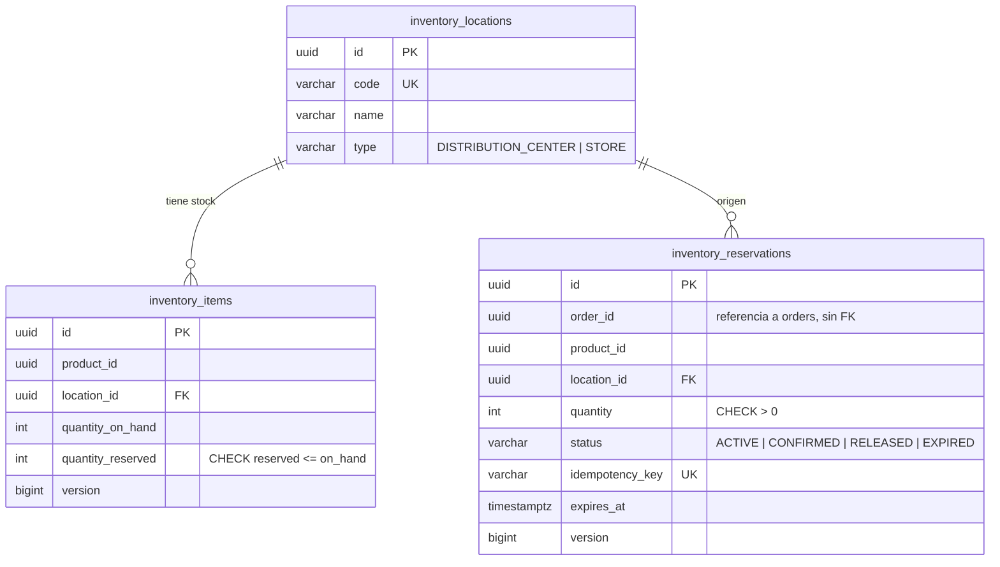
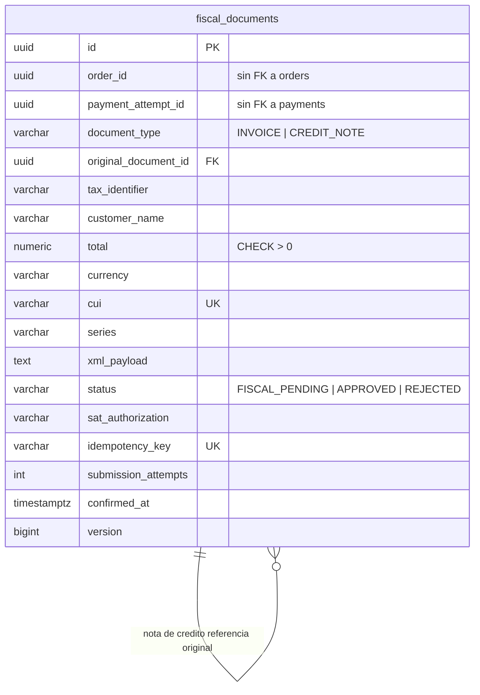
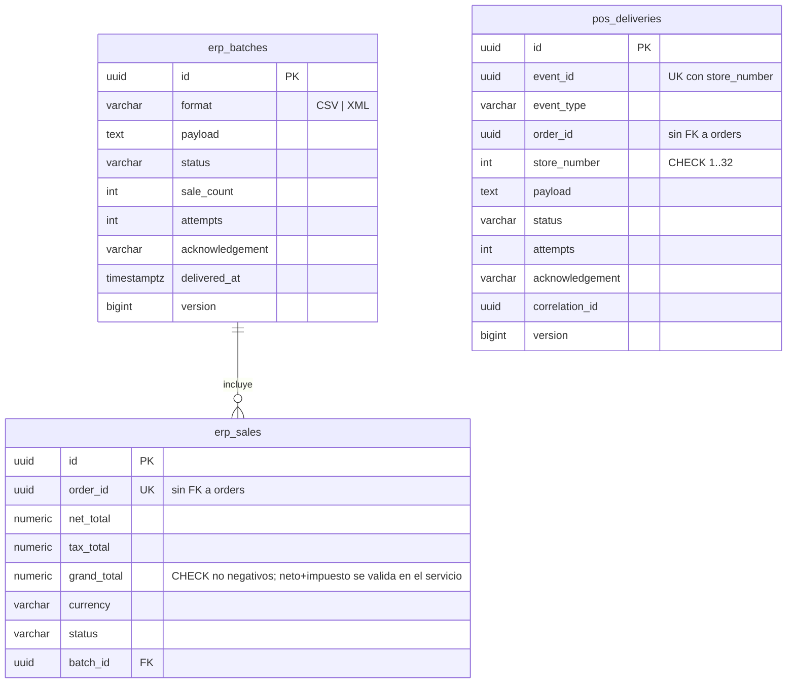
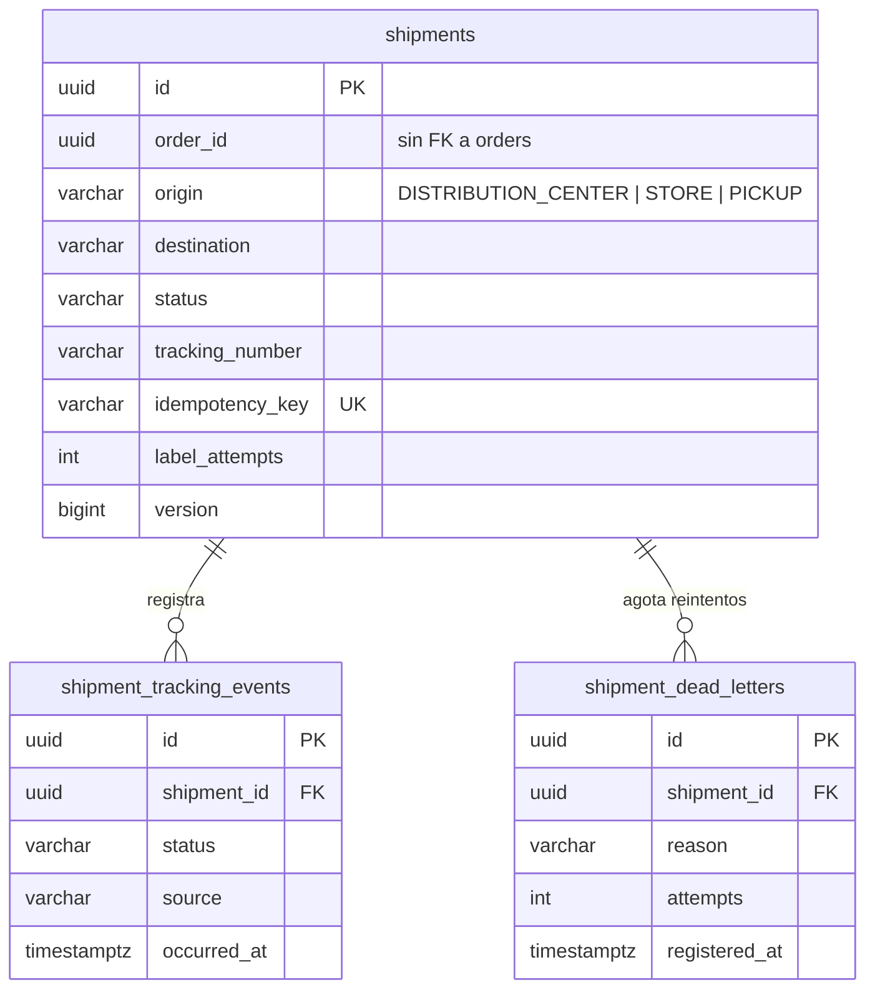
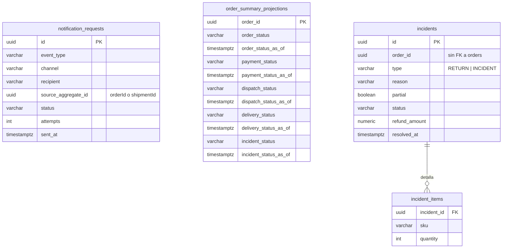
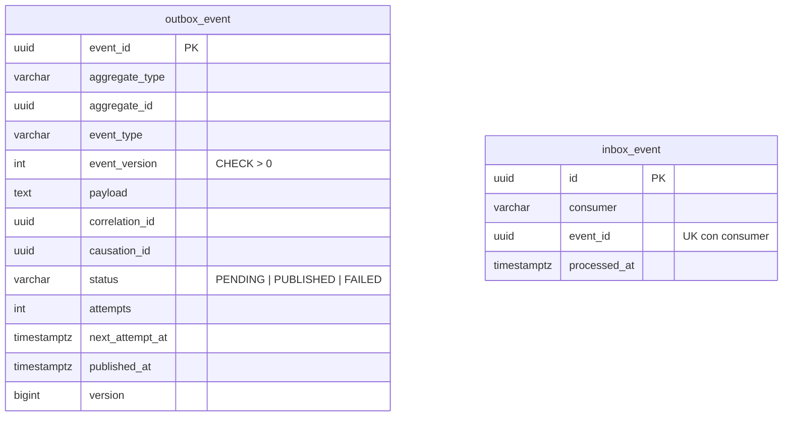
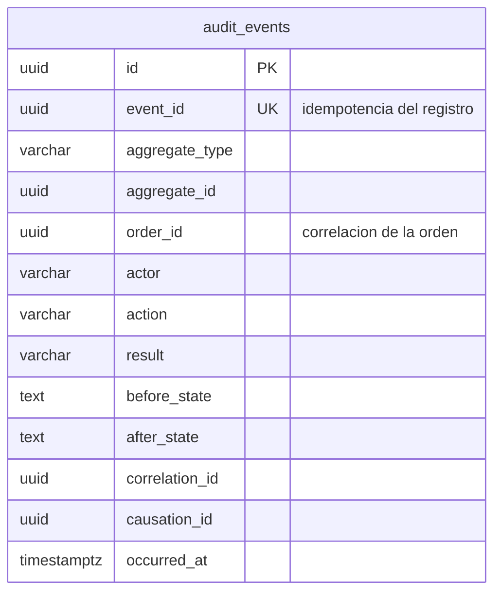
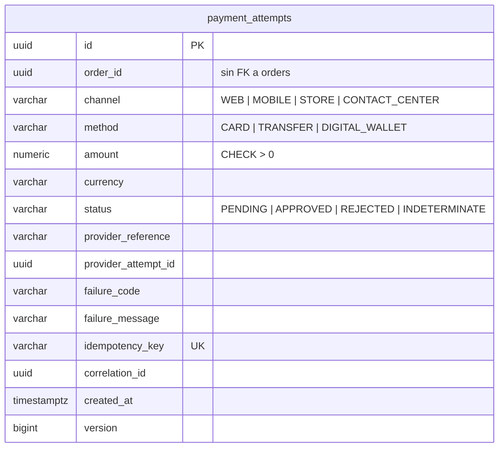
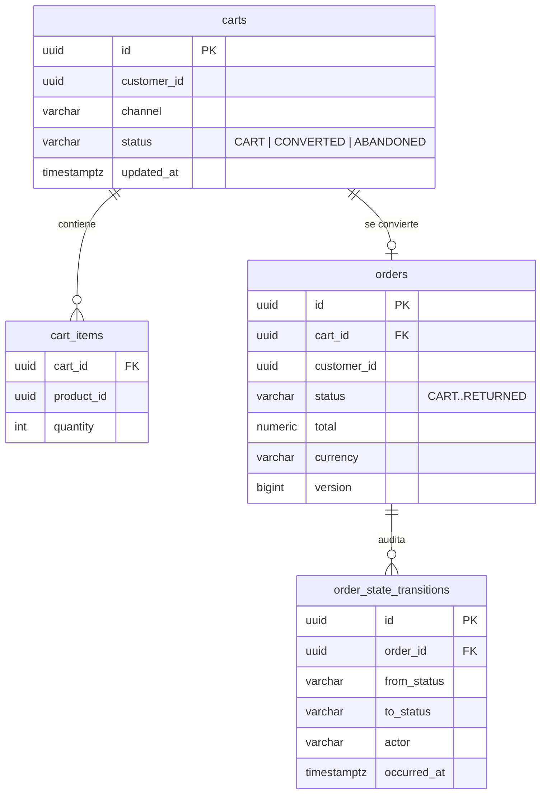
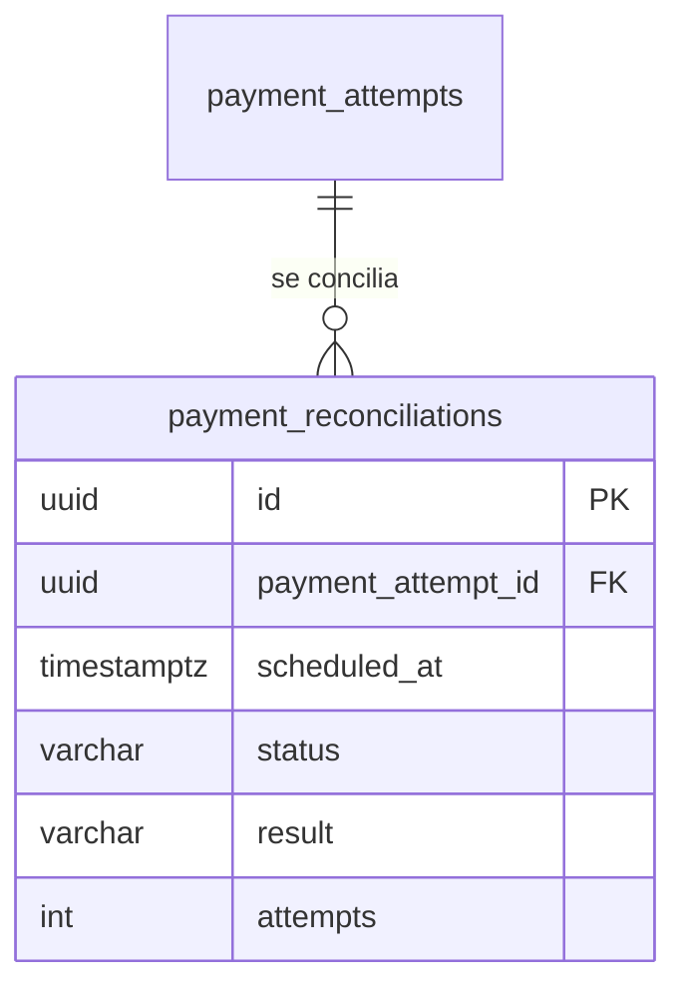

# Modelo de datos de Fase 2 (MVP)

**Sistema:** SGO-Logic
**Fuente arquitectónica:** `Docs/DDA.md` (§3 CDU, §4 EaC, §5 ADR, §6 Vistas)
**Organización técnica:** `Docs/planificacion/STACK_TECNOLOGICO_FASE_2.md` (§6 y §8)
**Estado:** vivo; se actualiza en la misma rama que la migración que lo modifica.
**Responsable de consolidación:** Jairo Gómez (DOC-01); cada módulo actualiza sus tablas.

---

## 1. Propósito

Este documento cierra el artefacto de **modelo de datos** que exige la tabla de
trazabilidad arquitectónica del curso. Cada capacidad del MVP debe poder
rastrearse en el CDU expandido (CUN), en el modelo de datos, en el diagrama de
despliegue y en el código. Sin este artefacto, una funcionalidad implementada
pierde puntaje aunque su código sea correcto.

Reglas de lectura:

- Un esquema lógico pertenece a un único módulo y solo ese módulo lo escribe.
- Las referencias entre módulos usan `UUID` de correlación, nunca claves
  foráneas hacia tablas privadas de otro módulo.
- Las tablas marcadas **PLANIFICADO** todavía no tienen migración Flyway; su
  forma final se ratifica al implementar la tarjeta indicada.
- Los datos semilla son simulados y no representan inventario real.

---

## 2. Propiedad lógica por esquema

| Esquema lógico | Módulo propietario | Responsable | CUN/CDU principal | EaC | Migraciones |
|---|---|---|---|---|---|
| `inventory` | `inventory` | Jorge Pumay | CUN-02 / CDU-02 | EaC-03, EaC-07 | `V1`, `V2` |
| `fiscal` | `fiscal` | Andy Sánchez | CUN-04 / CDU-04 | EaC-02, EaC-07 | `V2001` |
| `integration` (ERP/POS) | `integration` | Andy Sánchez | CUN-05, CUN-06 | EaC-06, EaC-07 | `V2002`, `V2003` |
| `integration` (Outbox/Inbox) | `integration` | Edson Sosa | Transversal a CDU-03 a CDU-06 y CDU-11 | EaC-04, EaC-07 | `V3001` (BB-04) |
| `logistics` | `logistics` | Kevin Girón | CUN-07, CUN-08 | EaC-05, EaC-07 | `V1001` |
| `notifications` | `notifications` | Kevin Girón | CUN-11 / CDU-11 | EaC-08, EaC-07 | `V1002` |
| `query` | `query` | Kevin Girón | CUN-09 / CDU-09 | EaC-01, EaC-07 | `V1003` |
| `incidents` | `incidents` | Kevin Girón | CUN-10 / CDU-10 | EaC-02, EaC-07 | `V1004` |
| `orders` | `orders` | Jairo Gómez | CUN-01 / CDU-01 | EaC-01, EaC-09 | **PLANIFICADO** (ORD-01/ORD-02) |
| `payments` | `payments` | Edson Sosa | CUN-03 / CDU-03 | EaC-04, EaC-12 | `V3003` (PAY-01) |
| `audit` | `audit` | Edson Sosa | CUN-12 / CDU-12 | EaC-02, EaC-07 | `V3002` (AUD-01) |

La instancia PostgreSQL es una sola; la separación es lógica y verificable por
Spring Modulith, según ADR-001 y la sección 8 del stack.

---

## 3. Esquemas implementados

### 3.1 `inventory` — CUN-02 (INV-01 a INV-05)

- 34 ubicaciones semilla (2 CD + 32 tiendas) y stock simulado en `V2`.
- `tryReserve`/`tryRelease` son sentencias `UPDATE ... WHERE` atómicas; los
  `CHECK` de la tabla son la red de seguridad de negocio.

### 3.2 `fiscal` — CUN-04 (FIS-01/FIS-02)

- La compuerta de confirmación es `status = APPROVED`; un timeout mantiene
  `FISCAL_PENDING` (ADR-007, ADR-010).

### 3.3 `integration` ERP y POS — CUN-05 y CUN-06 (ERP-01/02, POS-01)

- La deduplicación ERP es por `order_id`; la de POS por `(event_id, store_number)`.
- La entrega durable a POS/ERP después de un reinicio queda pendiente de BB-04.

### 3.4 `logistics` — CUN-07 y CUN-08 (LOG-01/02/03)

- `shipment_dead_letters` es una cola local explícitamente temporal mientras
  BB-04 no existe; debe migrar a la DLQ del broker.

### 3.5 `notifications`, `query` e `incidents` — CUN-09, CUN-10 y CUN-11

- `order_summary_projections` materializa CDU-09 E1: cada campo expone `asOf`
  para mostrar la última información conocida sin fallar la consulta completa.
- Su alimentación actual por `POST /api/v1/query/order-summary` es temporal;
  el consumidor de Outbox la reemplaza cuando BB-04 exista.

### 3.6 `integration` Outbox/Inbox — transversal (BB-04)

- `outbox_event` se escribe en la **misma transacción** que el cambio de
  negocio (ADR-002, `PublishEvent` exige transacción activa); el dispatcher
  publica después al exchange `sgo.events`.
- Reintentos 2/8/32 s y estado `FAILED` tras agotar los intentos; el lote se
  reclama con `FOR UPDATE SKIP LOCKED` para que varios dispatchers no
  dupliquen publicaciones.
- `inbox_event` con `UNIQUE (consumer, event_id)` da idempotencia al
  consumidor mediante `INSERT ... ON CONFLICT DO NOTHING`.
- Es la precondición explícita de CDU-06 y el cierre de la ventana de pérdida
  descrita en ADR-010.

### 3.7 `audit` — CUN-12 (AUD-01/AUD-02)

- Tabla de solo anexado: el repositorio extiende `Repository` y no expone
  actualización ni borrado.
- El registro se escribe en la misma transacción del cambio de negocio
  (`AuditRecorder` exige transacción activa); el actor sale del contexto
  autenticado o es `system`.
- Índices por `order_id`, por `(aggregate_type, aggregate_id)` y por
  `correlation_id` para responder en menos de 1 s (EaC-02).
- CDU-12 exige además registrar el acceso a la evidencia, la búsqueda fallida
  con alerta y la exportación autorizada: AUD-02 lo cubre con
  `AUDIT_EVIDENCE_ACCESSED`, `AUDIT_SEARCH_FAILED` y `AUDIT_EVIDENCE_EXPORTED`,
  escritos en transacción independiente para sobrevivir a la búsqueda fallida.

### 3.8 `payments` — CUN-03 (PAY-01)

- Cubre CDU-03 paso 2 (intento con orden, canal y fecha), paso 3 (idempotencia
  sin PAN/CVV), el resultado aprobado/rechazado y la postcondición de registro
  auditable; un timeout deja `PENDING` y nunca se reporta como aprobación.
- `provider_attempt_id` conserva el identificador del intento que devuelve
  PayKlik (BB-06) para trazabilidad, además de `provider_reference`.
- No almacena PAN completo ni CVV (EaC-12).
- La conciliación (`payment_reconciliations`) pertenece a PAY-03 y no existe
  todavía.

---

## 4. Esquemas planificados

> Estas tablas **no existen todavía**. Se documentan para que la
> implementación de Jairo (ORD-01/ORD-02) y de Edson (PAY-02/PAY-03) no se
> convierta en código huérfano. Su forma final se ratifica en el ADR o
> contrato correspondiente antes de la migración.

### 4.1 `orders` — CUN-01 (ORD-01/ORD-02, Jairo Gómez)

Estados según `docs/contracts/orders/order-states.md` (propuesta `PROPOSED`).

### 4.2 `payments` conciliación — CUN-03 (PAY-03, Edson Sosa)

Cubre CDU-03 E1 (conciliación antes de reintentar) y el criterio de PAY-03
(primer trabajo ≤ 60 s sin doble cobro). `payment_attempts` ya existe en
`V3003` (§3.8); esta tabla se creará en PAY-03.

---

## 5. Reglas de integridad y trazabilidad

1. Ningún módulo usa repositorios, entidades ni tablas de otro módulo; la
   correlación es por `UUID` (`order_id`, `product_id`, `event_id`).
2. Toda operación reintentable tiene clave de idempotencia única en su tabla.
3. Todo cambio de estado relevante debe producir un registro auditable
   (CUN-12) y, cuando corresponda, un evento Outbox.
4. Los `CHECK` de base de datos refuerzan las invariantes de negocio:
   `quantity_reserved <= quantity_on_hand`, `store_number BETWEEN 1 AND 32`,
   `total > 0` y totales ERP no negativos. La igualdad
   `net_total + tax_total = grand_total` se valida en el servicio antes de
   insertar.
5. No se almacenan PAN completo, CVV, secretos ni credenciales.

## 6. Referencias

- Migraciones: `backend/src/main/resources/db/migration/`
- Contratos y estados: `docs/contracts/`
- Matriz EaC: `docs/qa/QA-03-matriz-eac.md`
- Trazabilidad CUN → código → datos → despliegue: `docs/qa/trazabilidad-cun-mvp.md`
- Vistas arquitectónicas de Fase 1: `Docs/DDA.md` §6 y `Docs/diagramas/`
