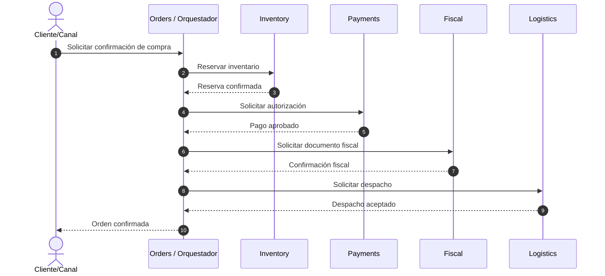

# Saga orquestada — camino feliz propuesto

**Estado:** `PROPOSED`

**Tarjeta relacionada:** ORD-03

**Código ejecutable:** no implementado

## Condiciones del diagrama

- Representa secuencia lógica, no protocolo síncrono definitivo.
- La confirmación fiscal condiciona el avance desde `FISCAL_PENDING`.
- Cada interacción conserva correlation ID, causation ID e idempotencia acordada.
- Los participantes responden mediante APIs públicas o eventos; nunca mediante acceso a tablas.
- Outbox, Inbox, retries y DLQ pertenecen a BB-04 y no se implementan aquí.
- Las ramas de error y compensación se definirán con ORD-04 cuando existan INV-02 y PAY-02.
