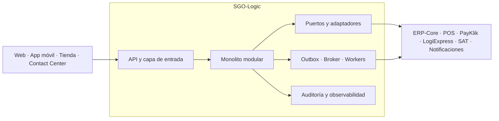
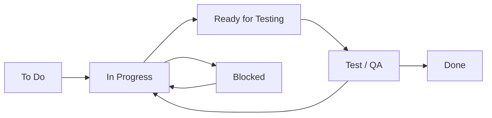

# SGO-Logic — Gestión de Órdenes y Logística Omnicanal

<div align="center">

**Proyecto de arquitectura para MegaStore — Fase 1**

[Documento de arquitectura](Docs/DDA.md) ·
[Prototipo](Docs/prototipo/mockups.html) ·
[Diagramas editables](Docs/diagramas/vistas-arquitectonicas-sgo-logic.drawio) ·
[Checklist](Docs/qa/checklist-entregables.md)

</div>

---

## ¿Qué es SGO-Logic?

**SGO-Logic** es la propuesta arquitectónica para modernizar la operación
omnicanal de **MegaStore**, una cadena regional de retail con 32 tiendas en
Guatemala, El Salvador y Costa Rica.

Actualmente, las tiendas, el comercio electrónico, el inventario, la logística
y la conciliación financiera funcionan de forma fragmentada. SGO-Logic se
plantea como el sistema de interés que coordina el ciclo completo de la orden:
carrito, inventario, pago, facturación, despacho, consulta, devolución,
notificaciones y auditoría.

La solución conserva los sistemas y contratos existentes. ERP-Core, los 32 POS,
PayKlik, LogiExpress, la SAT y el proveedor de notificaciones permanecen fuera
de la frontera de SGO-Logic y se conectan mediante contratos y adaptadores.

### Objetivos principales

| Objetivo | Resultado esperado |
|---|---|
| Experiencia omnicanal | Iniciar, continuar y completar una compra desde tienda, web, aplicación móvil o centro de atención |
| Continuidad de las órdenes | Conservar la intención de compra aunque PayKlik u otra integración presente fallas |
| Escalabilidad | Preparar la arquitectura para soportar hasta ocho veces el tráfico normal durante Black Friday |
| Trazabilidad | Reconstruir quién realizó una operación, cuándo ocurrió y qué cambió |
| Integración segura | Incorporar ERP-Core, POS y proveedores sin modificar sus implementaciones internas |
| Evolución controlada | Iniciar en infraestructura local y conservar una ruta futura hacia la nube |

> La Fase 1 define y justifica la arquitectura. No contiene una implementación
> productiva ni afirma resultados de pruebas que todavía requieren construcción
> y medición.

---

## Equipo y responsabilidades

El trabajo se divide en cinco responsabilidades complementarias. Los roles
permiten que cada artefacto tenga un responsable claro y, al mismo tiempo, sea
revisado de forma cruzada antes de considerarse terminado.

| Rol | Responsabilidad principal | Entregables |
|---|---|---|
| Persona 1 — Rol A | Consolidación y trazabilidad | Estructura del DDA, alcance, stakeholders, priorización y matrices de trazabilidad |
| Persona 2 — Rol B | Negocio y drivers funcionales | CUN, CDU core, doce CDU expandidos y coherencia con el prototipo |
| Persona 3 — Rol C | Calidad y decisiones | Escenarios de atributos de calidad, restricciones, ADR y evaluación de costos |
| Persona 4 — Rol D | Modelado arquitectónico | Diagramas de Contexto, Componentes, Despliegue y Bloques |
| Persona 5 — Rol E | Documentación y validación | Resumen ejecutivo, prototipo, QA, presentación y defensa |

El estado detallado de cada responsabilidad se mantiene en el
[checklist unificado](Docs/qa/checklist-entregables.md).

---

## Herramientas y fundamentos

### Herramientas de la entrega

| Herramienta o formato | Uso en el proyecto |
|---|---|
| Markdown | DDA, checklist, guion y documentación del proyecto |
| diagrams.net / draw.io | Edición de los CDU y de las cuatro vistas arquitectónicas |
| Graphviz | Fuentes reproducibles y exportación de diagramas en SVG y PNG |
| HTML y CSS | Prototipo navegable no funcional del recorrido omnicanal |
| Git y GitHub | Versionado, revisión e integración de los artefactos |
| Trello / Kanban | Visualización del flujo de trabajo arquitectónico |

### Fundamentos de la arquitectura propuesta

| Fundamento | Aplicación en SGO-Logic |
|---|---|
| Monolito modular | Organiza el núcleo por capacidades de negocio sin asumir desde el inicio la complejidad operativa de microservicios |
| Puertos y adaptadores | Aísla el núcleo de ERP-Core, POS, PayKlik, LogiExpress, SAT y notificaciones |
| Mensajería asíncrona | Desacopla las integraciones que no deben bloquear el flujo principal |
| Outbox transaccional | Evita perder eventos después de confirmar un cambio de negocio |
| Circuit Breaker y reintentos | Contienen fallas externas y permiten recuperar operaciones |
| Idempotencia | Evita duplicar efectos al reprocesar pagos, ventas o eventos |
| Saga orquestada | Coordina el ciclo de vida de la orden y sus compensaciones |
| Observabilidad centralizada | Correlaciona órdenes, integraciones, fallas y reintentos |

---

## Capacidades cubiertas

La arquitectura contempla doce capacidades funcionales de negocio:

- Gestionar el carrito omnicanal.
- Verificar y reservar inventario.
- Procesar pagos.
- Emitir documentación fiscal.
- Sincronizar ventas con ERP-Core.
- Notificar eventos a los POS.
- Gestionar el despacho.
- Integrarse con LogiExpress.
- Consultar el estado de una orden.
- Gestionar devoluciones y reembolsos.
- Notificar al cliente.
- Auditar las operaciones.

Estas capacidades se documentan como CUN y CDU, se relacionan con doce
escenarios de atributos de calidad y se trazan hasta las decisiones y vistas que
las atienden.

---

## Arquitectura del sistema

La decisión principal adopta un **monolito modular**, acompañado por una capa
de integración basada en puertos, adaptadores y mensajería. El despliegue
inicial es local y la migración a nube se mantiene como una evolución futura,
no como infraestructura ya implementada.



### Vistas arquitectónicas

| Vista | Propósito | Fuente editable |
|---|---|---|
| Contexto | Delimita SGO-Logic, sus usuarios, canales y sistemas externos | [Draw.io multipágina](Docs/diagramas/vistas-arquitectonicas-sgo-logic.drawio) |
| Componentes | Presenta módulos, contratos, adaptadores y mecanismos transversales | [Draw.io multipágina](Docs/diagramas/vistas-arquitectonicas-sgo-logic.drawio) |
| Despliegue | Expone la topología local inicial y la ruta futura hacia nube | [Draw.io multipágina](Docs/diagramas/vistas-arquitectonicas-sgo-logic.drawio) |
| Bloques | Resume la propuesta y su valor para stakeholders ejecutivos | [Draw.io multipágina](Docs/diagramas/vistas-arquitectonicas-sgo-logic.drawio) |

<div align="center">
  
  <p><em>SGO-Logic como capa de orquestación entre los canales de MegaStore y sus sistemas externos.</em></p>
</div>

Las decisiones completas, alternativas y consecuencias se encuentran en los
[ADR-001 a ADR-008 del DDA](Docs/DDA.md#10-decisiones-arquitectónicas-adrs).

---

## Prototipo y evidencia visual

El repositorio incluye un mockup no funcional del recorrido principal:

1. Iniciar el carrito desde la aplicación móvil.
2. Continuar la compra y procesar el pago desde la web.
3. Consultar la orden desde cualquier canal.
4. Gestionar una devolución desde el centro de atención.

Para revisarlo, abra [Docs/prototipo/mockups.html](Docs/prototipo/mockups.html)
en un navegador. No requiere instalación ni servidor local.

El prototipo utiliza datos ilustrativos y no contiene backend, persistencia ni
integraciones reales. Su función es validar el recorrido contra CDU-01, CDU-03,
CDU-09 y CDU-10 y mostrar cómo los estados de la interfaz reflejan las
decisiones arquitectónicas.

---

## Cómo se trabajará

### Gestión Kanban

El proyecto utiliza un tablero Kanban con foco arquitectónico. Las tareas
representan componentes, patrones, decisiones o validaciones; se prioriza el
*backbone* técnico antes que elementos cosméticos.

| Columna | Criterio |
|---|---|
| To Do | Requerimiento arquitectónico pendiente y listo para iniciar |
| Blocked | Tarea detenida por una decisión técnica, dependencia o recurso faltante |
| In Progress | Diseño, documentación o construcción activa |
| Ready for Testing | Artefacto listo para validación de integración o consistencia |
| Test/QA | Revisión contra escenarios de arquitectura, trazabilidad y criterios de aceptación |
| Done | Artefacto validado, documentado y disponible como evidencia de la fase |

Las tarjetas usan el formato:

```text
[ARQ-###][Prioridad][Responsable o tipo] Descripción breve
```

Ejemplo:

```text
[ARQ-014][P0][Rol-D] Finalizar Diagrama de Despliegue con EaC visibles
```

El tablero vigente es [MegaStore — Fase 1](https://trello.com/b/ySQoRziE/megastore-fase-1)
y su respaldo se conserva en
[Docs/tablero-kanban-megastore-fase-1.json](Docs/tablero-kanban-megastore-fase-1.json).

### Flujo de una tarea



Una tarea avanza cuando su evidencia cumple los criterios de aceptación. Si QA
encuentra inconsistencias, vuelve a `In Progress`; si existe un impedimento
real, se mueve a `Blocked` y se documenta la causa.

### Versionado e integración

La colaboración sigue una estrategia basada en ramas:

- `main`: versión estable de la entrega.
- `develop`: integración y revisión conjunta antes de publicar.
- `docs/<tema>`: trabajo documental o arquitectónico acotado.

Cada cambio debe mantener coherencia entre el DDA, las matrices, los diagramas,
el prototipo y el guion. Antes de integrar una rama se revisan enlaces, figuras,
nomenclatura, trazabilidad y ausencia de contradicciones.

### Criterio de terminado

Un artefacto puede pasar a `Done` cuando:

- Tiene un responsable y un alcance identificables.
- Cumple su criterio de aceptación.
- Es consistente con los drivers, ADR y vistas relacionados.
- Cuenta con una fuente editable cuando corresponde.
- Está incorporado o referenciado desde el DDA.
- Superó la revisión técnica o documental asignada.

---

## Cómo consultar y editar la entrega

### Requisitos mínimos

- Un navegador moderno para el prototipo HTML.
- Un visor de Markdown para la documentación.
- [diagrams.net](https://app.diagrams.net/) para editar archivos `.drawio`.
- Graphviz, de forma opcional, para regenerar archivos SVG o PNG desde `.dot`.

### Clonar el proyecto

```bash
git clone https://github.com/JairoGH/AYD2_A_2S2025_PROYECTO_G5.git
cd AYD2_A_2S2025_PROYECTO_G5
```

### Abrir el prototipo

```bash
xdg-open Docs/prototipo/mockups.html
```

También puede abrirse el archivo manualmente en cualquier navegador.

### Regenerar una vista con Graphviz

```bash
dot -Tsvg Docs/diagramas/contexto.dot -o Docs/diagramas/contexto.svg
dot -Tpng -Gdpi=150 Docs/diagramas/contexto.dot -o Docs/diagramas/contexto.png
```

La regeneración es opcional porque las versiones SVG y PNG ya están incluidas.

---

## Estructura del proyecto

```text
AYD2_A_2S2025_PROYECTO_G5/
├── Docs/
│   ├── DDA.md
│   ├── diagramas/
│   │   ├── img/
│   │   ├── cdu-negocio-y-expandidos.drawio
│   │   ├── vistas-arquitectonicas-sgo-logic.drawio
│   │   ├── contexto.{dot,svg,png}
│   │   ├── componentes.{dot,svg,png}
│   │   ├── despliegue.{dot,svg,png}
│   │   └── bloques.{dot,svg,png}
│   ├── presentacion/
│   │   └── guion-45min.md
│   ├── prototipo/
│   │   └── mockups.html
│   ├── qa/
│   │   └── checklist-entregables.md
│   └── tablero-kanban-megastore-fase-1.json
└── README.md
```

---

## Entregables de la Fase 1

| Entregable | Acceso | Estado documental |
|---|---|---|
| Documento de Definición de Arquitectura | [Docs/DDA.md](Docs/DDA.md) | Versión 1.0 consolidada |
| CDU core y doce expansiones | [Archivo editable](Docs/diagramas/cdu-negocio-y-expandidos.drawio) | Producido |
| Vistas arquitectónicas | [Archivo editable](Docs/diagramas/vistas-arquitectonicas-sgo-logic.drawio) | Producido |
| Prototipo de alto nivel | [Abrir mockups](Docs/prototipo/mockups.html) | Producido, no funcional |
| Guion de presentación | [Guion de 45 minutos](Docs/presentacion/guion-45min.md) | Producido |
| Control de calidad | [Checklist por persona](Docs/qa/checklist-entregables.md) | Vigente |
| Tablero arquitectónico | [Trello](https://trello.com/b/ySQoRziE/megastore-fase-1) | En uso |

---

## Alcance de esta versión

La versión actual consolida el análisis de negocio, stakeholders, drivers,
restricciones, priorización, matrices de trazabilidad, ocho decisiones
arquitectónicas, cuatro vistas y un prototipo no funcional.

Los valores que dependen de medición o confirmación —como tráfico base, número
de instancias, disponibilidad objetivo, RTO, RPO, retención y residencia de
datos— permanecen como parámetros abiertos. Deben resolverse con evidencia y
stakeholders antes de dimensionar o implementar la solución productiva.

Para el detalle completo, consulte el
[Documento de Definición de Arquitectura](Docs/DDA.md).
